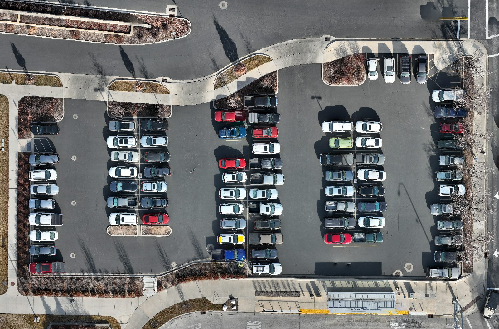
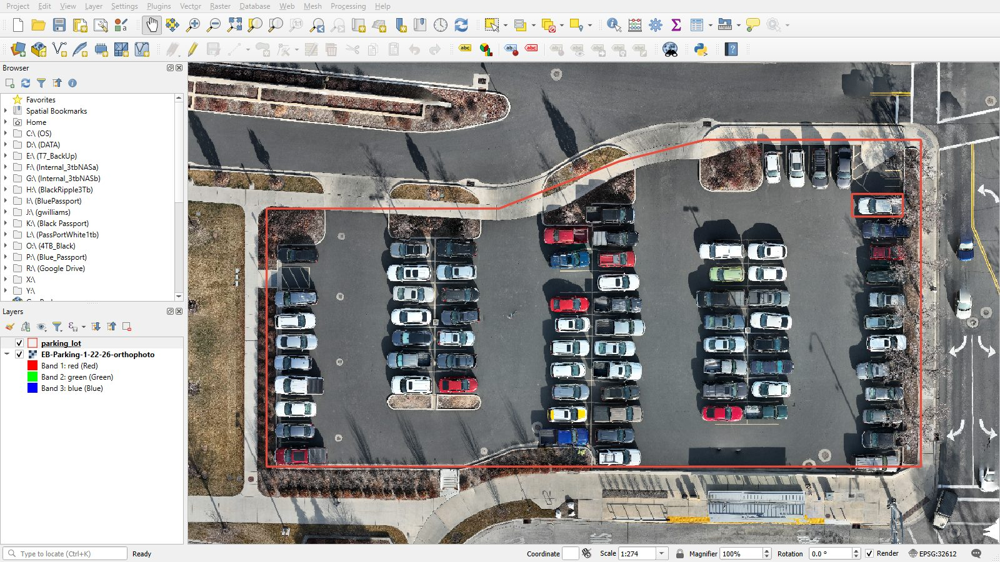
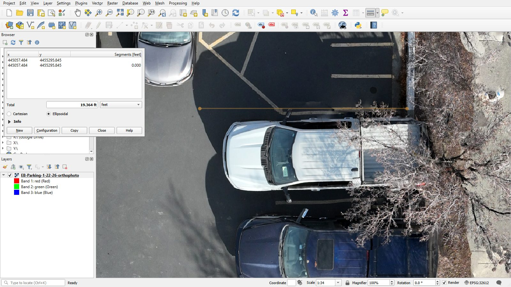

# Example Technical Memo

!!! abstract "Key Takeaways"
    - This is what a strong memo looks like: six sections, one page of writing, numbered figures.
    - Every flight setting comes with a reason.
    - The Limitations section is honest about what went wrong and what the data cannot show.
    - Use it for format and level of detail. Your project, site, and numbers will be different.

!!! note "About this example"
    The site and the images are real: the parking lot east of the Engineering Building, flown by the
    class on January 22, 2026, and the same orthomosaic you measured in the
    [Week 5 lab — Measurements and Methods](../labs/2_measurements_and_methods.md), and the 19.4 ft
    stall length in Figure 3 is a real QGIS measurement. The client, the flight details, the area and
    cost, and the taped check are **made up for illustration**. Margin notes in the
    blue boxes explain why each section is written the way it is; leave those out of your own memo.

---

**To:** Project Manager, BYU Physical Facilities 
**From:** Student A and Student B, CCE Drone Measurements 
**Date:** December 10, 2026 
**Subject:** EB East Parking Lot — Area and Resurfacing Estimate from Drone Mapping

### Project scope and purpose

Physical Facilities plans to resurface the parking lot east of the Engineering Building next summer
and needs the paved area to budget the work. We mapped the lot with a drone, measured the paved area
and stall dimensions on the resulting orthomosaic, and estimated the cost of a mill-and-overlay
resurfacing.

!!! tip "Why this works"
    Client, problem, and what the data is for, in three sentences. The reader knows right away what
    decision this memo supports.

### Flight plan

We flew a single grid mission with a DJI Mini at **150 ft above ground level (AGL)**, which gives a
ground sample distance (GSD) of about 0.5 in (1.3 cm) per pixel. That is fine enough to see stall
striping and pavement cracks, and high enough to clear the light poles and trees on the lot edges.
Front overlap was **80%** and side overlap **70%**: asphalt has little texture, and the extra overlap
gives the software more matches over the plain surface. The camera pointed straight down (gimbal
**−90°**) because the products we needed were flat: an orthomosaic and an area. The planned flight
time was 6 minutes, so one battery covered the mission with a spare in reserve.

!!! tip "Why this works"
    Every number has a "because". Compare a memo that only lists "110 ft, 80% front, 20% side" —
    the reader cannot tell whether those were chosen or just left at the default.

### Flight execution

We met at EB B122 at 8:00, walked to the site, and were airborne by 8:12 after the pre-flight
checklist and a site walk for pedestrians and vehicles. The mission flew as planned in 6 minutes and
collected 142 photos. One change: a delivery truck parked in the drive aisle partway through, so we
paused the mission for about a minute until it moved, then resumed. We were back in the lab by 8:40.

### Data summary and results

We processed the photos in Bentley iTwin Capture Modeler into an orthomosaic (Figure 1). All 142
photos were used in aerotriangulation. In QGIS we traced the paved area of the lot, excluding planters
and sidewalks (Figure 2), and measured **28,000 ft²**, about 3,100 square yards.

*Figure 1: Orthomosaic of the EB east parking lot.*

*Figure 2: Paved area traced in QGIS (red outline).*

At an assumed $3.50 per square foot for a 2 in mill and overlay, resurfacing would cost about
**$98,000**. Restriping is extra and was not estimated.

To check the orthomosaic, we taped the length of one stall on site at **19.5 ft**. The same stall
measured **19.4 ft** in QGIS (Figure 3), a difference of 0.1 ft, or about 0.5%.

*Figure 3: Stall length measured in QGIS (19.4 ft), checked against a taped length of 19.5 ft.*

!!! tip "Why this works"
    Every figure has a number and a caption, and the text points to each one. The numbers are rounded
    to what the data supports: 28,000 ft², not 28,013.62 ft². The check measurement is optional, but
    one sentence of it makes the whole memo more believable.

### Limitations

- **Parked cars** hide about a third of the pavement, so we could not map cracks or estimate a
  crack-sealing option. A flight on a weekend morning, when the lot is nearly empty, would fix this.
- **Shadows and trees** along the east edge make the lot boundary hard to see there; the area could be
  off by a few hundred square feet along that edge.
- The **cost per square foot** is a typical published value, not a quote. The area is good for
  budgeting, not for a bid.

!!! tip "Why this works"
    Each limitation says what went wrong, how much it matters, and what would fix it.

### Conclusion

The paved area of the EB east lot is about 28,000 ft², and a mill-and-overlay resurfacing would cost
roughly $98,000. The drone area is accurate enough for budgeting. We recommend a second flight on an
empty-lot morning if Physical Facilities wants to compare resurfacing against crack sealing.

---

## Checklist for your own memo

- [ ] To, From (both partners), Date, Subject.
- [ ] Six sections with these headings, in this order.
- [ ] Every flight setting has a reason.
- [ ] Figures numbered, captioned, and mentioned in the text.
- [ ] Numbers rounded to what your data supports, with units.
- [ ] One page of writing or less, not counting figures.
- [ ] Proofread, including names of software (Bentley iTwin, QGIS).

Back to the [Technical Memo](report.md) assignment and rubric.
