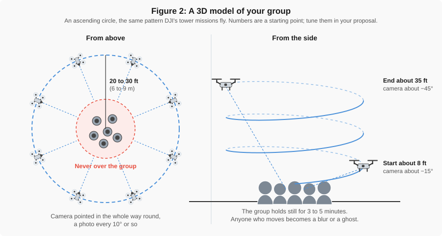

# Example Projects

!!! abstract "Key Takeaways"
    - A good project has a **client**, a **question**, and a **product** that answers it.
    - Pick a site you can reach, fly, and leave in **50 minutes**, starting and ending at EB B122.
    - The ideas below come from past semesters. Use one, adapt one, or bring your own.
    - Read the "what went wrong" notes. Past groups hit these problems so you don't have to.

---

## What makes a good project

| Good | Weak |
|---|---|
| "How much asphalt would it take to repave Lot 45, and what would it cost?" | "We flew over a parking lot." |
| A client who would actually use the answer: a city, BYU Physical Facilities, a contractor | No one who needs the data |
| A product that answers the question: an area, a volume, a count, a map of damage | A pretty 3D model with no measurement |
| A site close to campus with open sky | A site 20 minutes away under trees and power lines |

---

## Ideas from past semesters

### Parking lot resurfacing estimate

Measure the paved area of a campus lot in QGIS, count the stalls, and estimate the cost to repave and
restripe.

- **Products:** orthomosaic; area polygon; stall count.
- **What went wrong before:** one group missed a corner of the lot and had to fill it in from
  Google satellite imagery. Plan your grid to extend past every edge. Another could not map cracks
  because parked cars covered the pavement.

### Pavement condition survey

Map a road or lot and locate the worst failures: alligator cracking, potholes, washouts. Recommend
where to patch and where to fully reconstruct.

- **Products:** orthomosaic or 3D model; marked-up figures of the worst areas.
- **What went wrong before:** trees along the road modeled poorly. Fly low enough to see cracks
  (a GSD around 0.5 in, or 1 cm) and keep the road, not the trees, in the middle of the grid.

### Sports court or park remodel

Document existing conditions of tennis courts, a playground, or a walkway, and propose a remodel:
resurfacing, new striping, better access to parking.

- **Products:** orthomosaic; DSM to check drainage; before-and-after figures.
- **What went wrong before:** a smooth, even court surface left holes in the model. Use higher
  overlap over low-texture surfaces.

### Earthwork volume

On a field or site that has been regraded, measure the area and estimate the soil moved, then compare
against the contractor's number.

- **Products:** orthomosaic; area; volume from area × depth, or from a DSM.
- **What went wrong before:** the area first came out at about 100,000 square miles because the
  coordinate reference system (CRS) was wrong. Set the project to **EPSG:32612** before you measure
  anything. Repetitive dirt texture also gave a poor orthomosaic. The group's final estimate was within
  about 11% of the contractor's, a good result worth reporting.

### Room for more parking

Map an area beside a trailhead or park and measure how many stalls would fit.

- **Products:** orthomosaic or 3D model; a figure of the proposed stalls with dimensions.
- **Tip:** a standard stall is about 9 ft wide and 18 to 20 ft long. Measure an existing stall on
  the orthomosaic first to check your scale.

### Other ideas

- Roof area of a campus building, for a re-roofing or solar estimate.
- Stockpile volume at a construction site (ask the site manager first).
- Impervious area of a block, for a stormwater runoff estimate.
- Vegetation health on a lawn or detention basin, with the multispectral drone.
- Construction progress on a campus project, compared against a site plan.

---

## Quick projects near campus

New for fall 2026. Each one is walkable from EB, needs one battery, and takes about 30 minutes on
site, so it fits a 50-minute trip with room to spare. The sites are left generic on purpose: your
proposal names the exact one. If a project needs a second flight on another day, arrange it with the
TAs.

### A 3D model of your group

The group stands still on a lawn and the drone flies an **ascending circle** around it, camera
pointed in, the same pattern DJI's tower-inspection missions fly. A TA sets the mission up with you.

{ width="100%" }

*Figure 2: The drone circles 20 to 30 ft out and climbs from about 8 ft to 35 ft, tilting the camera
down as it goes. It never passes over the group.*

- **Products:** 3D model (mesh).
- **Check one number:** tape one person's height and compare it with the same height in the model.
- **Watch out for:** anyone who moves during the 3 to 5 minutes of the flight comes out as a blur or a
  ghost. Pick a spot with no foot traffic; a passer-by inside the circle means pausing the mission.

### How tall is it?

Model a light pole, flagpole, or building corner with the same ascending circle and measure its
height. A nadir grid will not do it: from straight above, a pole is a dot.

- **Products:** 3D model; point cloud.
- **Check one number:** a height from the building plans, or the shadow method (tape the pole's
  shadow and a yardstick's shadow at the same moment).

### Roof heat loss at 8 a.m.

Fly the thermal drone over a low roof you have permission to fly, on a cold morning before the sun
reaches it. Warm patches mark where heat is leaking: wet insulation, a gap, an unsealed vent.

- **Products:** a thermal mosaic in °C; a marked-up figure of the warm areas and their size.
- **Before takeoff:** power the drone on 10 minutes before the first photo and run the shutter
  calibration (FFC) by hand; a cold camera reads up to 30 °C too cold. Set the photo format to
  JPG + TIFF, since the `.irg` and `.TIFF` files hold the temperatures and the colour JPG is only a
  picture. Plan about 90 % front and side overlap.
- **Processing:** [autel-thermal](https://github.com/gus-p-williams/autel-thermal), the class's own
  Python tool for this camera, converts every frame to °C, places it on the map and stitches a
  mosaic you can open in QGIS. Its `examples/` folder has the install steps and four notebooks,
  the last of which finds hot spots and their area. Copy the whole flight folder off the SD card,
  `.mrk` file included, and rename nothing. If the install asks you to sign in to GitHub, the
  repository is not public yet: ask a TA.
- **Check one number:** an infrared thermometer on one roof surface you can reach, compared with
  the mosaic at the same spot.
- **Watch out for:** the tool places every frame on flat ground at the takeoff height. A roof sits
  above that, so its areas come out too large (about 40 % for a 6 m roof flown at 40 m) unless you
  tell the tool where the roof is, with `--ground-below-takeoff -6`. Shiny metal and glass show
  reflected sky, not their own temperature, so say so in the limitations. See
  [Thermal Imaging](../gen_reading/thermal.md).

### Is this ramp accessible?

Measure the slope of a campus ramp or walkway against the ADA (Americans with Disabilities Act)
limit for a ramp, 1:12 or about 8.3 %.

- **Products:** DSM; slope or rise-over-run measurements in QGIS.
- **Check one number:** a 2 ft level and a tape at two spots on the ramp.
- **Tip:** fly low for a fine GSD, and add one oblique line along the ramp.

### Count the lot by computer

Make an orthomosaic of a parking lot and let a Python image-recognition model count the cars and
trucks. Fly it twice (two days, or the start and end of your trip) and it becomes an occupancy
study. The Week 10 [lecture slides](../slides/week_10.html) have a starting script that uses a model
trained on aerial photos.

- **Products:** orthomosaic; vehicle counts by type.
- **Check one number:** count one row by hand. How many did the model miss, and how many did it
  invent?
- **Watch out for:** the model learned on cars about 20 to 60 pixels long. Export the orthomosaic as
  an 8-bit RGB image at about 10 to 15 cm per pixel before you run it; at full resolution, or squeezed
  to 1,024 pixels, it misses most of the cars.

---

## Before you pick a site

- **Can you do it in 50 minutes?** Walk or drive from EB B122, set up, fly, pack up, and get back.
  See the time budget on the [Project Proposal](proposal.md#4-time-budget) page.
- **Is it legal?** Check the airspace and whether you need LAANC authorization. Most of campus is in
  Provo's Class D airspace.
- **Do you need permission?** Private property, active construction sites, and some campus areas
  need the owner's OK. Getting it is your job.
- **Will the drone see what you need?** Trees, shadows, parked cars, and water all cause trouble.

Then write it up in your [Project Proposal](proposal.md).
