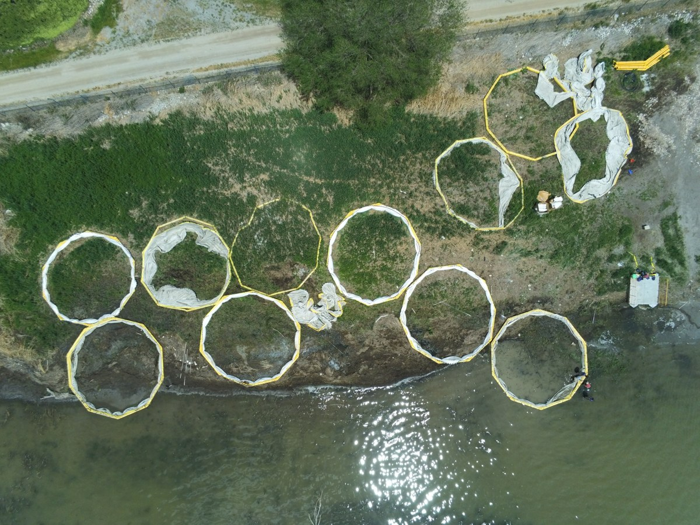

# Metadata for Aerial Measurements

!!! abstract "Key Takeaways"
    - **Metadata** is "data about data"—the context that makes an image useful.
    - For drones, the most critical metadata is **Location** (GPS), **Time**, and **Orientation**.
    - **EXIF** is the standard format used to store this information inside image files.
    - Accurate metadata is essential for photogrammetry and 3D modeling.

---

## 1. What is Metadata?

In the simplest terms, **metadata** is "data about data." 

Think of a **can of soup** in your pantry. 
*   The **data** is the soup inside the can (the actual content you want).
*   The **metadata** is the label on the outside: the ingredients, nutritional facts, expiration date, and manufacturer. 

Without the label (metadata), you wouldn't know if the soup is tomato or chicken noodle, or if it expired three years ago. The soup exists, but it's hard to use safely or effectively.

---

## 2. Why Metadata Matters for Drones

When we fly drones to take measurements or photos, the images themselves are our **data**. However, a photo of a construction site or a cornfield isn't very useful on its own if we don't know the context.

For aerial measurements, the most critical metadata includes:

1.  **Location (Geospatial Data):** 
    *   **Latitude and Longitude:** Exactly where on Earth was the drone when it took the picture?
    *   **Altitude:** How high above the ground was it? (This affects the scale of the image—how big things look).
2.  **Time (Temporal Data):** 
    *   **Timestamp:** When was the image captured? This is crucial for tracking changes over time (e.g., "How much did the construction site progress between Monday and Friday?").
3.  **Orientation:**
    *   **Heading (Yaw):** Which direction was the drone facing?
    *   **Gimbal Pitch:** Was the camera looking straight down (nadir) or at an angle (oblique)?

---

## 3. EXIF Data

Most digital cameras, including those on drones, automatically save this metadata inside the image file itself. This format is called **EXIF** (Exchangeable Image File Format).

If you take a photo with a drone and open the file properties on your computer, you can often see this hidden information. It tells software (like photogrammetry tools) exactly how to stitch the photos together to create a 3D model or a map.

!!! info "Digital Detective: Finding EXIF Data"
    You can check the metadata of any photo on your own computer:
    - **Windows:** Right-click an image > **Properties** > **Details** tab.
    - **Mac:** Right-click an image > **Get Info** > **More Info** section.
    - **Mobile:** Open the photo in your gallery and look for an "i" icon or "Details" menu.
    
    *Try this with a photo you've taken recently! Can you find the GPS coordinates or the camera settings (ISO, Shutter Speed)?*

### A real photo's metadata

{ width="100%" }

*One frame from a Parrot Anafi flight over a construction site on the Utah Lake shore, May 2023.
The table is what its EXIF record said, read with a free tool called ExifTool. The copy shown here
has had its metadata removed.*

| Field | Value in this photo | What it is for |
|---|---|---|
| Make, Model | Parrot, Anafi | Which camera, so the software knows the sensor size |
| DateTimeOriginal | 2023-05-26 13:14:08 | Change over time; sun angle; matching to a flight log |
| GPSLatitude, GPSLongitude | 40° 20′ 12.9″ N, 111° 46′ 39.5″ W | Where the camera was, to a few metres |
| GPSAltitude | 1417.2 m above sea level | Height, which sets the scale of the photo |
| ImageWidth × ImageHeight | 4608 × 3456 | Pixel count, which with height gives the ground sample distance |
| FocalLength, FNumber | 4.0 mm, f/2.4 | The lens geometry the camera solve starts from |
| ExposureTime, ISO | 1/3846 s, 142 | Was it sharp, was it noisy |
| Camera pitch, yaw, roll | 6.4°, 9.8°, 0.0° | Which way the camera pointed: this one is close to nadir |

Every row above is something the processing software in [How Photos Become 3D](sfm_workflow.md)
uses: position and altitude give it the first guess for where each camera was, the lens numbers
give it the camera model, and the pitch tells it which way the camera looked. DJI aircraft write the
same information under their own tag names (for example `GimbalPitchDegree` and `RelativeAltitude`).

---

## 4. Summary & Privacy

*   **Data** = The image or measurement itself.
*   **Metadata** = The "who, what, when, where, and how" of that data.

!!! warning "A Note on Privacy"
    Because metadata often includes exact GPS coordinates, many social media platforms (like Instagram or Facebook) automatically strip metadata from your photos when you upload them to protect your privacy. However, for engineering and surveying, we **must** keep this data intact for our tools to work!

    The photo above also carried the aircraft's **serial number** (`PI040416BA8H090078`) and its
    **firmware version**, and the GPS position and timestamp together say exactly where someone was
    standing at 1:14 pm on a given day. That is why the copy on this page has its metadata stripped,
    and why you should strip it from any drone photo you post publicly. Keep the originals for
    processing.

Always ensure your drone's settings are correct (especially the clock and GPS connection) so your metadata is accurate. **Bad metadata can make good data useless!**

---

## Where this is used

[Week 8 lab — Data Processing](../labs/5_data_processing.md) depends on this metadata: the processing
software uses the GPS position and camera orientation stored in each photograph to work out where
the pictures were taken from. See [Bentley iTwin Capture Modeler](../software/bentley_itwin.md) for
the workflow that reads it.
