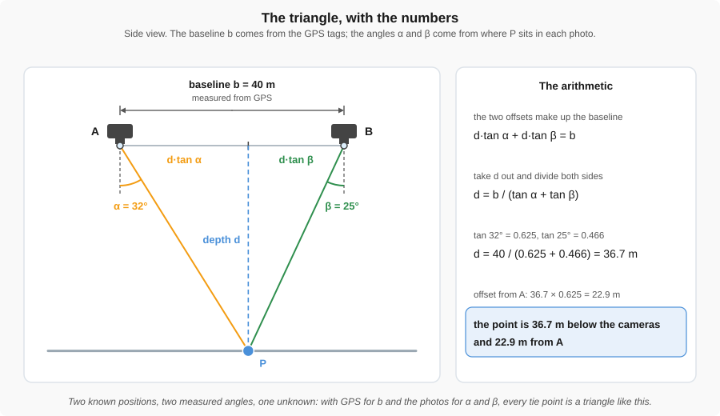
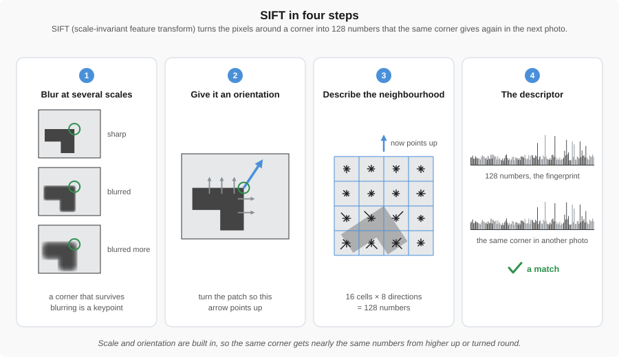
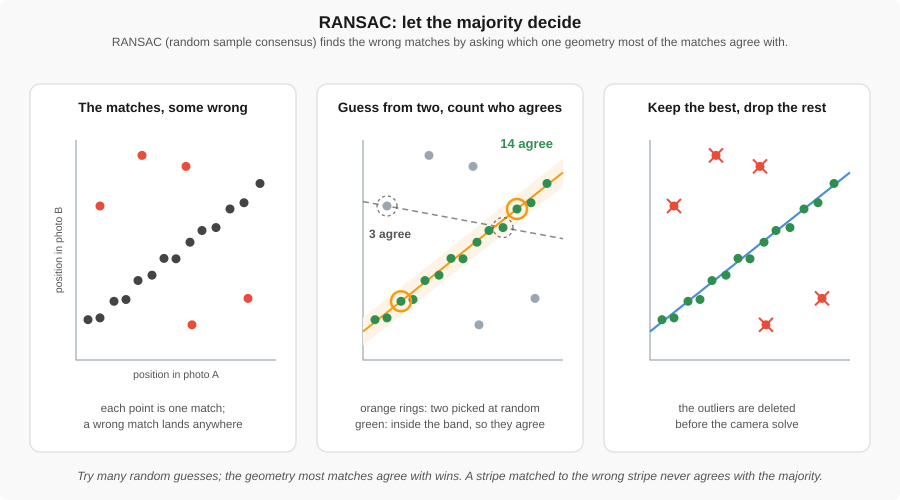

# How Photos Become 3D

!!! abstract "Key Takeaways"
    - **Structure from Motion (SfM)** turns ordinary overlapping photos into a 3D model by finding
      the same point in several of them.
    - A point photographed **once** is useless. The same point photographed from several positions
      becomes a measurement.
    - The software solves for **where the camera was** and **what the scene looks like** at the same
      time.
    - Knowing roughly where the drone was, from GPS, makes that solve faster and puts the answer in
      the right place on Earth.

This page is about why you fly the way you do in the next section. You do not need the algorithms;
you need to know what the software is trying to do, so that you give it what it needs.

{ width="100%" }

*Figure 1: Six stages, four buttons. Every product on the right is built from the photos on the
left, and the software's four steps map onto the stages between.*

---

## Where 3D comes from

A single photo is flat. Two photos of the same thing, taken from different places, are not.

{ width="100%" }

*Figure 2: The same pole looks short from almost overhead and long from off to the side. That
difference is the measurement.*

If you already know where the drone was for each photo, the only unknowns left are the height and
position of the pole, and two photos are enough to solve for them. Two known camera positions, two
measured angles, one unknown height: that is a triangle.

{ width="100%" }

*Figure 2b: The triangle with its numbers. The baseline between the cameras comes from GPS, the two
angles come from where the point sits in each photo, and one line of trigonometry gives the depth.
The software does this for every tie point, thousands of times per photo.*

### What if you do not know where the drone was?

In practice you rarely know the camera positions exactly. Then you are solving a bigger problem:
**where each photo was taken from, and where everything in the scene is, at the same time.**

That is still solvable, but it needs more to work with. The same point has to appear in several
photos, and each pair of photos needs several points in common, not just one. Given enough shared
points across enough photos, there is one arrangement of cameras and 3D points that explains every
photo *best*, and the software searches for it by starting from a guess and nudging cameras and
points until the leftover misfit is as small as it can be. Real photos carry noise, so the answer is
a best fit, never an exact one. The software also solves for the camera itself — its focal length
and the distortion of its lens — which is one reason the same camera has to be used for the whole
flight.

Software does this either one photo at a time, adding each new photo to the arrangement so far
(**incremental**, which can drift over a long strip), or for all the photos at once (**global**).
Either way, a rough starting position for each photo makes the search shorter and the drift smaller.

This is what Structure from Motion does, and it is why the name mentions structure *and* motion: it
recovers the shape of the scene and the path of the camera together. Robotics calls the same problem
**SLAM**, simultaneous localization and mapping.

{ width="100%" }

*Figure 3: Every matched point sends a ray from every photo that saw it. The software moves the
cameras and the points together until all the rays agree as closely as they can. The leftover miss
is the reprojection error; Bentley calls the whole step aerotriangulation.*

!!! warning "Shape is not size"
    With no known positions at all, the software recovers the **shape** of everything and the
    relative arrangement of the cameras, but not the **size**, and not where any of it sits on
    Earth. A model of a building can come out perfectly proportioned and twice life size.

    Something has to supply the missing scale and position. Usually that is the drone's GPS. It does
    not have to be perfect: a rough position for each photo gives the software a starting point near
    the answer, so it solves faster and drifts less. With **RTK GPS**, where each photo's position is
    known to a few centimeters, the camera positions are close to known before processing begins.

---

## Why overlap is the whole game

Everything above depends on one thing: the same point appearing in many photos. That is what overlap
buys you, and it is the single most important number you set before a flight.

{ width="100%" }

*Figure 4: Overlap is not wasted effort. It is what puts every ground point into five to nine
different photos.*

A **tie point** is a feature the software recognizes in more than one photo. A point has to appear
in at least three photos to be solved at all; five to nine is what makes the solve reliable. More
overlap means more tie points, and more tie points means a better solve. Too little overlap and the
reconstruction develops holes that no amount of processing will fill.

### What makes a good tie point

The software is not looking for *texture*. It is looking for a point it can identify **uniquely** and
then find again in another photo. Those are not the same thing, and the difference is where most
reconstructions go wrong.

| Kind of surface | Examples | What the software does |
|-----------------|----------|------------------------|
| **Uniquely identifiable** | A manhole cover, a rock, a building corner, a crack, a painted arrow or number | Matches it correctly. This is what you want. |
| **Nothing to identify** | Blank asphalt, fresh snow, still water, plain roofs, glass | Finds nothing. You get holes. |
| **Identifiable but repeated** | Parking stall lines, lane dashes, grass, row crops, tiled roofs | Matches confidently and **wrongly**. |

{ width="100%" }

*Figure 5: Where the software finds its points. Corners, lids, edges and canopy texture are kept.
Blank asphalt gives it nothing; a row of identical stripes gives it the wrong thing.*

{ width="100%" }

*Figure 6: Each keypoint gets a fingerprint of the pixels around it. Fingerprints that agree across
two photos are matched; a match that disagrees with the geometry of all the others is thrown out.*

!!! warning "A repeating pattern is worse than a blank one"
    A blank surface fails honestly. The software finds nothing, and you get a hole you can see and
    deal with.

    A repeating pattern fails quietly. Every dash in a lane line looks like every other dash, so a
    segment in one photo gets matched to the wrong segment in the next. Parking lot stall lines do
    this constantly. So does grass: one clump looks distinctive on its own, but the field is full of
    clumps that are equally distinctive and look just like it. Row crops are the same problem planted
    in neat rows.

    The result is not a gap. It is a model that is confidently wrong, sometimes with a whole section
    shifted or warped, and nothing on screen tells you. Only a checkpoint catches it.

    **What helps:** more overlap, so a bad match is outvoted by good ones; a cross-hatch pass, so the
    pattern is seen from a second direction; and ground control, so the error has something to show
    up against.

!!! tip "This is why overcast days are good for mapping"
    Flat light means a feature looks the same in every photo. Bright sun creates hard shadows that
    move as you fly, and a shadow edge is exactly the kind of false feature that fools the matcher.

### How the software finds and matches points, in a little more detail

The software cannot see a manhole cover the way you do. It looks for spots that stand out, then
describes each one with numbers. The best-known method is **SIFT (Scale-Invariant Feature
Transform)**. It blurs the photo by several different amounts and looks for blobs and corners that
still stand out at more than one of those zoom levels, so a feature is found whether the next photo
was taken from higher or lower.

Each spot is then given an orientation, taken from the direction in which brightness changes most
around it, and the pixels around it are summarised as a **descriptor**: a list of 128 numbers, the
fingerprint in Figure 6. Because the zoom level and the orientation are built into that list, the
same building corner gets nearly the same 128 numbers in a photo taken from farther away or from a
different angle. ORB and AKAZE are other detectors of the same kind, and processing software
rarely tells you which one it is using.

{ width="100%" }

*Figure 6b: SIFT in four steps. A corner that survives blurring is a keypoint; turning the patch to
its dominant direction and summarising the gradients in a 4 × 4 grid gives the 128 numbers that
make up its fingerprint.*

Matching compares descriptors between two photos. A match is kept only if its best candidate is
clearly better than the runner-up, the **ratio test**. A stall line fails that test, because every
other stripe looks about as good.

Some wrong matches still get through. **RANSAC (Random Sample Consensus)** deals with them: pick a
few matches at random, work out the camera geometry they imply, count how many of the other matches
agree with it, and repeat. The geometry that the most matches agree with wins, and the matches that
never agree with anything are discarded as outliers. That is the red match in Figure 6.

{ width="100%" }

*Figure 6c: RANSAC lets the majority decide. A random guess from two matches is scored by how many
others agree with it; after many guesses the best-supported geometry is kept and the matches that
never agreed are deleted before the camera solve.*

Once the geometry between two photos is known, a point in one of them can only have its partner
somewhere along one line in the other, the **epipolar line**. That is why a search of the whole
image becomes a search along a line, and it is what makes matching every pixel possible in the
dense step later.

---

## From points to products

Once the cameras and the tie points agree, the rest is mechanical. Each step trades some information away for something easier to use.

{ width="100%" }

*Figure 7: The same building at four stages. A sparse cloud of tie points is thickened into a dense
cloud, meshed into a surface, and covered with the original photographs.*

### What actually happens at each step

**Sparse to dense.** The sparse cloud only has points where the software found something
distinctive, so it is mostly corners and edges. Now that it knows where every camera was, it goes
back to the photos and works on *every* pixel. The trick is that once the camera positions are
known, a pixel's match in another photo must lie along a single known line, so a search of the whole
image becomes a search along one line. That is what makes matching millions of points possible at
all. Thousands of points become millions.

{ width="100%" }

*Figure 8: For one pixel in photo A the match in photo B lies on one known line. Find it, read the
depth from where the two rays cross, and repeat for every pixel. This is the slow step.*

**Dense to mesh.** A point cloud is samples, not surfaces. Meshing stretches a continuous skin of
triangles over the points, bridging small gaps and deciding what is solid. Noise gets smoothed here,
and thin things such as railings, wires, and fence posts often vanish, because too few points landed
on them to define a surface.

It also errs the other way. Where two things are near each other but not actually joined, such as a
tree beside a wall, the gap between two buildings, or the space under a railing, the mesher can
bridge straight across and invent a surface that is not there. Models like this look shrink-wrapped
or webbed, and it is obvious once you know to look for it.

{ width="100%" }

*Figure 9: Points become triangles. A thin pole gets webbed to the ground unless the joining
tolerance is tightened, and tightening it costs genuine holes elsewhere.*

!!! tip "If the mesh looks webbed, change the tolerance"
    Processing software exposes settings for how far it is willing to reach when joining points.
    Tighten them and the mesh follows the points more strictly, which removes the false webbing at
    the cost of leaving more genuine holes. Loosen them and you get a smoother, more complete
    surface that may be partly invented. Neither setting is correct in general; it depends on
    whether you would rather have gaps you can see or surfaces you cannot trust.

**Mesh to textured model.** Each triangle is colored using whichever photo saw it best: most
face-on, least blurred, least shadowed. This adds no geometry at all. It is what makes the model
recognizable rather than what makes it accurate.

**Surface to orthophoto.** Every photo is a perspective view, so buildings lean outward from the
center of the frame and the scale changes across it. Orthorectification projects each pixel onto the
surface the software just built, then re-renders the scene as if photographed from directly
overhead, everywhere at once. Every part of the result is at the same scale, and that is precisely
what makes it something you can measure on.

{ width="100%" }

*Figure 10: A photo leans every building away from the camera, and two photos disagree about where
the roof is. Drape each photo on the mesh and look straight down at every point, and the lean is
gone.*

**Surface to DSM and DTM.** The surface is sampled onto a regular grid, storing one height per cell
instead of a picture. Keep everything and you have a **DSM**. Classify the cells, remove the ones
that are vegetation or structures, and interpolate the ground underneath, and you have a **DTM**.

{ width="100%" }

*Figure 11: Sample the surface on a grid and every cell gets one height. Keep the building and the
tree for a DSM; strip them to bare ground for a DTM.*

{ width="100%" }

*Figure 12: The orthophoto and the DSM are the same surface read two different ways, one as a
picture and one as a grid of heights.*

!!! note "Georeferencing runs through all of it"
    None of the above puts the model anywhere in particular. On its own the reconstruction sits in
    its own relative coordinates, correct in shape and arbitrary in size and place. The GPS tag on
    each photo goes into the solve as its starting guess, and surveyed ground control points pin the
    finished arrangement to real coordinates. Either way the model has no scale and no place until
    one of them supplies it.

See [Aerial Measurement Products](data_products.md) for what each of those outputs is
used for.

---

!!! question "Activity: think like the software"
    Look at two overlapping photos from a flight, or at the site outside your classroom.

    1. **Find three easy features.** Points a computer could identify and find again: a manhole
       cover, a corner of a sidewalk, a painted arrow or number.
    2. **Find three hard ones.** Two kinds count here. Areas with nothing to match at all, such as
       blank asphalt or a puddle, and areas full of things that look identical to each other, such
       as stall lines or mown grass. Which kind worries you more, and why?
    3. **Then decide.** You are asked to map a rocky canyon and a snowfield on the same day. Which
       one worries you, and what would you change about the flight to compensate?

---

??? note "Optional: what the algorithms are called"
    You will meet these names in software documentation. You do not need them for this course.

    - **Feature detectors:** SIFT, ORB, AKAZE. These find and describe distinctive keypoints.
    - **Outlier rejection:** RANSAC. Throws out matches that do not fit the emerging geometry.
    - **Bundle adjustment solvers:** Ceres Solver, g2o. These minimize reprojection error, the gap
      between where a point should appear in a photo and where it actually does.
    - **Surface reconstruction:** Poisson reconstruction, Delaunay triangulation. These turn a cloud
      of points into a continuous surface.
    - **Open-source pipeline:** COLMAP, if you want to see the whole process end to end.

---

## Resources

Most approachable first.

- [Structure from Motion, Humboldt State GSP 216](http://gsp.humboldt.edu/olm/Courses/GSP_216/lessons/SfM.html)
  — a plain-language overview of drone SfM, from overlapping photos to a point cloud, orthophoto and
  DEM, with a stream and a redwood example.
- [Structure from Motion, IEEE Technology Navigator](https://technav.ieee.org/topic/structure-from-motion/)
  — a short definition covering features, incremental reconstruction and where SfM is used.
- [Structure from motion, Wikipedia](https://en.wikipedia.org/wiki/Structure_from_motion) — the
  overview, including incremental versus global methods and the use of ground control points. Its
  links lead to the subtopics below.
- [Scale-invariant feature transform, Wikipedia](https://en.wikipedia.org/wiki/Scale-invariant_feature_transform)
  — how SIFT finds and describes a point; the ratio test is here.
- [RANSAC, Wikipedia](https://en.wikipedia.org/wiki/RANSAC) — the fit-a-line-through-noisy-points
  example shows why outliers can be ignored.
- [Epipolar geometry, Wikipedia](https://en.wikipedia.org/wiki/Epipolar_geometry) — why a match
  must lie on one line in the other photo.
- [Structure from Motion in OpenCV](https://opencv.org/structure-from-motion-in-opencv/) — the
  OpenCV library's introduction to its own SfM tools, for anyone who wants to run the pipeline
  themselves.
- [SfM and SLAM, UT Dallas CS 6384 lecture 12 (PDF)](https://yuxng.github.io/Courses/CS6384Spring2022/lecture_12_SfM_and_SLAM.pdf)
  — lecture slides with the full mathematics; the cube-and-three-cameras picture is readable without
  it.
- [Herrera-Granda et al., a survey of visual SLAM and SfM, Heliyon 2024](https://pmc.ncbi.nlm.nih.gov/articles/PMC11415689/)
  — a research survey for the curious, including why incremental methods drift.

---

## Where this is used

- [Week 6 lab — Creating Flight Plans](../labs/3_creating_flight_plans.md) — the overlap you plan for is driven by what this process needs
- [Week 8 lab — Data Processing](../labs/5_data_processing.md) — you run this process on your own photographs
