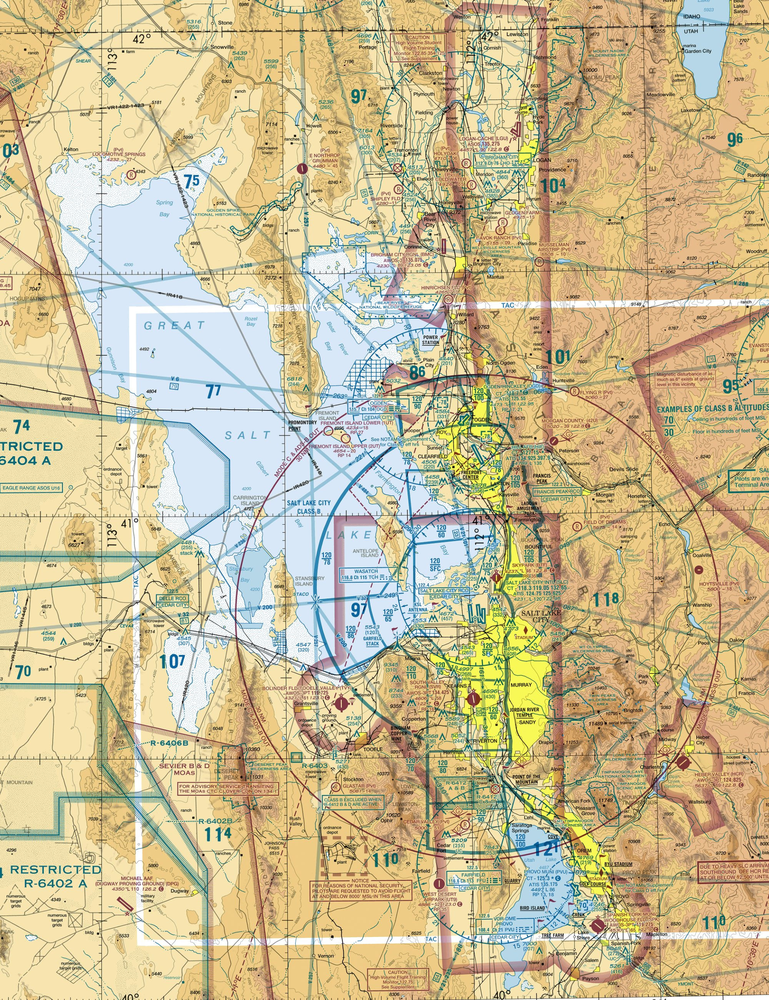

# Full Practice Exam — Answers Explained
## Week 9 — FAA-Level Difficulty

Try the exam on the [Full Practice Exam page](60_question_exam.md) first.

---

## Sectional Chart Reference (Figure 10 — Salt Lake City Area)

---

Question numbers match the [Full Practice Exam](60_question_exam.md) page. Rules are from 14 CFR
Parts 107, 89 and 48 (checked October 2026); chart answers use Figure 10 above and its legend.

---
### Question 1
Refer to Figure 10. The solid blue concentric rings surrounding KSLC indicate:

**Correct Answer: B**

**Explanation:** Solid blue rings are Class B airspace, the busiest kind, and the chart labels them SALT LAKE CITY CLASS B. (Chart legend; PHAK ch. 15.)

Not A: Class C is drawn in solid magenta. Not C: Class D is a dashed blue line.

---
### Question 2
Refer to Figure 10. The number '120/60' within a Class B shelf indicates:

**Correct Answer: A**

**Explanation:** A Class B shelf label is ceiling over floor in hundreds of feet MSL (mean sea level), so 120/60 means 12,000 ft MSL over 6,000 ft MSL. Every shelf on this chart reads 120/xx because the whole Class B tops out at 12,000 ft MSL. (Chart "Examples of Class B Altitudes" box.)

Not B or D: chart altitudes are MSL, never AGL (above ground level), and the top number is always the ceiling.

---
### Question 3
Refer to Figure 10. Provo Airport (KPVU) is surrounded by a dashed blue circle. This indicates:

**Correct Answer: B**

**Explanation:** A dashed blue circle is Class D airspace, the kind drawn around a smaller airport with a control tower. (Chart legend.)

Not C: a Class E surface area is a dashed *magenta* line.

---
### Question 4
Refer to Figure 10. West of Salt Lake City is R-6402A. This area is:

**Correct Answer: C**

**Explanation:** The R- prefix means a Restricted Area; the chart prints RESTRICTED R-6402 A at the lower left. Flying there needs permission from the agency that controls it. (14 CFR 107.45.)

---
### Question 5
Refer to Figure 10. The area labeled 'SEVIER B & D MOAs' southwest of the lake is:

**Correct Answer: B**

**Explanation:** MOA stands for Military Operations Area, drawn with magenta hatching. An MOA is a hazard to check before you fly (activity times are in the chart margin), not a no-fly zone. (Chart legend.)

Not A: nothing on this excerpt is a Prohibited Area; the restricted areas next door are the ones that need permission.

---
### Question 6
Given METAR: KSLC 121753Z 33012KT 10SM FEW050 SCT120 18/06 A2992 What is the wind?

**Correct Answer: A**

**Explanation:** In a METAR (an airport weather observation) the group 33012KT reads as wind from 330 degrees true at 12 knots. (PHAK ch. 13; AC 00-45.)

Not B: METAR winds are always in knots, never mph.

---
### Question 7
Given METAR: KSLC 121753Z 33012KT 10SM FEW050 SCT120 18/06 A2992 What is the visibility?

**Correct Answer: B**

**Explanation:** 10SM is 10 statute miles of visibility. (PHAK ch. 13.)

Not C: the 18 comes from the temperature group, not the visibility group.

---
### Question 8
Given METAR: KSLC 121753Z 33012KT 10SM FEW050 SCT120 18/06 A2992 What is the temperature and dewpoint?

**Correct Answer: A**

**Explanation:** 18/06 is temperature 18 C and dew point 6 C, in that order and always in Celsius. (PHAK ch. 13.)

---
### Question 9
Given TAF: TAF KSLC 121720Z 1218/1324 32010KT P6SM SCT050 FM130300 35015KT P6SM SKC What change occurs at 0300Z?

**Correct Answer: A**

**Explanation:** In a TAF (an airport forecast) FM130300 means "from 0300Z on the 13th", and the group after it is the new forecast: wind 350 at 15 knots, visibility more than 6 SM, sky clear. (PHAK ch. 13.)

Not B or D: both visibility and sky *improve* at that time.

---
### Question 10
(Refer to Figure 10) You plan to operate at 350 ft AGL near Sandy, beneath the Class B shelf marked 120/60 and outside any Class D or Class E surface area. What is required?

**Correct Answer: B**

**Explanation:** The shelf floor is 6,000 ft MSL, about 1,500 ft above the ground at Sandy, so a drone at 350 ft AGL is in uncontrolled airspace beneath it and needs no ATC (air traffic control) authorization. The 400 ft AGL limit still applies. (14 CFR 107.41.)

Not A: authorization is needed only inside Class B, C, D or a Class E surface area.

---
### Question 11
What is the maximum groundspeed allowed for a small UAS under Part 107?

**Correct Answer: A**

**Explanation:** Part 107 caps groundspeed at 87 knots, which is 100 mph. (14 CFR 107.51(a).)

Not B: 100 knots is 115 mph, over the limit; the exam likes to swap the units.

---
### Question 12
According to Part 107, what is the minimum visibility required for flight from the control station?

**Correct Answer: C**

**Explanation:** Minimum flight visibility from the control station is 3 statute miles. (14 CFR 107.51(c).)

---
### Question 13
(Refer to Figure 10) What is the ceiling of the Class D airspace surrounding Provo Airport (KPVU)?

**Correct Answer: C**

**Explanation:** The bracketed number inside a Class D circle is its ceiling in hundreds of feet MSL. Provo shows **[70]**, so the ceiling is 7,000 ft MSL, about 2,500 ft above the 4,497 ft field. (Chart legend, "Ceiling of Class D Airspace in hundreds of feet".)

Not B: 4,535 ft MSL is only 38 ft above the field and matches nothing on the chart. Not D: the surface is the floor of Class D, not the ceiling.

---
### Question 14
Which of the following is a "hazardous attitude" as defined by the FAA?

**Correct Answer: B**

**Explanation:** The FAA's five hazardous attitudes are anti-authority, impulsivity, invulnerability, macho and resignation. (PHAK ch. 2.)

Not A: complacency is a real risk, but it is not one of the five named attitudes.

---
### Question 15
Under Part 107, how many days do you have to report an accident that results in serious injury or property damage over $500?

**Correct Answer: B**

**Explanation:** Report to the FAA within 10 calendar days after a serious injury, any loss of consciousness, or damage to someone else's property over $500 (repair cost or fair market value). (14 CFR 107.9, retitled "Safety event reporting" in 2022; substance unchanged.)

Not D: 48 hours is not a Part 107 deadline.

---
### Question 16
What mnemonic helps a pilot assess their physical and mental fitness to fly?

**Correct Answer: C**

**Explanation:** IMSAFE is a self-check of the pilot: Illness, Medication, Stress, Alcohol, Fatigue, Emotion. (PHAK ch. 2.)

Not A: PAVE checks the whole flight, not just the pilot.

---
### Question 17
Under Part 107, when must a small unmanned aircraft be registered with the FAA?

**Correct Answer: A**

**Explanation:** Every aircraft flown under Part 107 must be registered, whatever it weighs. The 0.55 lb (250 g) exemption applies only to aircraft flown purely for recreation. (14 CFR 48.15; 107.13.)

Not B: the weight threshold is the recreational rule, and it is the usual trap here.

---
### Question 18
When must a remote pilot yield the right-of-way to all other aircraft?

**Correct Answer: C**

**Explanation:** A small unmanned aircraft must yield the right-of-way to all other aircraft, at all times, including airborne vehicles and launch and reentry vehicles. (14 CFR 107.37(a).)

---
### Question 19
What is the "structure exception" to the 400 ft AGL altitude limit?

**Correct Answer: A**

**Explanation:** Within a 400 ft radius of a structure you may fly up to 400 ft above its top. (14 CFR 107.51(b).)

Not D: the exception adds a fixed 400 ft, not a multiple of the structure's height.

---
### Question 20
Which weather product provides current observed conditions at an airport?

**Correct Answer: B**

**Explanation:** A METAR is a current observation. A TAF is a forecast, a SIGMET is a hazardous-weather advisory, and a NOTAM (Notice to Air Missions) is not a weather product at all. (PHAK ch. 13.)

---
### Question 21
What is "density altitude"?

**Correct Answer: A**

**Explanation:** Density altitude is pressure altitude corrected for non-standard temperature: hot, high and humid air "feels" higher to the aircraft and performance drops. (PHAK ch. 11.)

Not B: the altimeter shows indicated altitude.

---
### Question 22
How often must a remote pilot complete recurrent training to maintain currency?

**Correct Answer: B**

**Explanation:** Currency needs the initial test or the free online recurrent training within the previous 24 calendar months; the certificate itself does not expire. (14 CFR 107.65.)

---
### Question 23
(Refer to Figure 10) The area marked R-6404A is a:

**Correct Answer: A**

**Explanation:** The R- prefix again means a Restricted Area; the chart prints RESTRICTED R-6404 A at the upper left. (14 CFR 107.45.)

Not D: an MOA is labelled "MOA" and hatched magenta.

---
### Question 24
What are the standard cloud clearance requirements for Part 107?

**Correct Answer: A**

**Explanation:** Stay 500 ft below and 2,000 ft horizontally from clouds. (14 CFR 107.51(d).)

Not D: the same two numbers, swapped.

---
### Question 25
The center of gravity (CG) of an aircraft is:

**Correct Answer: A**

**Explanation:** The CG (center of gravity) is the point where the aircraft would balance, and it moves as you change the load. (PHAK ch. 10.)

---
### Question 26
Which of these involves the "PAVE" checklist?

**Correct Answer: A**

**Explanation:** PAVE: Pilot, Aircraft, enVironment, External pressures. (PHAK ch. 2.)

---
### Question 27
Under Part 107, night operations are permitted if the drone is equipped with:

**Correct Answer: B**

**Explanation:** Night flight needs anti-collision lighting visible for at least 3 statute miles with a flash rate that avoids a collision, plus initial testing or recurrent training taken after April 6, 2021. (14 CFR 107.29(a).)

Not D: steady navigation lights are not anti-collision lights.

---
### Question 28
Which source is used to obtain authorizations for controlled airspace in near-real-time?

**Correct Answer: B**

**Explanation:** LAANC (Low Altitude Authorization and Notification Capability) gives near-real-time ATC authorization in controlled airspace at or below the UAS Facility Map altitude. (14 CFR 107.41; FAA LAANC page.)

Not A: FAADroneZone handles the slower manual requests and waivers. Not C: you do not phone the tower.

---
### Question 29
A "TAF" is typically valid for what period of time?

**Correct Answer: B**

**Explanation:** A TAF covers 24 hours (30 at some major airports) and is issued four times a day. (PHAK ch. 13.)

---
### Question 30
What type of fog forms on clear, calm nights when the ground cools rapidly?

**Correct Answer: C**

**Explanation:** Radiation fog forms when the ground radiates its heat away on a clear, calm night and cools the air just above it. (PHAK ch. 12.)

Not A: advection fog needs warm, moist air moving over a cooler surface.

---
### Question 31
What is the primary purpose of a "Visual Observer" (VO)?

**Correct Answer: B**

**Explanation:** A VO (visual observer) helps the pilot see and avoid other aircraft and hazards by scanning the airspace. (14 CFR 107.3, 107.33.)

---
### Question 32
(Refer to Figure 10) The "120/60" label on the Class B shelf south of KSLC (near Sandy) indicates a floor of:

**Correct Answer: A**

**Explanation:** The bottom number of 120/60 is the floor in hundreds of feet MSL: 6,000 ft MSL. (Chart "Examples of Class B Altitudes" box.)

Not B: chart altitudes are MSL, not AGL. Not C: 12,000 ft is the ceiling.

---
### Question 33
What is the effect of high humidity on sUAS performance?

**Correct Answer: B**

**Explanation:** Moist air is less dense than dry air, so lift and thrust fall. (PHAK ch. 11.)

Not A: water vapor is lighter than the air it replaces, so humidity thins the air rather than thickening it.

---
### Question 34
Which document must be available for inspection upon request by the FAA?

**Correct Answer: B**

**Explanation:** Your remote pilot certificate (with photo ID) must be on you, and the aircraft registration must be available; present them on request to the FAA or law enforcement. (14 CFR 107.7; 91.203.)

---
### Question 35
If a remote pilot changes their permanent mailing address, how long do they have to update it with the FAA?

**Correct Answer: B**

**Explanation:** After 30 days at a new address you may not exercise the certificate until the FAA has been told. (14 CFR 107.77(c).)

---
### Question 36
What is the definition of a "Small UAS" under Part 107?

**Correct Answer: A**

**Explanation:** A small unmanned aircraft weighs less than 55 lb at takeoff, including everything on board or attached. (14 CFR 107.3.)

---
### Question 37
"Stable air" is typically associated with which of the following?

**Correct Answer: A**

**Explanation:** Stable air is smooth, with poor visibility from haze or fog, layered clouds and steady rain. (PHAK ch. 12.)

Not B or D: turbulence, updrafts and thunderstorms belong to *unstable* air.

---
### Question 38
What should a pilot do if they experience a "flyaway" or lost link in controlled airspace?

**Correct Answer: B**

**Explanation:** If a fly-away could endanger other traffic, tell ATC as soon as possible; the pilot in command must not create an undue hazard. (AC 107-2A ch. 5; 14 CFR 107.19.)

Not C: a report the next day does nothing for the traffic at risk now.

---
### Question 39
A "Military Operations Area" (MOA) is depicted on a sectional chart by:

**Correct Answer: B**

**Explanation:** An MOA is drawn with a hatched magenta boundary. (Chart legend.)

Not A or C: solid blue is Class B and dashed blue is Class D. Blue hatching marks restricted, prohibited and warning areas.

---
### Question 40
According to ADM principles, if you feel "impulsive" during a flight, the antidote is:

**Correct Answer: A**

**Explanation:** The antidote to impulsivity is "Not so fast. Think first." (PHAK ch. 2.)

Not B: "Follow the rules" answers anti-authority. Not C: "It could happen to me" answers invulnerability. Not D: "I am not helpless" answers resignation.

---
### Question 41
What is the "standard" lapse rate in the atmosphere?

**Correct Answer: A**

**Explanation:** The standard lapse rate is about 2 C (3.5 F) per 1,000 ft of altitude. (PHAK ch. 12.)

---
### Question 42
Under Part 107, can a remote pilot operate from a moving vehicle?

**Correct Answer: A**

**Explanation:** You may fly from a moving land or water vehicle only over a sparsely populated area and not carrying someone else's property for hire; never from a moving aircraft. (14 CFR 107.25.)

Not C: it is allowed, with those conditions.

---
### Question 43
What type of cloud has the most significant vertical development and is associated with thunderstorms?

**Correct Answer: C**

**Explanation:** Cumulonimbus is the towering thunderstorm cloud. (PHAK ch. 12.)

---
### Question 44
(Refer to Figure 10) The blue obstruction symbol labeled "4656 (408)" beside the Stadium in Salt Lake City represents:

**Correct Answer: A**

**Explanation:** For an obstruction the upright number is the top in feet MSL (4,656) and the number in parentheses is its height above the ground (408 ft AGL). (Chart legend, "Obstructions".)

Not D: an airport's elevation is printed in its data box, not beside a tower symbol.

---
### Question 45
What does the "A" in the IMSAFE checklist stand for?

**Correct Answer: C**

**Explanation:** The A in IMSAFE is Alcohol: no flying within 8 hours of a drink or with 0.04 or more blood alcohol. (14 CFR 107.27; 91.17.)

---
### Question 46
A remote pilot must perform a pre-flight inspection of the UAS:

**Correct Answer: C**

**Explanation:** A preflight inspection comes before every flight. (14 CFR 107.49.)

---
### Question 47
"Load factor" increases during:

**Correct Answer: B**

**Explanation:** In a level turn the aircraft must support more than its own weight: 1.15 G at 30 degrees of bank, 2 G at 60 degrees. (PHAK ch. 5.)

Not A or D: straight-and-level flight and a still-air hover carry exactly 1 G.

---
### Question 48
Which of the following is true regarding Remote ID?

**Correct Answer: B**

**Explanation:** Remote ID broadcasts the aircraft's identity, position and the control-station (or takeoff) location in real time. (14 CFR 89.101, 89.105.)

Not A or C: it is required for every aircraft that must be registered, which is every Part 107 aircraft. Not D: it adds to registration; it does not replace it.

---
### Question 49
What is the floor of Class E airspace in most of the United States (unless otherwise marked)?

**Correct Answer: B**

**Explanation:** Class E starts at 1,200 ft AGL by default, or at 700 ft AGL inside the faded magenta vignette. (Chart legend; 14 CFR 107.41.)

Not A: it starts at the surface only inside a dashed magenta line, and that surface area is the one kind of Class E that needs ATC authorization.

---
### Question 50
If the temperature and dew point are within 3 degrees of each other, what is likely to form?

**Correct Answer: C**

**Explanation:** When the temperature and dew point are within about 3 degrees of each other the air is nearly saturated, so fog or low cloud is likely. (PHAK ch. 12.)

---
### Question 51
Who is ultimately responsible for the safe operation of a small UAS?

**Correct Answer: C**

**Explanation:** The remote PIC (pilot in command) has final authority and is directly responsible for the flight. (14 CFR 107.19.)

Not D: the VO helps, but the responsibility stays with the PIC.

---
### Question 52
What is the risk of "spatial disorientation"?

**Correct Answer: B**

**Explanation:** Spatial disorientation is losing track of which way the aircraft is pointing or where it is, which is why keeping it in sight and using a VO matter. (PHAK ch. 17.)

---
### Question 53
(Refer to Figure 10) The hatched blue boundary labeled R-6402A indicates:

**Correct Answer: A**

**Explanation:** Blue hatching marks prohibited, restricted and warning areas, and R-6402A is restricted. (Chart legend.)

Not B or C: parks and refuges carry their own names on the chart and no hatching.

---
### Question 54
"Thermal plumes" (updrafts) are caused by:

**Correct Answer: A**

**Explanation:** Thermals rise where the sun heats the ground unevenly: a dark parking lot sends up warmer air than the wet field beside it. (PHAK ch. 12.)

---
### Question 55
A "Waiver" from the FAA allows you to:

**Correct Answer: B**

**Explanation:** A Certificate of Waiver lets you deviate from the specific sections listed in 14 CFR 107.205 (for example 107.31 line of sight, 107.39 over people, 107.51 operating limits) once you show the FAA it can be done safely. (14 CFR 107.200, 107.205.)

Not A: rules such as the alcohol limit and registration cannot be waived.

---
### Question 56
Which frequency should a pilot use to announce their position at a non-towered airport?

**Correct Answer: A**

**Explanation:** At a non-towered airport pilots announce on the CTAF (Common Traffic Advisory Frequency), shown on the chart as the frequency followed by a white C in a magenta circle. (PHAK ch. 14.)

Not B: 121.5 is the emergency frequency.

---
### Question 57
Under Part 107, "Civil Twilight" is defined as:

**Correct Answer: A**

**Explanation:** Civil twilight for Part 107 runs from 30 minutes before official sunrise to sunrise, and from sunset to 30 minutes after official sunset (outside Alaska); anti-collision lights visible 3 SM are required then too. (14 CFR 107.29(b)-(c).)

Not D: it follows the sun, not the clock.

---
### Question 58
What is the primary risk of flying with a "Macho" attitude?

**Correct Answer: A**

**Explanation:** Macho is taking chances to prove yourself or impress others; the antidote is "Taking chances is foolish." (PHAK ch. 2.)

---
### Question 59
In the "PAVE" checklist, the "E" stands for:

**Correct Answer: B**

**Explanation:** The E in PAVE is External pressures: the schedule, the client, the urge to get the shot. (PHAK ch. 2.)

Not A: battery energy is part of the Aircraft check.

---
### Question 60
What should a pilot do if they encounter a manned aircraft while flying their drone?

**Correct Answer: A**

**Explanation:** Yield right-of-way to the manned aircraft at once and never pass over, under or ahead of it unless well clear. (14 CFR 107.37.)

Not B: holding course and altitude is what you do when you *have* the right-of-way, and a drone never does.

---
## Answer Key

1) B, 2) A, 3) B, 4) C, 5) B, 6) A, 7) B, 8) A, 9) A, 10) B,
11) A, 12) C, 13) C, 14) B, 15) B, 16) C, 17) A, 18) C, 19) A, 20) B,
21) A, 22) B, 23) A, 24) A, 25) A, 26) A, 27) B, 28) B, 29) B, 30) C,
31) B, 32) A, 33) B, 34) B, 35) B, 36) A, 37) A, 38) B, 39) B, 40) A,
41) A, 42) A, 43) C, 44) A, 45) C, 46) C, 47) B, 48) B, 49) B, 50) C,
51) C, 52) B, 53) A, 54) A, 55) B, 56) A, 57) A, 58) A, 59) B, 60) A
