# The Part 107 Exam

This page is the Week 3 reading on the rules that govern drone flight in the United States, and an overview of the FAA Part 107 Remote Pilot Certificate: which rules apply to which flight, what the certificate lets you do, how to earn it, and what the knowledge test covers. Use it alongside the [Knowledge Review](part_107_knowledge_review.md) (Week 9, test preparation) and the [Study Resources](part_107_resources.md).

!!! abstract "Key Takeaways"
    - **Two sets of rules.** Flying purely for fun is *recreational* flying under 49 U.S.C. 44809 (take the free TRUST test). Everything else — paid work, class projects, research mapping — is flown under **14 CFR Part 107** by a certificated remote pilot. In this class, a TA holds that certificate and is the remote pilot in command.
    - **The operating limits:** 400 ft above ground level (AGL), 3 statute miles (SM) of visibility, keep the aircraft in sight, yield to every other aircraft, and get ATC authorization before flying in Class B, C, D or surface Class E airspace (§107.41).
    - **Night flying is legal** since 2021 if the pilot's test or training is current and the aircraft carries anti-collision lighting visible for 3 SM (§107.29). It is not a waiver item.
    - **The knowledge test:** 60 scored questions (plus 5 unscored), 2 hours, 70 % to pass, at a PSI testing center. Regulations are now nearly half the test.
    - **The certificate never expires,** but you must complete free online recurrent training every 24 calendar months to keep flying under it.

---

!!! tip "Essential Download — FAA Testing Supplement"
    The knowledge test refers to figures in the **Airman Knowledge Testing Supplement (FAA-CT-8080-2H)**: sectional chart excerpts, airport diagrams and weather reports. Testing centers have handed out a printed copy; the FAA now says the figures increasingly appear on screen inside the question. Either way, the figures are the same.

    **Crucial for success:**
    - The copies linked below are the ones the test uses.
    - Students who know the supplement's layout and can find a figure or legend quickly do noticeably better.
    - Practice looking up legends, airport frequencies and airspace boundaries on the charts *before* test day.

    **[Download local copy — FAA-CT-8080-2H (PDF, reduced resolution)](images/sport_rec_private_akts_FAA-CT-8080-2H_small.pdf)** | **[Official FAA source (full resolution)](https://www.faa.gov/training_testing/testing/supplements)**

    On the FAA page, look for the PDF titled **"FAA-CT-8080-2H"**. The local copy is compressed for convenience; use the FAA link for the high-resolution version when you need to read small chart details.

---

## I. What is FAA Part 107?

### A. Regulatory Background

The Federal Aviation Administration (FAA) governs all civil aviation in the United States, including small unmanned aircraft systems (sUAS — any drone under 55 lb / 25 kg at takeoff). The rule for non-recreational drone flying is **14 CFR Part 107**, the "Small Unmanned Aircraft Rule," in force since **August 29, 2016**. Before it, a business needed a manned-aircraft pilot certificate and a special exemption to fly a drone at all.

**Purpose of Part 107:**

- Provide a clear, accessible path for commercial and professional sUAS operations
- Establish safety standards for drones sharing the National Airspace System (NAS) with manned aircraft
- Define pilot certification, operating rules, and aircraft requirements for drones under 55 lb

Part 107 has been amended since 2016. The changes that matter most for this course and the test came in **April 2021**: night flying without a waiver, operations over people by category, and free online recurrent training instead of a recurrent test. **Remote ID** (Part 89) followed, required from September 16, 2023 and enforced from March 16, 2024.

### B. Which rules apply to your flight?

The question to ask before any flight is *why* you are flying, not what you are flying. The same aircraft can be flown under either set of rules.

| | **Recreational — 49 U.S.C. 44809** | **Part 107** | **Public COA (government)** |
|---|---|---|---|
| **Who** | Anyone flying strictly for fun or personal enjoyment | Anyone flying for any other purpose: paid work, a business, research, a class project, volunteer work for an organization | Federal, state and local agencies |
| **Certificate** | Pass TRUST (free, online, never expires) and carry proof | Remote Pilot Certificate (FAA knowledge test, TSA check) | Certificate of Authorization, or Part 107 |
| **Key rules** | Follow an FAA-recognized community-based organization's safety guidelines; VLOS; 400 ft AGL; ATC authorization in controlled airspace; register if 0.55 lb (250 g) or more | The Part 107 operating rules below; register every aircraft; Remote ID | Agency-specific; may have broader authority |
| **Compensation** | Not allowed | Allowed | Government operations |

**When does Part 107 apply?** Any flight that is not purely recreational: real-estate photography, construction surveying, inspection, mapping, or any flight that furthers a business or an organization's purpose, paid or not. **A class project or a research flight is not recreation**, so most mapping flights you will make as a student or an engineer are Part 107 flights and need a certificated **remote pilot in command (remote PIC)** responsible for them (§107.12, §107.19). Someone without a certificate may fly the controls only under the direct supervision of a remote PIC who can take over immediately.

!!! note "How class flights work"
    - **Indoor flights** with the Holy Stone mini drones (Weeks 2 and 3) are inside a building, which is not the National Airspace System, so neither set of rules applies there.
    - **Outdoor flights** — the Week 5 measurement flights, Rock Canyon Park, and the final project — are flown under **Part 107**. A **TA is the remote pilot in command** under their own certificate; you fly the controls under their direct supervision (§107.12(a)(2)).
    - When a site is in controlled airspace, the department requests authorization through **LAANC** (see §IV.C) before the flight. All of campus is inside Provo's Class D airspace, so every campus flight needs it; see "Flying at BYU" in §IV.E.
    - You do not need a certificate to take this class. You will want one before you fly for a job, and this course prepares you for the test.

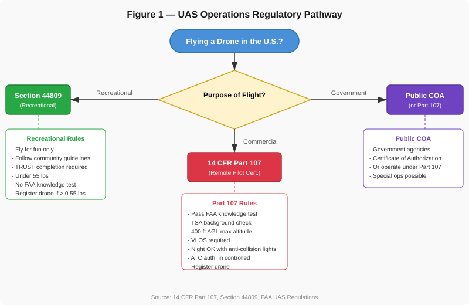{ width="100%" }
*Figure 1: Decision flowchart showing the three main regulatory pathways for UAS operations in the United States.*

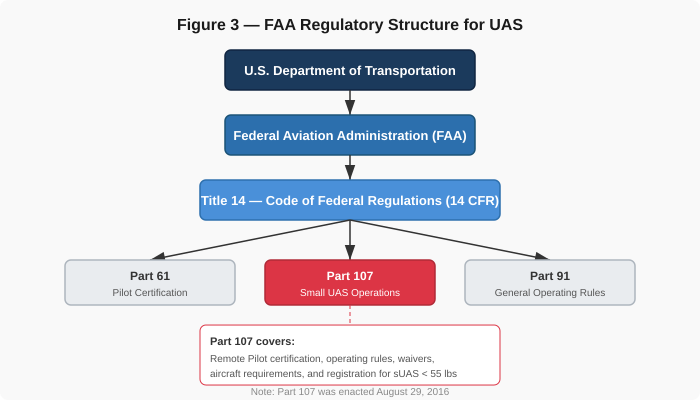{ width="100%" }
*Figure 3: The FAA regulatory hierarchy — Part 107 sits within Title 14 of the Code of Federal Regulations under the FAA.*

### Practice Questions — Regulations

!!! note "Question 1.1"
    A construction company hires you to photograph a building site from the air using a small drone. Under what regulatory authority must you operate?

    - (A) Section 44809 (Recreational)
    - (B) 14 CFR Part 107
    - (C) No special authority is needed if the drone is under 55 lbs

    **Answer: (B).** Any time you fly a drone for compensation or to further a business interest, Part 107 applies — even if someone else is paying you. Section 44809 is only for purely recreational flights with no business purpose.

!!! note "Question 1.2"
    Your neighbor offers to pay you $50 to take aerial photos of their house to post on a real estate listing. Do you need a Part 107 Remote Pilot Certificate?

    - (A) No, because the flight is over private property
    - (B) No, because the payment is under $100
    - (C) Yes, because you are receiving compensation for the flight

    **Answer: (C).** There is no minimum dollar threshold — any compensation makes the flight a commercial operation requiring Part 107 certification. The location of the flight (private vs. public property) does not change the regulatory requirement.

---

## II. Eligibility & Certification Process

### A. Eligibility Requirements

To hold a Remote Pilot Certificate under Part 107 (§107.61), you must:

- Be at least **16 years old** (you may take the knowledge test at 14)
- Be able to read, speak, write, and understand **English**
- Be in a **physical and mental condition** to safely operate a small UAS
- Pass the **initial aeronautical knowledge test** (UAG — Unmanned Aircraft General)
- Clear a **TSA security background check**

There is no flight-hours requirement and no medical certificate (unlike manned-aircraft pilots). You must self-assess your fitness to fly before each operation (§VIII).

### B. Getting Your Certificate — Step by Step

The whole process usually takes a few weeks, most of it studying.

1. **Create an IACRA profile** at [iacra.faa.gov](https://iacra.faa.gov) (the FAA's Integrated Airman Certification and Rating Application). It issues your **FAA Tracking Number (FTN)**, which you need before you can schedule the test.
2. **Study.** The knowledge areas are in §III; the free FAA materials are on the [Study Resources](part_107_resources.md) page.
3. **Schedule the test** at [faa.psiexams.com](https://faa.psiexams.com/) for "Unmanned Aircraft General – Small (UAG)". PSI runs the FAA's testing centers. **Nearest to campus:** UVU's testing center at the Provo airport; other centers are listed when you schedule.
4. **Pay the fee.** As of October 2026 the fee was about **$175**; check PSI when you schedule. Bring a government photo ID that shows your date of birth, signature and physical address.
5. **Take the test:** 60 scored questions (plus 5 unscored), 120 minutes, 70 % to pass. Your score report (the AKTR) is printed at the center. If you fail, you can retake it after **14 calendar days** (§107.71).
6. **Apply in IACRA:** Start New Application → Pilot → Remote Pilot, enter the 17-digit Knowledge Test Exam ID from your score report, and e-sign. It can take up to 48 hours for a test to appear in IACRA.
7. **TSA security check.** When it clears, an email tells you how to print a **temporary certificate** (valid up to 120 days, §107.64), which lets you fly under Part 107 immediately.
8. **The permanent card** arrives by mail, typically within several weeks.

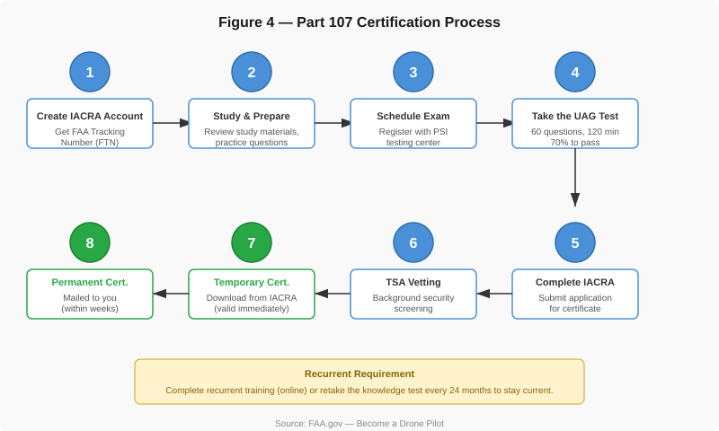{ width="100%" }
*Figure 4: Step-by-step certification process from IACRA registration through permanent certificate.*

### C. Recurrent Training Requirements

Your Remote Pilot Certificate **never expires**, but to exercise it you must be *current* (§107.65): within the previous **24 calendar months** you must have passed the initial test or completed the FAA's **free online recurrent training** (course ALC-677 at [faasafety.gov](https://www.faasafety.gov)). The recurrent *test* was dropped in April 2021; the training replaced it.

If your currency lapses, you simply cannot fly under Part 107 until you complete the training. There is no penalty and no new certificate is issued. See §IX.A for the timeline.

### Practice Questions — Eligibility & Certification

!!! note "Question 2.1"
    What is the minimum age to obtain a Remote Pilot Certificate under Part 107?

    - (A) 14 years old
    - (B) 16 years old
    - (C) 18 years old

    **Answer: (B).** Part 107 requires certificate holders to be at least 16 years old (§107.61). You may sit the knowledge test at 14. There is no requirement for a medical certificate, but applicants must be able to read, speak, write, and understand English and be in a physical and mental condition to safely operate a small UAS.

!!! note "Question 2.2"
    A remote pilot passed the initial Part 107 knowledge test 30 months ago and has not completed any recurrent training. Can they legally conduct a commercial sUAS operation today?

    - (A) Yes, the certificate never expires
    - (B) No, they must complete the online recurrent training before flying
    - (C) Yes, but only if they fly below 200 ft AGL

    **Answer: (B).** The certificate itself does not expire, but §107.65 requires the initial test or recurrent training within the previous 24 calendar months. At 30 months this pilot is not current and cannot exercise Part 107 privileges until they complete the free online training.

---

## III. Structure of the Part 107 Exam

### A. Exam Format

| Detail | Value |
|---|---|
| Exam code | UAG (Unmanned Aircraft General – Small) |
| Number of questions | 60 scored, plus 5 unscored "validation" questions you cannot tell apart |
| Time allowed | 120 minutes |
| Passing score | 70 % (42 of 60 correct) |
| Fee | About $175 as of October 2026 — check PSI when you schedule |
| Location | PSI testing centers; nearest is UVU's center at the Provo airport |
| Provided at the test | The testing-supplement figures (printed book or on screen in the question), scratch paper, a pen, and a **built-in calculator** in the test software |
| You may bring | A personal calculator (memory cleared in front of the proctor), plotter, straightedge |
| NOT allowed | Phones, smart watches, notes, reference books |
| If you fail | Retake after 14 calendar days; bring the failed score report |

Many questions reference figures from the supplement, so practice reading sectional charts and METARs beforehand. The [Knowledge Review](part_107_knowledge_review.md) walks through how a figure question is worded.

### B. Major Knowledge Areas

PSI's test bulletin, effective **September 29, 2025**, sets the current weighting. Older study guides and prep sites still show the previous ranges (operations 35–45 %, weather 11–16 %); those were correct until 2025 and are now out of date.

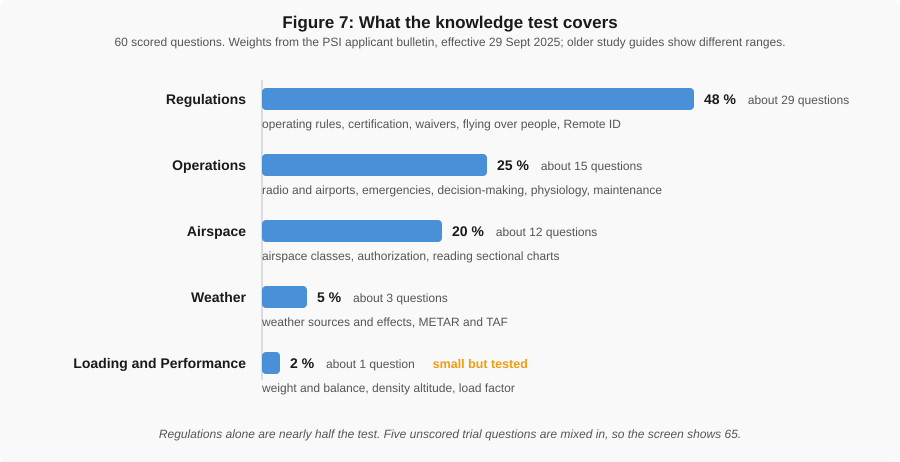{ width="100%" }
*Figure 7: Share of the 60 scored questions by knowledge area under the PSI bulletin effective 2025-09-29. Regulations alone are nearly half the test; regulations and airspace together are about two thirds.*

| Knowledge area | Share | About how many questions | What it covers |
|---|---|---|---|
| **Regulations** | **48 %** | ~29 | Part 107 operating rules, certification, waivers, operations over people, Remote ID, registration, reporting |
| **Operations** | **25 %** | ~15 | Radio and airport procedures, emergencies (batteries, lost link), aeronautical decision-making, physiology, maintenance |
| **Airspace** | **20 %** | ~12 | Airspace classes, sectional charts, special-use airspace, TFRs, authorization |
| **Weather** | **5 %** | ~3 | METAR and TAF decoding, weather theory and hazards |
| **Loading and performance** | **2 %** | ~1 | Density altitude, weight and balance, center of gravity, load factor |

### C. Sample Question

This is an actual FAA sample question (the FAA publishes its sample set without answers; the answer and explanation here are ours).

!!! note "Example Exam Question"
    **Refer to [FAA-CT-8080-2H](https://www.faa.gov/training_testing/testing/supplements), Figure 26, Area 4.**
    You have been hired to inspect the tower under construction at 46.9° N and 98.6° W, near Jamestown Regional Airport (JMS). What must you receive before flying your unmanned aircraft in this area?

    - (A) Authorization from the military
    - (B) Authorization from ATC
    - (C) Authorization from the National Park Service

    **Answer: (B).** Find Area 4 on Figure 26 and the tower symbol near JMS. The airport is ringed by a **dashed magenta line**, which is a Class E surface area, and §107.41 requires prior ATC authorization for Class B, C, D and *surface* Class E. You would request it through LAANC (§IV.C). Nothing on the chart shows military or National Park Service airspace. This is the pattern of most figure questions: find the area number, find the feature, read the symbol with the legend, and apply one rule.

    To follow along, download **FAA-CT-8080-2H**: **[Local copy (PDF, reduced resolution)](images/sport_rec_private_akts_FAA-CT-8080-2H_small.pdf)** | **[Official FAA source (full resolution)](https://www.faa.gov/training_testing/testing/supplements)**.

---

## IV. Airspace Fundamentals

Airspace is about a fifth of the test and the area students most often get wrong. You must know the airspace classes, which of them need ATC authorization, and how to find an airspace boundary on a sectional chart.

### A. National Airspace System (NAS)

The NAS divides airspace into six classes:

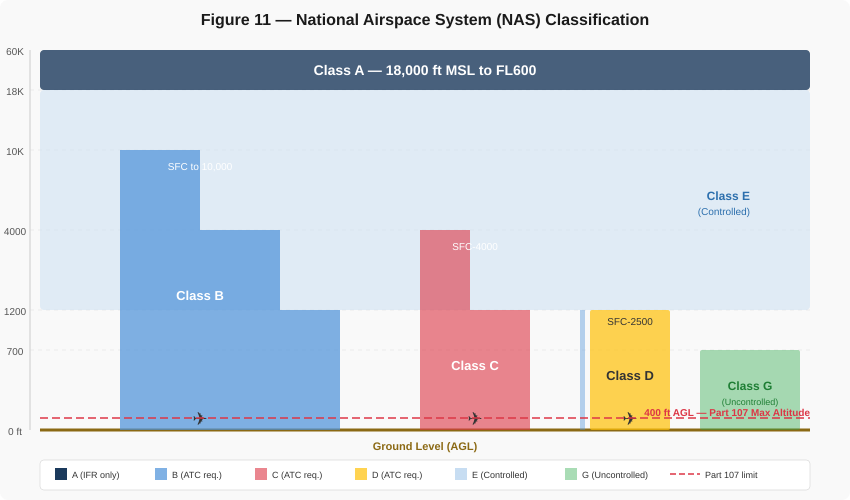{ width="100%" }
*Figure 11: Vertical profile of the National Airspace System showing all airspace classes. Note the Part 107 400 ft AGL limit at the bottom.*

| Class | Type | Altitude | ATC authorization for sUAS? | Notes |
|---|---|---|---|---|
| **A** | Controlled | 18,000 ft MSL – FL600 | N/A | Instrument flight only. No Part 107 operations. |
| **B** | Controlled | Surface to about 10,000 ft MSL, in layered shelves | **Yes** | Busiest airports (SLC, ATL). "Upside-down wedding cake." |
| **C** | Controlled | Surface to about 4,000 ft above the airport, core + shelf | **Yes** | Medium-traffic airports. |
| **D** | Controlled | Surface to about 2,500 ft above the airport | **Yes** | Towered airports such as Provo (PVU). |
| **E** | Controlled | Floor at the surface, 700 ft AGL or 1,200 ft AGL | **Only the surface area** | Most of the sky above 1,200 ft AGL. |
| **G** | **Uncontrolled** | Surface up to the Class E floor | **No** | Most sUAS flights happen here. |

**Key rule (§107.41):** You need prior ATC authorization (through LAANC or FAA DroneZone) to fly in **Class B, C, D, or the surface area of Class E** designated for an airport. Class E that starts at 700 or 1,200 ft AGL is above you, so under it you are in Class G and need no authorization — but every other Part 107 rule still applies.

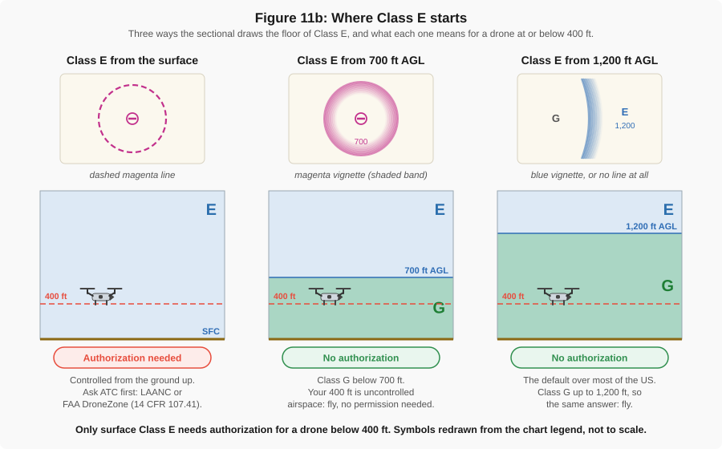{ width="100%" }
*Figure 11b: The three Class E floors as a sectional chart shows them. Only the surface area (dashed magenta) needs ATC authorization for a drone; under a 700 ft floor (shaded magenta edge) or a 1,200 ft floor (shaded blue edge, or wherever nothing is drawn) a Part 107 flight is in Class G.*

### B. Sectional Charts

Sectional charts are the standard visual flight rules (VFR) aeronautical charts. On the test you will be asked to interpret them. Key features to identify:

- **Class B airspace**: Solid **blue** lines with altitude figures (e.g., "100/40" means ceiling 10,000 ft MSL, floor 4,000 ft MSL)
- **Class C airspace**: Solid **magenta** lines, with the same ceiling/floor figures
- **Class D airspace**: Dashed **blue** lines, with the ceiling in a bracket
- **Class E surface area**: Dashed **magenta** lines
- **Airport symbols**: Blue for towered, magenta for non-towered
- **Obstructions**: Tower symbols with the top in **MSL** and, in parentheses, the height **AGL**
- **Special-use airspace**: Restricted (R), Prohibited (P), MOAs, Warning and Alert areas

!!! warning "MSL on the chart, AGL for you"
    Every altitude printed on a sectional chart is **mean sea level (MSL)** except the obstacle heights in parentheses. Your 400 ft limit and every cloud base in a weather report are **above ground level (AGL)**. Mixing the two is the single most common chart mistake on the test.

The figure below shows an excerpt of the Salt Lake City sectional chart. Notice the SLC Class B airspace depicted by concentric solid blue lines with altitude labels, restricted areas R-6404 and R-6402 shown with hatched boundaries, towered airports in blue, non-towered airports in magenta, and terrain elevation contours across the Wasatch Front corridor from Ogden down to Provo.

{ width="100%" }
*Figure 10: Excerpt from the FAA Salt Lake City Sectional Aeronautical Chart showing Class B airspace, restricted areas, airports, and terrain along the Wasatch Front. Source: [FAA VFR Raster Charts](https://www.faa.gov/air_traffic/flight_info/aeronav/digital_products/vfr/) (public domain). Not for navigation.*

The chart legend below shows the standard symbols used on all FAA sectional charts. Practice matching these symbols to what you see on the chart excerpt above — identify the airport types, airspace boundaries, obstruction markers, and communication frequencies.

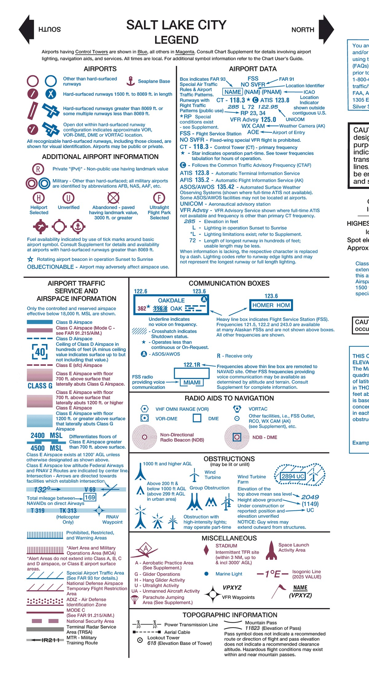{ width="100%" }
*Figure 10b: Sectional chart legend from the Salt Lake City chart showing airport symbols, airspace depictions, communication boxes, radio aids, obstructions, and topographic information. Source: [FAA VFR Raster Charts](https://www.faa.gov/air_traffic/flight_info/aeronav/digital_products/vfr/) (public domain).*

### C. LAANC Authorization

**Low Altitude Authorization and Notification Capability (LAANC)** is the FAA's automated system for airspace authorization in controlled airspace, available to Part 107 pilots and recreational flyers alike. You request it through an app or website run by one of the **FAA-approved UAS Service Suppliers** — the FAA keeps the current list, with which companies offer which services, at [faa.gov/uas/getting_started/laanc](https://www.faa.gov/uas/getting_started/laanc); Aloft is one widely used example. Through a LAANC provider you can:

- Request authorization to fly in controlled airspace around a participating airport
- Receive approval in near-real time for altitudes at or below the **UAS Facility Map** ceiling for that grid cell (never above 400 ft)
- Submit a "further coordination" request, reviewed by people, when you need to fly above the grid ceiling

If the airport does not participate in LAANC, or you need a waiver as well as an authorization, use the manual process in [FAA DroneZone](https://faadronezone-access.faa.gov/), which can take weeks.

!!! note "What LAANC is not"
    The FAA's **B4UFLY** service shows you what airspace you are in; it does not grant authorization. Manufacturer geofencing (DJI's FlySafe unlock, for example) is the manufacturer's software, not FAA permission. Only a LAANC provider or DroneZone gives you an authorization.

### D. Airports and Traffic Patterns

You may fly near an airport without authorization if it is in Class G, but §107.43 says you may not **interfere with airport operations or traffic patterns**, so you need to know where manned traffic will be. Manned aircraft fly a rectangular **traffic pattern** around the runway in use: upwind, crosswind, downwind, base, and final. The runway number is its magnetic heading divided by ten (Runway 13 points about 130°), and the standard pattern makes **left turns**, so the downwind leg is flown with the runway on the pilot's left. Test questions ask you to place an aircraft that reports "left downwind, Runway 13" on a chart.

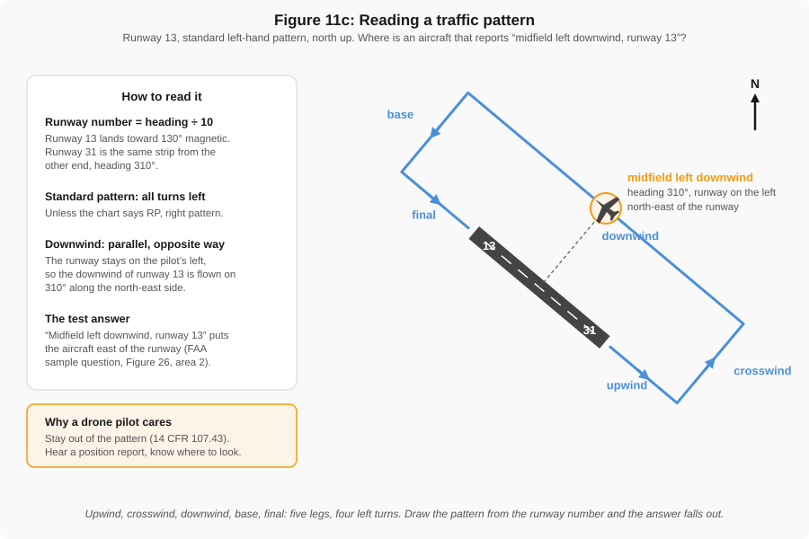{ width="100%" }
*Figure 11c: A standard left-hand traffic pattern for Runway 13. An aircraft on the left downwind flies the opposite direction to the runway (about 310°) with the runway on its left, which puts it to the northeast of the field.*

### E. Temporary Flight Restrictions, Stadiums and Game Day

A **Temporary Flight Restriction (TFR)** is airspace closed by a Notice to Air Missions (NOTAM) for a set time: wildfires, disaster response, presidential visits, space launches, and major sporting events. TFRs apply to drones (§107.47) and change daily, so check [tfr.faa.gov](https://tfr.faa.gov/) or your LAANC app before every outdoor flight.

!!! warning "Large crowds and stadiums"
    A standing FAA NOTAM, **FDC 0/0367** (the "stadium TFR"; older handouts cite its predecessor 4/3621), prohibits all manned and unmanned aircraft within **3 nautical miles** and up to **3,000 ft AGL** of any stadium seating **30,000 or more** during a Major League Baseball, National Football League, or NCAA Division I football game, and during NASCAR Cup, IndyCar and Champ Series races, from **one hour before** the scheduled start until **one hour after** the end. BYU's LaVell Edwards Stadium seats about 62,000 and hosts Division I football, so on a home game day all of campus and most of Provo is closed to drones for the duration. Only the event's own operations, security, or the broadcast rights holder can get an FAA airspace security waiver; nobody else may fly. Violations are national-defense airspace violations: civil penalties of up to $75,000, certificate action, and possible criminal charges. The FAA's [stadium page](https://www.faa.gov/uas/recreational_fliers/where_can_i_fly/airspace_restrictions/sports_stadiums) lists the week's qualifying events. Separately, a drone without the right category (§V.B) may never fly over the crowd in the stands at any time.

!!! note "Flying at BYU"
    - **Airspace.** Campus — the stadium, the Engineering Building, everything between — is inside **Provo (KPVU) Class D** (surface to 7,000 ft MSL), with a Class E surface area when the tower is closed. Both need ATC authorization. The LAANC grid ceiling over campus is 400 ft, so a **LAANC** request from the department is approved in near-real time; confirm the airspace in a LAANC app on the day.
    - **Permit.** BYU requires an [Unmanned Aircraft System permit](https://risk.byu.edu/ehs/unmanned-aircraft-system-permit) for any flight over BYU property and for any BYU-owned drone anywhere; recreational flying on campus is prohibited. The department holds the permit for class flights.
    - **Pilot.** A TA is the remote pilot in command under their Part 107 certificate; you fly under their supervision.
    - **Game day.** The stadium NOTAM above closes campus to drones for about five hours around every home football game.
    - **Utah law.** The state repeats the federal airspace rules (Utah Code 72-10-1002) and adds its own: flying over a wildfire is a crime (65A-3-2.5, a misdemeanor rising to a felony if a firefighting aircraft is brought down), and the drone may be shot down.

### Practice Questions — Airspace

!!! note "Question 4.1"
    You want to fly your sUAS at 200 ft AGL near a small airport. On the sectional chart, the airport is surrounded by a dashed magenta line. What class of airspace are you in, and do you need ATC authorization?

    - (A) Class D — yes, authorization required
    - (B) Class E surface area — yes, authorization required
    - (C) Class G — no authorization required

    **Answer: (B).** A dashed magenta line on a sectional chart indicates a Class E surface area. Because this is controlled airspace extending to the surface, §107.41 requires ATC authorization (via LAANC or FAA DroneZone) before you fly there. Remember: dashed *blue* = Class D, solid *blue* = Class B, solid *magenta* = Class C.

!!! note "Question 4.2"
    A remote pilot plans to operate an sUAS in Class G airspace at 350 ft AGL. Which statement is correct?

    - (A) No ATC authorization is needed, but all Part 107 operating rules still apply
    - (B) ATC authorization is required for any flight above 200 ft AGL
    - (C) Class G airspace does not exist below 1,200 ft AGL

    **Answer: (A).** Class G is uncontrolled airspace — no ATC authorization is needed to fly there. The remote pilot must still comply with every other Part 107 rule: VLOS, 400 ft AGL maximum, 3 SM visibility, cloud clearance, anti-collision lighting at night, yielding right of way, and no interference with airport traffic.

---

## V. Operating Rules Under Part 107

### A. Key Operational Limitations

| Rule | Requirement | Section |
|---|---|---|
| **Maximum altitude** | 400 ft above ground level (AGL) | 107.51(b) |
| **Structure exception** | May fly above 400 ft if within 400 ft horizontally of a structure and no higher than 400 ft above its top | 107.51(b) |
| **Visual line of sight** | The remote PIC (or a visual observer) must be able to see the aircraft unaided, corrective lenses excepted, at all times | 107.31 |
| **Night and twilight** | Allowed. Night needs a pilot whose test or training is dated after April 6, 2021, plus anti-collision lighting visible for 3 SM; civil twilight (30 minutes before sunrise, 30 minutes after sunset) needs the lighting | 107.29 |
| **Maximum speed** | 87 knots (100 mph) groundspeed | 107.51(a) |
| **Minimum visibility** | 3 statute miles from the control station | 107.51(c) |
| **Cloud clearance** | 500 ft below clouds, 2,000 ft horizontally from clouds | 107.51(d) |
| **Right of way** | Yield to every other aircraft; never pass over, under or ahead of one unless well clear | 107.37 |
| **People** | Over participants, people under cover or in stopped vehicles, or only within one of the four categories in §V.B | 107.39 |
| **Moving vehicles** | Over them only in a closed or restricted-access site with the occupants on notice, or while passing over without sustained flight — and only with a category that allows flight over people | 107.145 |
| **From a moving vehicle** | Never from an aircraft; from a car or boat only over a sparsely populated area | 107.25 |
| **Multiple aircraft** | One pilot, one aircraft (waivable) | 107.35 |
| **Alcohol and drugs** | No flying within 8 hours of drinking, at 0.04 alcohol concentration or above, or on impairing drugs | 107.27 |
| **Aircraft weight** | Under 55 lb (25 kg) at takeoff including payload | 107.3 |

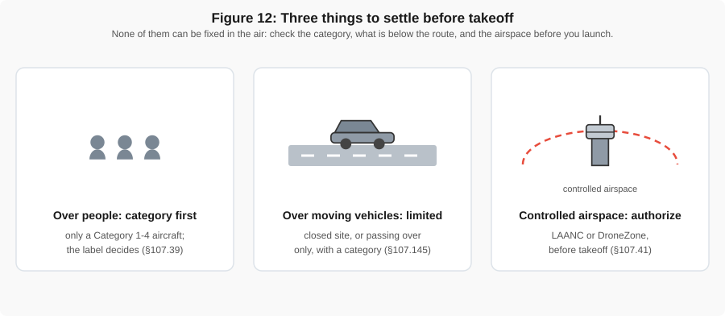{ width="100%" }
*Figure 12: Three things to settle before takeoff. Flying over people needs an aircraft whose category allows it; flying over moving vehicles is limited to closed sites or passing over; and controlled airspace needs an authorization through LAANC or DroneZone. None of them can be fixed once you are in the air.*

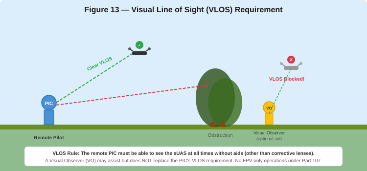{ width="100%" }
*Figure 13: The remote PIC must maintain direct visual contact with the sUAS at all times. A Visual Observer may assist but does not replace the PIC's VLOS obligation.*

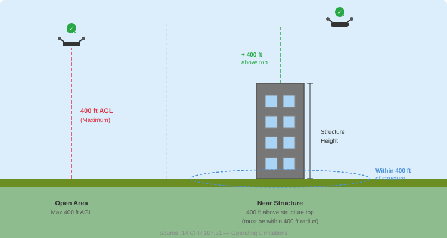{ width="100%" }
*Figure 14: In open areas, the maximum altitude is 400 ft AGL. Near a structure, you may fly up to 400 ft above the structure's top, provided you remain within 400 ft horizontally of the structure.*

### B. Operations Over People

Since April 2021, flying over people who are not part of your operation is allowed only within one of four **categories** (§107.39 and Subpart D). This is the most-missed item on the real test — the FAA's own statistics show about three quarters of candidates get the **Declaration of Compliance** question wrong — so learn it now.

| Category | What qualifies the aircraft | Over an open-air crowd? |
|---|---|---|
| **1** | 0.55 lb (250 g) or less at takeoff, including everything on board, and no exposed rotating parts that would cut skin | Only if Remote ID compliant |
| **2** | Listed on an FAA-accepted **Declaration of Compliance (DoC)** filed by the *manufacturer* showing an impact below 11 ft-lb, and carrying a label | Only if Remote ID compliant |
| **3** | DoC for impact below 25 ft-lb and label; **never** over an open-air assembly; only in a closed site with people on notice, or without sustained flight over anyone | **No** |
| **4** | An **airworthiness certificate** under Part 21, flown within its flight manual | Only if Remote ID compliant |

The remote PIC's job is to check that the aircraft is listed on a current DoC and labeled for its category. Most consumer mapping drones weigh more than 0.55 lb and carry no DoC, so they fit **no category** — they may not fly over people who are not participating, under cover, or inside a stopped car.

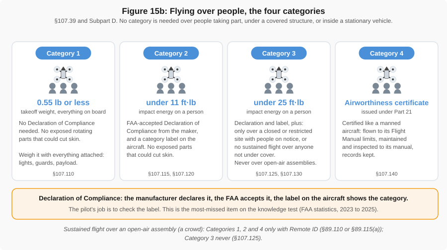{ width="100%" }
*Figure 15b: The four categories for flying over people. Categories 2 and 3 exist only because the manufacturer filed a Declaration of Compliance; Category 3 can never fly over an open-air crowd.*

### C. Waivers

The FAA may grant **waivers** for certain Part 107 rules if you show the operation can be done safely (§107.200). Applications go through FAA DroneZone, take 90 days or more, and are not guaranteed. The list of what can be waived is in §107.205; everything else cannot.

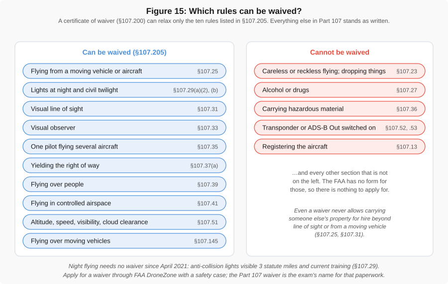{ width="100%" }
*Figure 15: Part 107 rules the FAA may waive (left) and rules that are never waived (right). Night flying is no longer on the list — since 2021 it needs lighting and current training, not a waiver.*

| Waivable (§107.205) | Not Waivable |
|---|---|
| Beyond visual line of sight (107.31) and the visual observer rule (107.33) | Registration and marking |
| Operations over people (107.39) and over moving vehicles (107.145) | Alcohol and drug limits (107.27) |
| Altitude, speed, visibility and cloud clearance (107.51) | Careless or reckless operation; dropping objects that create a hazard (107.23) |
| Multiple aircraft (107.35) | Yielding right of way (107.37(b)) |
| Operations from a moving vehicle (107.25) | Holding a Remote Pilot Certificate |
| Anti-collision lighting at night or twilight (107.29) — the lighting, not the night | Interfering with airport operations (107.43) and TFRs (107.47) |
| Controlled airspace (107.41) — in practice handled by an *authorization*, not a waiver | |

!!! warning "Important"
    A waiver does not guarantee approval. You must submit a detailed safety case explaining how you will mitigate risks. Waiver processing typically takes 90 days or more.

### D. In-Flight Emergencies

If something goes wrong, the remote PIC may break any rule in Part 107 to the extent the emergency requires (§107.21) and must send the FAA a report of the deviation only **if the FAA asks for one**. The practical side — lost link, fly-aways, low battery, GPS loss — is in [Common Flight Issues](../gen_reading/flight_issues.md); read it before the Thursday lab.

### Practice Questions — Operating Rules

!!! note "Question 5.1"
    A remote PIC is conducting a Part 107 flight at 300 ft AGL. The current weather reports visibility of 2 statute miles. Is this operation legal?

    - (A) Yes, as long as the pilot maintains VLOS with the sUAS
    - (B) No, Part 107 requires a minimum visibility of 3 statute miles
    - (C) Yes, visibility requirements only apply in controlled airspace

    **Answer: (B).** Part 107.51 requires a minimum flight visibility of 3 statute miles from the control station, regardless of airspace class. At 2 SM visibility, the pilot must not fly unless they obtain a waiver for reduced visibility operations. This rule applies in both controlled and uncontrolled airspace.

!!! note "Question 5.2"
    You are hired to inspect a 500-foot-tall radio tower. What is the maximum altitude at which you may legally operate your sUAS near this structure without a waiver?

    - (A) 400 ft AGL
    - (B) 500 ft AGL (top of the tower)
    - (C) 900 ft AGL

    **Answer: (C).** Under Part 107.51, a drone may fly higher than 400 ft AGL if it remains within 400 ft of a structure. In this case, the tower is 500 ft tall, and you may fly up to 400 ft above the top of the structure — a maximum of 900 ft AGL. The sUAS must remain within a 400-foot horizontal radius of the structure at all times while above 400 ft AGL.

!!! note "Question 5.3"
    Which of the following Part 107 restrictions can the FAA grant a waiver for?

    - (A) Operating beyond visual line of sight
    - (B) Yielding right of way to manned aircraft
    - (C) Requiring the remote PIC to hold a certificate

    **Answer: (A).** BVLOS operations (107.31) are waivable with an approved safety case. Yielding right of way to manned aircraft and the requirement for a Remote Pilot Certificate are **not** waivable under any circumstances — these are fundamental safety and legal requirements that cannot be set aside.

!!! note "Question 5.4"
    Sunset was 20 minutes ago. You passed your initial knowledge test last year, and your aircraft has a strobe visible for 3 statute miles. May you finish the flight?

    - (A) No, Part 107 flights end at sunset
    - (B) Yes, with the strobe on, because this is civil twilight
    - (C) Only with a night-operations waiver

    **Answer: (B).** Civil twilight runs for 30 minutes after official sunset and needs only anti-collision lighting visible for 3 SM (§107.29(b)). After that, night operations are also allowed, with the same lighting plus a test or training dated after April 6, 2021 — which yours is. Night waivers have not been needed since 2021.

---

## VI. Weather & Aviation Weather Services

Weather is a small share of the test (about 5 %) but a big share of real flying: wind, visibility, cloud ceiling, and temperature all affect safety and aircraft performance, and the 3 SM and cloud-clearance rules are only checkable if you can read a weather report.

### A. Basic Weather Theory

**Key concepts:**

- **Atmospheric stability**: Stable air resists vertical motion (smooth flying conditions, fog/stratus possible). Unstable air promotes vertical motion (turbulence, cumulus clouds, thunderstorms).
- **Lapse rate**: Temperature decreases approximately 2 °C per 1,000 ft in the standard atmosphere. When the actual lapse rate exceeds the standard rate, the atmosphere is unstable.
- **Dew point**: The temperature at which air becomes saturated and moisture condenses. When temperature and dew point converge (spread under about 2 °C / 4 °F), expect fog or low clouds.
- **Fog formation**: Radiation fog forms on clear, calm nights. Advection fog forms when warm, moist air moves over a cold surface. Both can reduce visibility to zero.
- **Convection**: Heating of the surface causes thermals and turbulence. Strong convection produces cumulonimbus clouds (thunderstorms) — a serious hazard to all aircraft.

### B. METARs and TAFs

**METAR** (Meteorological Aerodrome Report) gives the current observed conditions at an airport. You will be expected to decode METARs on the test.

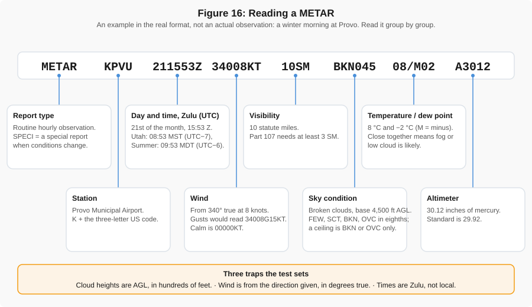{ width="100%" }
*Figure 16: A METAR read left to right: station, day and time in UTC, wind (true direction and knots), visibility, present weather, sky condition (cloud bases in hundreds of feet AGL), temperature and dew point, altimeter setting.*

**Sample METAR for Salt Lake City, group by group:**

```
METAR KSLC 121756Z 17010KT 10SM FEW080 SCT150 BKN250 27/06 A3012 RMK AO2
```

| Component | Meaning |
|---|---|
| `METAR` | Report type (routine observation; `SPECI` is a special report) |
| `KSLC` | Station identifier (Salt Lake City International) |
| `121756Z` | Date/time: 12th day, 17:56 UTC (Zulu). Utah is UTC−7 in winter and UTC−6 in summer |
| `17010KT` | Wind from 170° **true** at 10 knots (`G` would add gusts) |
| `10SM` | Visibility: 10 statute miles |
| `FEW080` | Few clouds at 8,000 ft AGL |
| `SCT150` | Scattered clouds at 15,000 ft AGL |
| `BKN250` | Broken clouds at 25,000 ft AGL — the **ceiling** is the lowest broken or overcast layer |
| `27/06` | Temperature 27 °C / dew point 6 °C |
| `A3012` | Altimeter setting: 30.12 inHg |
| `RMK AO2` | Remarks: automated station with a precipitation sensor |

**TAF** (Terminal Aerodrome Forecast) is a forecast for an airport, typically covering 24 to 30 hours. TAFs use the same codes as METARs plus change groups (`FM`, `TEMPO`, `BECMG`, `PROB`) saying when conditions are expected to change.

**Other weather products to know:**

- **AIRMET** — Advisories for moderate icing, turbulence, sustained surface winds > 30 kt, mountain obscuration, and IFR conditions
- **SIGMET** — Significant meteorological information for severe conditions (severe icing, severe turbulence, volcanic ash)
- **Convective SIGMET** — Thunderstorm-related warnings
- **PIREPs (UA)** — Pilot reports of actual conditions (turbulence, icing, cloud tops)

!!! tip "Study Tip"
    The best way to learn METAR/TAF decoding is practice. Visit [AviationWeather.gov](https://www.aviationweather.gov) and decode several real METARs for airports in your area.

### Practice Questions — Weather

!!! note "Question 6.1"
    Given the following METAR, what is the reported visibility and wind?

    `METAR KPVU 151845Z 27015G25KT 4SM -RA BKN020 OVC040 18/15 A2985 RMK AO2`

    - (A) 4 statute miles visibility; wind from 270 at 15 knots gusting to 25 knots
    - (B) 4 nautical miles visibility; wind from 150 at 27 knots
    - (C) 15 statute miles visibility; wind from 270 at 4 knots

    **Answer: (A).** In a METAR, `4SM` means 4 statute miles visibility. The wind group `27015G25KT` decodes as: wind **from** 270 degrees true (west) at 15 knots, **gusting** to 25 knots. Also note: `-RA` means light rain, `BKN020` means broken clouds at 2,000 ft AGL (the ceiling), and `18/15` shows the temperature/dew point spread is only 3 °C — conditions are moist and could deteriorate further.

!!! note "Question 6.2"
    On a clear, calm night, the surface temperature is 58 °F and the dew point is 56 °F. What weather phenomenon is most likely to develop by early morning?

    - (A) Thunderstorms
    - (B) Radiation fog
    - (C) High-altitude turbulence

    **Answer: (B).** Radiation fog forms on clear, calm nights when the ground cools by radiating heat, lowering the air temperature to the dew point. A temperature/dew point spread of only 2 °F means the air is nearly saturated. As the surface continues to cool overnight, the temperature will likely reach the dew point, producing ground-level fog. This could reduce visibility well below the 3 SM minimum required for Part 107 operations.

---

## VII. Loading, Performance & sUAS Limitations

!!! note "A minor test area"
    Loading and performance is about 2 % of the test — roughly one question. It is kept here because the physics matters on every hot summer flight in Utah, not because it will decide your score.

### A. Density Altitude

Density altitude is the altitude the aircraft "feels" based on air density. High density altitude means thinner air and reduced performance. It increases with:

- **Higher temperature** — hot air is less dense
- **Higher elevation** — less air above means less pressure
- **Higher humidity** — moist air is less dense than dry air
- **Lower barometric pressure** — fewer molecules per cubic foot

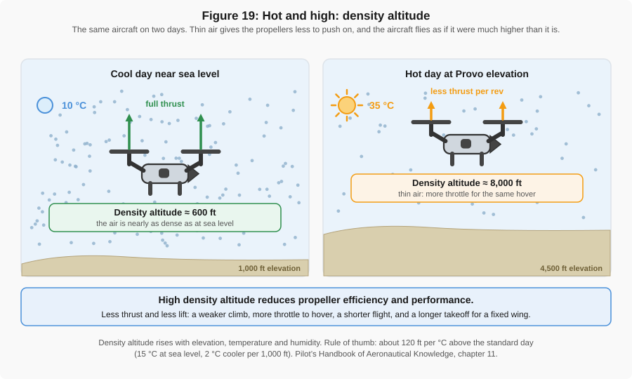{ width="100%" }
*Figure 19: Two aircraft at the same elevation on a cold day and a hot day. In the thinner hot-day air the propellers produce less thrust, the motors work harder to hover, and flight time drops. Provo at 4,500 ft on a 95 °F afternoon has a density altitude above 7,500 ft.*

**Practical impacts on sUAS:** reduced thrust and lift, shorter hover time and flight duration, higher battery consumption, and slower climbs.

### B. Weight, Balance and Center of Gravity

The center of gravity (CG) is the point where the aircraft balances. For sUAS:

- Adding a payload (camera, sensor, package) shifts the CG; follow the loading instructions in the aircraft's flight manual
- A CG outside the manufacturer's envelope causes instability, difficulty hovering, or loss of control
- Verify that total takeoff weight is under 55 lb and that every payload is secured against shifting

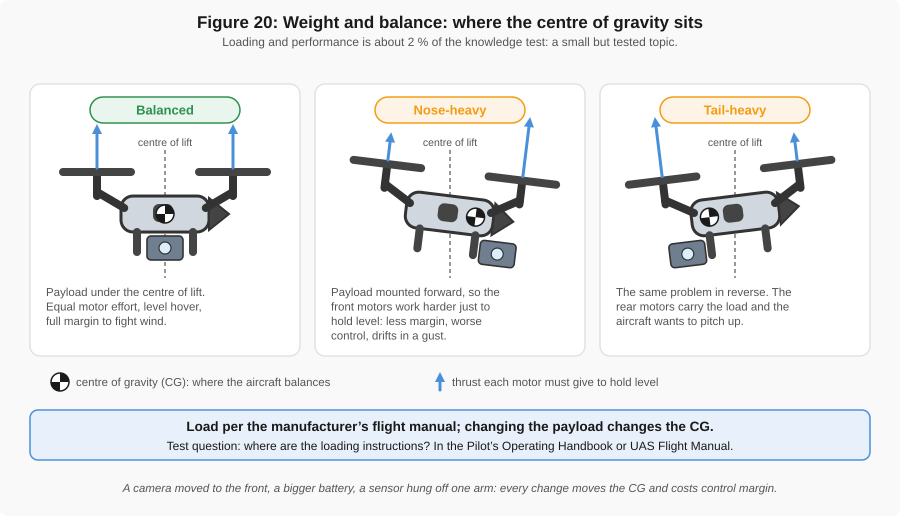{ width="100%" }
*Figure 20: The CG must stay inside the manufacturer's envelope. A correctly loaded aircraft sits inside the box; a nose-heavy or tail-heavy load sits outside it, and the aircraft pitches or drifts and the controller runs out of authority to correct it.*

### C. Load Factor in a Turn

In a banked turn the wing or rotors must carry more than the aircraft's weight. The multiplier is the **load factor**: about **1.15 at 30°**, **1.41 at 45°**, and **2.0 at 60°** of bank. A 33 lb aircraft in a 30° turn loads its structure with about 38 lb. Steep turns in gusty air are where an overloaded aircraft breaks.

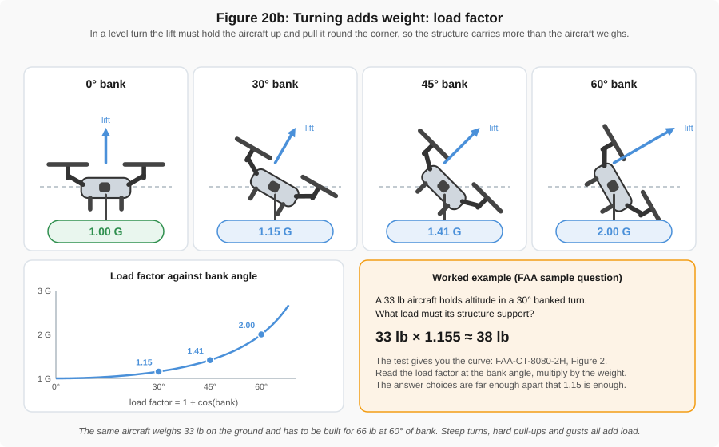{ width="100%" }
*Figure 20b: Load factor against bank angle. It rises slowly at first, then quickly: doubling at 60° and climbing steeply beyond.*

### D. Temperature and Batteries

- **Cold** reduces battery voltage and capacity — expect shorter flights in winter; warm batteries to at least 60 °F (15 °C) before flight
- **Heat** can cause batteries to overheat, cut out, or swell; never fly a swollen or smoking battery, and isolate it outdoors on a non-flammable surface
- Store and transport batteries at room temperature

### Practice Questions — Loading & Performance

!!! note "Question 7.1"
    A remote pilot is planning a flight at a field site at 6,500 ft elevation on a hot summer day (95 °F). Compared to flying the same sUAS at sea level on a standard day, the pilot should expect:

    - (A) Increased battery life due to thinner air reducing drag
    - (B) Decreased aircraft performance — reduced thrust and shorter flight time
    - (C) No change, because sUAS performance is not affected by altitude

    **Answer: (B).** High elevation and high temperature both increase density altitude, meaning the air is thinner. The drone's propellers produce less thrust in thinner air, the motors work harder to maintain hover, and battery consumption increases. At 6,500 ft on a 95 °F day, the density altitude could exceed 10,000 ft — a significant performance reduction. Always plan for shorter flights and reduced payload capacity in hot, high conditions.

!!! note "Question 7.2"
    A remote pilot attaches a heavy LiDAR sensor to the left side of a quadcopter without adding counterweight. What is the most likely effect?

    - (A) The sUAS will fly faster due to reduced drag
    - (B) The center of gravity shifts, causing the aircraft to drift or tilt and potentially become unstable
    - (C) Battery life will increase because the motors compensate automatically

    **Answer: (B).** An asymmetric payload shifts the center of gravity away from the aircraft's geometric center. The flight controller will attempt to compensate by increasing power to motors on the heavy side, but this reduces overall efficiency, shortens flight time, and may exceed the controller's ability to stabilize — especially in wind. Always mount payloads symmetrically or add counterweight to keep the CG within the manufacturer's limits.

---

## VIII. Aeronautical Decision-Making & Safety

Good decision-making is as important as technical knowledge. The FAA emphasizes Aeronautical Decision-Making (ADM) and Crew Resource Management (CRM) as core competencies for remote pilots, and they fall under Operations, a quarter of the test.

### A. Risk Management

**PAVE Checklist**

PAVE is a structured framework for pre-flight risk assessment. Before every flight, evaluate each element:

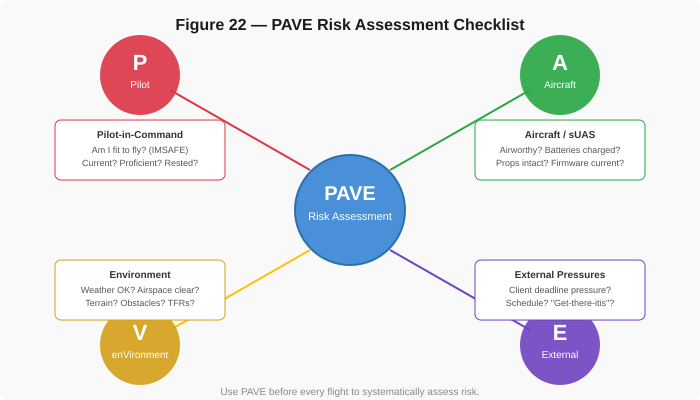{ width="100%" }
*Figure 22: The PAVE checklist systematically evaluates four risk categories before flight.*

- **P — Pilot**: Am I physically and mentally fit? Current and proficient?
- **A — Aircraft**: Is the sUAS airworthy? Batteries charged? Props inspected?
- **V — enVironment**: What is the weather? Airspace? Terrain? Obstacles? NOTAMs?
- **E — External Pressures**: Is there schedule pressure? Client demands? "Get-there-itis"?

If any element raises concern, mitigate the risk or make a no-go decision.

**IMSAFE Checklist**

IMSAFE is a personal fitness self-assessment:

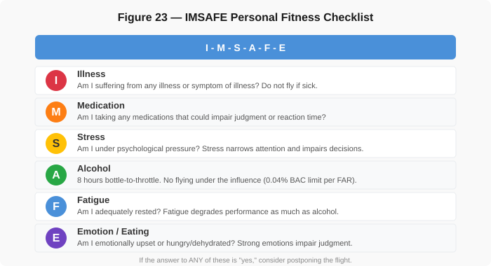{ width="100%" }
*Figure 23: The IMSAFE checklist for self-assessing personal fitness to fly.*

- **I** — Illness: Am I sick?
- **M** — Medication: Am I taking anything that impairs judgment?
- **S** — Stress: Am I under unusual psychological pressure?
- **A** — Alcohol: Have I consumed alcohol in the last 8 hours? Am I below 0.04 alcohol concentration?
- **F** — Fatigue: Am I adequately rested?
- **E** — Emotion/Eating: Am I emotionally upset? Hungry or dehydrated?

If the answer to any IMSAFE question is "yes" (or "no" for rest/eating), seriously consider postponing the flight.

### B. Crew Resource Management (CRM)

CRM applies to sUAS operations even with a single pilot. Key principles:

**Communication:**

- Brief all crew members (visual observers, ground crew, client) before the flight
- Establish clear roles: who monitors airspace, who watches for people/obstacles, who communicates with ATC
- Use standard terminology and hand signals
- Debrief after the flight to capture lessons learned

**Task Delegation:**

- Do not overload yourself — use visual observers to help scan for traffic
- Assign a dedicated person to monitor the flight app / telemetry
- If you are overwhelmed, land the aircraft and reassess

**Hazardous Attitudes:**

The FAA identifies five hazardous attitudes that lead to poor decisions. The test asks you to name the attitude from a short scenario and to pair it with its antidote.

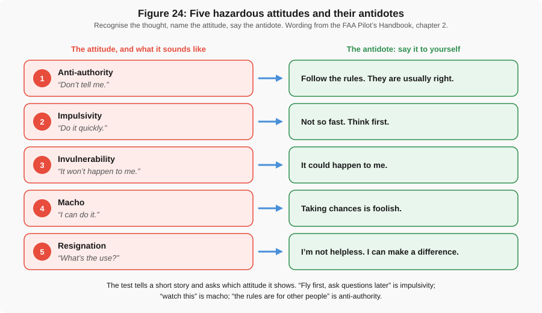{ width="100%" }
*Figure 24: The five hazardous attitudes, each paired with the antidote the FAA wants you to say to yourself.*

| Hazardous Attitude | Example | Antidote |
|---|---|---|
| **Anti-authority** | "Rules don't apply to me" | "Follow the rules — they exist for a reason" |
| **Impulsivity** | "Do something — quick!" | "Not so fast — think first" |
| **Invulnerability** | "It won't happen to me" | "It could happen to me" |
| **Macho** | "I can handle it" | "Taking chances is foolish" |
| **Resignation** | "What's the use?" | "I'm not helpless — I can make a difference" |

### Practice Questions — ADM & Safety

!!! note "Question 8.1"
    What does the "V" in the PAVE checklist stand for, and what factors does it address?

    - (A) Velocity — groundspeed and wind limitations
    - (B) enVironment — weather, airspace, terrain, obstacles, and NOTAMs
    - (C) Visibility — minimum flight visibility requirements

    **Answer: (B).** The "V" in PAVE stands for en**V**ironment and covers all external conditions affecting the flight: current and forecast weather, airspace classification and restrictions, terrain and obstacles at the operating site, and any active NOTAMs or TFRs. A thorough environmental assessment is critical — conditions that seem flyable on the ground may not be safe at altitude.

!!! note "Question 8.2"
    A remote pilot has a client deadline to deliver aerial survey data by tomorrow. The weather forecast calls for gusty winds and low visibility in the morning, but the pilot thinks, "I've flown in worse — I can handle it." Which hazardous attitude does this represent, and what is the antidote?

    - (A) Resignation — "I'm not helpless, I can make a difference"
    - (B) Anti-authority — "Follow the rules, they exist for a reason"
    - (C) Macho — "Taking chances is foolish"

    **Answer: (C).** The "macho" attitude leads pilots to take unnecessary risks to prove they can handle difficult conditions. The antidote is recognizing that "taking chances is foolish." This scenario also involves external pressure (the "E" in PAVE) — the client deadline is pushing the pilot toward a risky decision. The correct action is to delay the flight until conditions improve and communicate the delay to the client.

!!! note "Question 8.3"
    A remote pilot had three beers at dinner last night and stopped drinking at 10:00 PM. Their planned flight is at 5:30 AM the next morning. Under FAA regulations, can they legally fly?

    - (A) Yes, as long as they feel fine
    - (B) No, because the 8-hour "bottle-to-throttle" rule has not been met
    - (C) Yes, the alcohol restriction only applies to manned aircraft pilots

    **Answer: (B).** The FAA requires at least 8 hours between consuming alcohol and operating any aircraft, including sUAS (§107.27, "8 hours bottle to throttle"). From 10:00 PM to 5:30 AM is only 7.5 hours — the pilot must wait until at least 6:00 AM. Additionally, the pilot must not have an alcohol concentration of 0.04 or higher, and the "F" in IMSAFE (Fatigue) should also be considered after a late night.

---

## IX. Maintaining Currency & Responsibilities

### A. Recurrent Training

Your Remote Pilot Certificate is permanent, but you must be **current** to use it (§107.65):

- Within the previous **24 calendar months** you must have passed the initial test or completed the FAA's free online **recurrent training** (ALC-677 at [FAASafety.gov](https://www.faasafety.gov))
- "Calendar months" means the deadline is the last day of the month, 24 months after the test or training
- The training also covers rule changes since your test, which is how pilots who tested before 2021 became eligible for night flying

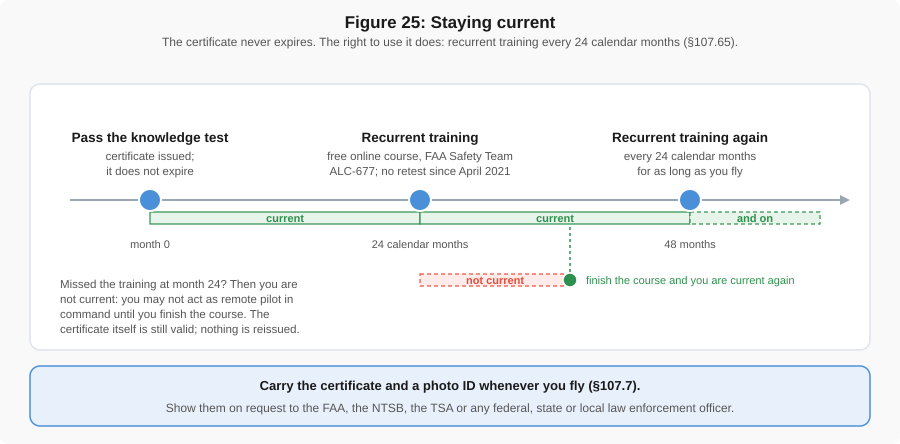{ width="100%" }
*Figure 25: Currency runs on a 24-calendar-month cycle: knowledge test, then free online recurrent training before the end of the 24th month, then again every 24 months. The certificate itself never lapses; only the right to fly under it does, and the training restores it.*

### B. Recordkeeping & Reporting

**Safety Event Reporting**

Under 14 CFR 107.9, the remote PIC must report to the FAA within **10 calendar days** if an sUAS operation results in:

- **Serious injury** to any person (requiring hospitalization, surgery, or resulting in death)
- **Loss of consciousness** of any person
- **Property damage** (other than to the sUAS) exceeding **$500** to repair or replace, whichever is lower

Reports are filed through the **FAA DroneZone** portal. Contrast this with an in-flight *emergency deviation* (§107.21), which is reported only if the FAA asks.

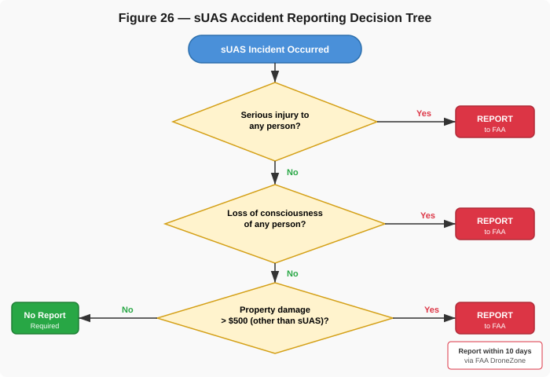{ width="100%" }
*Figure 26: Use this decision tree to determine whether an incident requires FAA reporting.*

!!! warning "Key Point"
    Damage to your own drone does NOT trigger reporting — only damage to other people's property exceeding $500, or injury/loss of consciousness of any person.

**Remote ID Requirements**

**Remote ID** (14 CFR Part 89) is a "digital license plate": the aircraft broadcasts its identity and position so that the FAA, police and other airspace users can tell who is flying. It has been required since **September 16, 2023** and enforced since **March 16, 2024**, for every aircraft that has to be registered — which is every Part 107 aircraft. There are three ways to comply:

| Way to comply | What it broadcasts | Conditions |
|---|---|---|
| **Standard Remote ID aircraft** (built in) | Aircraft ID, position, altitude and velocity; the **control station's** position and altitude; a time mark; emergency status | If the broadcast fails in flight, **land as soon as practicable** (§89.110) |
| **Broadcast module** (add-on, §89.115(a)) | The same, but the **takeoff** location instead of the control station | Module serial number on the aircraft's registration; check it works before takeoff; keep the aircraft in sight; land as soon as practicable if it stops |
| **FAA-Recognized Identification Area (FRIA)** (§89.115(b)) | Nothing | The aircraft and the pilot stay inside the FRIA for the whole flight, in sight. FRIAs are sites requested by community-based organizations and schools; they are not a route for project flying elsewhere |

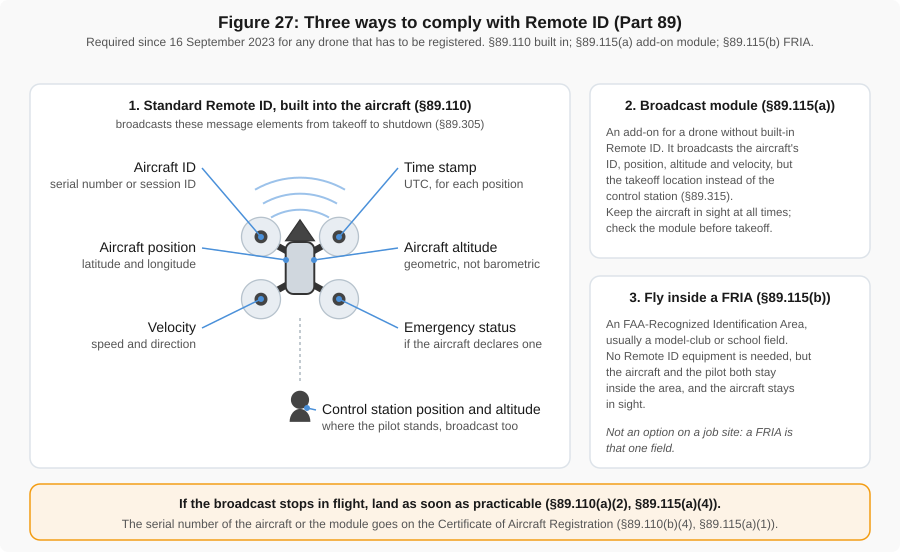{ width="100%" }
*Figure 27: What a Standard Remote ID aircraft broadcasts: its serial or session ID, position, altitude and velocity, the control station's position, a time mark, and an emergency status flag. A broadcast module sends the takeoff point instead of the control station.*

### C. Registration

Every aircraft flown under Part 107 must be **registered with the FAA** — **regardless of weight** (§107.13, §48.15). The 0.55 lb (250 g) exemption applies only to aircraft flown exclusively for recreation under 49 U.S.C. 44809. Register at [FAA DroneZone](https://faadronezone-access.faa.gov/):

- $5 per aircraft under Part 107 (each aircraft registered separately), valid for 3 years
- The owner must be at least 13 (§48.25)
- The registration number must be marked on the outside of the aircraft, and the Remote ID serial number recorded on the registration

### Practice Questions — Currency & Responsibilities

!!! note "Question 9.1"
    During an sUAS mapping operation, the drone strikes a parked car, causing $750 in damage to the vehicle. The drone is also damaged, but no one is injured. Is the remote PIC required to report this to the FAA?

    - (A) No, because no one was injured
    - (B) Yes, because property damage (other than to the sUAS) exceeds $500
    - (C) No, because the total damage is under $1,000

    **Answer: (B).** Under 14 CFR 107.9, the remote PIC must report to the FAA within 10 calendar days if an operation causes serious injury, loss of consciousness, or damage to property (other than the sUAS itself) exceeding $500. The $750 damage to the parked car triggers the reporting requirement. Damage to your own drone does not count toward the $500 threshold.

!!! note "Question 9.2"
    A remote pilot's sUAS does not have built-in Remote ID capability. Which of the following is a compliant way to operate under current regulations?

    - (A) Operate normally — Remote ID is optional for Part 107 pilots
    - (B) Attach an FAA-accepted Remote ID broadcast module to the sUAS
    - (C) File a Remote ID exemption through IACRA before each flight

    **Answer: (B).** Remote ID has been required since September 2023 and enforced since March 16, 2024, for every registered aircraft. If the drone lacks built-in Standard Remote ID, the pilot can attach an FAA-accepted broadcast module (and list its serial number on the registration), or fly only inside a FRIA. There is no per-flight exemption.

!!! note "Question 9.3"
    You buy a 0.5 lb (230 g) drone to photograph a construction site for a client. Must it be registered?

    - (A) No, it is under 0.55 lb
    - (B) Yes, every aircraft flown under Part 107 is registered regardless of weight
    - (C) Only if it flies above 200 ft AGL

    **Answer: (B).** The 0.55 lb exemption in §48.15 applies only to aircraft flown *exclusively* for recreation. Any Part 107 flight requires registration, and therefore Remote ID as well.

---

## Key Takeaways

1. **Part 107 governs every non-recreational flight** — paid or not, including class projects — with a certificated remote pilot in command; in this class that is a TA
2. **Pass the UAG knowledge test** (60 scored questions, 70 % to pass) and clear the TSA check; the certificate never expires, the free recurrent training every 24 calendar months keeps you current
3. **Regulations are nearly half the test** and airspace a fifth — know the operating rules by section number and practice reading sectional charts
4. **Operating rules**: 400 ft AGL, keep it in sight, 100 mph, 3 SM visibility, yield to every aircraft, lighting at night, over people only by category
5. **Get ATC authorization** through LAANC before flying in Class B, C, D or surface Class E; check TFRs, including the stadium rule, before every outdoor flight
6. **Use PAVE and IMSAFE** before every flight for structured risk assessment
7. **Report safety events** to the FAA within 10 days if serious injury, loss of consciousness, or over $500 of property damage occurs
8. **Register every Part 107 aircraft** and keep Remote ID broadcasting

---

## References

- [14 CFR Part 107 — Small Unmanned Aircraft Systems](https://www.ecfr.gov/current/title-14/chapter-I/subchapter-F/part-107) — Full regulatory text (eCFR)
- [14 CFR Part 89 — Remote Identification](https://www.ecfr.gov/current/title-14/chapter-I/subchapter-F/part-89)
- [AC 107-2A, Small Unmanned Aircraft Systems](https://www.faa.gov/documentlibrary/media/Advisory_Circular/AC_107-2A.pdf) — The FAA's plain-language guide to Part 107, including night, operations over people and Remote ID
- [FAA — Become a Certificated Remote Pilot](https://www.faa.gov/uas/commercial_operators/become_a_drone_pilot/) — The official step list
- [FAA Airman Knowledge Testing Supplement](https://www.faa.gov/training_testing/testing/supplements) — The figures used in the actual exam
- [FAA LAANC](https://www.faa.gov/uas/getting_started/laanc) — How it works and the current list of approved providers
- [FAA Temporary Flight Restrictions](https://tfr.faa.gov/) — Active TFRs
- [FAA DroneZone](https://faadronezone-access.faa.gov/) — Registration, waivers, and safety event reporting
- [IACRA](https://iacra.faa.gov) — Integrated Airman Certification and Rating Application
- [FAASafety.gov](https://www.faasafety.gov) — Recurrent training (ALC-677)
- [AviationWeather.gov](https://www.aviationweather.gov) — METARs, TAFs, and graphical weather products
- [Study Resources](part_107_resources.md) — Study guides, practice tests and videos
