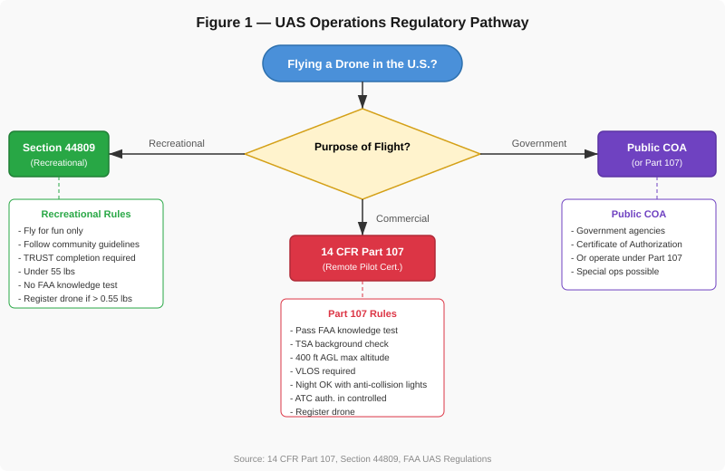

# Part 107, Week 2 — Which Rules Apply to Your Flight?

!!! abstract "Key Takeaways"
    - Ask **why** you are flying, not what you are flying. The same drone can be flown under either set of rules.
    - Flying **purely for fun** is recreational flying (49 U.S.C. 44809). You need the free **TRUST** certificate.
    - **Everything else** (paid work, a business, research, a class project) is flown under **14 CFR Part 107**, by a pilot holding a **Remote Pilot Certificate**.
    - In this class, outdoor flights are Part 107 flights. A **TA is the remote pilot in command**, and you fly the controls under their direct supervision.

---

## Two sets of rules

| | Recreational (49 U.S.C. 44809) | Part 107 |
|---|---|---|
| **Who** | Anyone flying strictly for fun | Anyone flying for any other purpose: paid work, a business, research, a class project, volunteer work for an organization |
| **Certificate** | Pass TRUST (free, online, never expires) and carry proof | Remote Pilot Certificate: FAA knowledge test plus a TSA security check |
| **Getting paid** | Not allowed | Allowed |

A flight does not have to be paid to fall under Part 107. A class project or a research flight is not recreation, so most mapping flights you will make as a student or an engineer are Part 107 flights. Someone without a certificate may fly the controls only under the direct supervision of a **remote pilot in command (remote PIC)** who can take over immediately (§107.12).

{ width="100%" }
*Figure 1: The question to ask first is why you are flying. Purely for fun leads to the recreational rules; any other purpose leads to Part 107.*

---

## How class flights work

- **Indoor flights** with the small drones (Weeks 2 and 3) are inside a building, which is not part of the National Airspace System, so neither set of rules applies. You still need your TRUST certificate for this class.
- **Outdoor flights** are Part 107 flights. A TA is the remote PIC under their own certificate.
- All of campus is in controlled airspace, so every campus flight also needs an authorization. That is the Week 5 topic.

---

## Practice

!!! question "1. A walk in the park"
    On a Saturday you fly your own drone at a park, just to see the view. Which rules apply?

    - (A) Part 107, because the drone is in the air outside
    - (B) The recreational rules, because the flight is purely for fun
    - (C) No rules, because it is your own drone

??? success "Answer"
    **(B).** The purpose decides. A flight purely for personal enjoyment is recreational; you need your TRUST certificate and must follow the recreational safety guidelines.

!!! question "2. The class project"
    Your final project group maps a parking lot for this class. Nobody is paid. Which rules apply?

    - (A) The recreational rules, because nobody is paid
    - (B) Part 107, because a class project is not recreation

??? success "Answer"
    **(B).** A flight does not need to be paid to be a Part 107 flight. Class projects and research are not recreation, which is why a TA flies as the remote PIC on every class flight.

!!! question "3. Fifty dollars"
    A neighbor offers you $50 to photograph their house for a real-estate listing. Do you need a Remote Pilot Certificate?

    - (A) No, the flight is over private property
    - (B) No, the payment is under $100
    - (C) Yes, the flight is for compensation

??? success "Answer"
    **(C).** There is no dollar threshold. Any compensation makes it a Part 107 flight, and where the flight happens does not change that.

---

**Read more:** [Which rules apply to your flight?](../faa_exam_planning_and_overview.md#b-which-rules-apply-to-your-flight) on the Week 3 reading. Back to [Part 107 Every Week](index.md).
