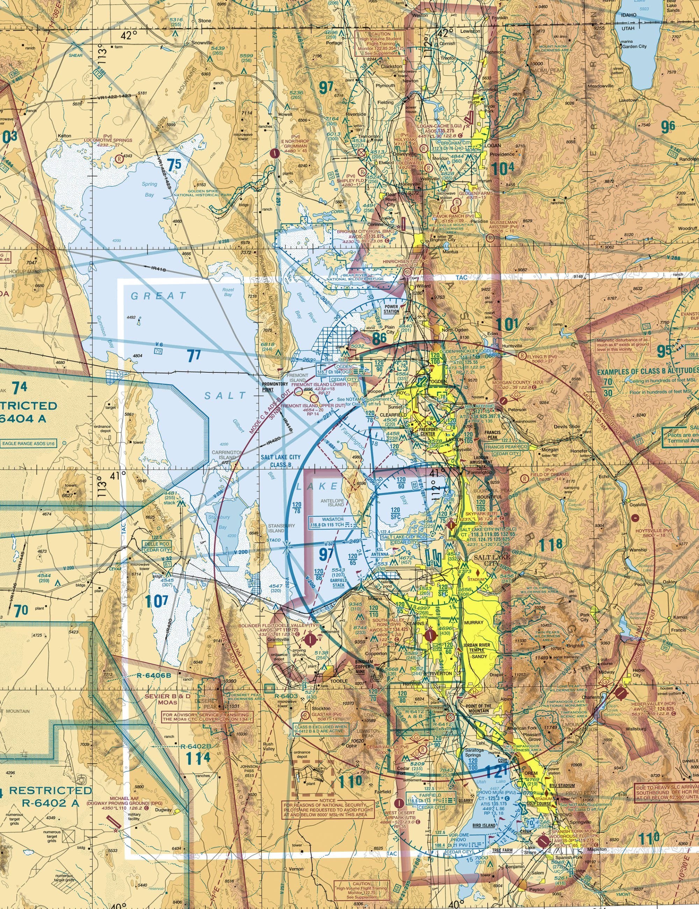
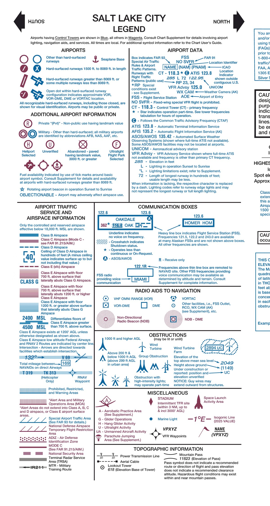

# Part 107, Week 4 — Reading a Sectional Chart

!!! abstract "Key Takeaways"
    - A **sectional chart** is the map pilots use. About a fifth of the test is airspace, and most of it is read off sectional charts.
    - Positions on a chart are given in **latitude and longitude**, the same coordinates you set up in QGIS this week.
    - Every altitude printed on a sectional is in feet above **mean sea level (MSL)**, except obstacle heights in parentheses, which are **above ground level (AGL)**. Your 400 ft limit is AGL.
    - The **legend** explains every symbol. Learn where it is in the testing supplement.

---

## Finding a place on the chart

Test questions point you to a spot two ways: an **area number** printed on the supplement figure, or a **latitude and longitude** such as "46.9° N, 98.6° W". Sectional charts carry a grid of latitude and longitude lines, with small tick marks along them so you can count to the exact position. This is the same coordinate idea as this week's lecture: a position on the Earth written as two angles.

{ width="100%" }
*Figure 10: Excerpt from the FAA Salt Lake City sectional chart: Class B airspace in solid blue around Salt Lake City, restricted areas with hatched edges, and towered airports in blue. Source: [FAA VFR Raster Charts](https://www.faa.gov/air_traffic/flight_info/aeronav/digital_products/vfr/) (public domain). Not for navigation.*

---

## Symbols to know first

| On the chart | Means |
|---|---|
| Solid **blue** lines with numbers like `100/40` | Class B airspace: ceiling 10,000 ft MSL, floor 4,000 ft MSL (hundreds of feet) |
| Solid **magenta** lines | Class C airspace |
| Dashed **blue** line | Class D airspace |
| Dashed **magenta** line | Class E airspace starting at the surface |
| Blue airport symbol | Towered airport |
| Magenta airport symbol | Non-towered airport |
| Tower symbol with `2049 (450)` | Top of the obstacle at 2,049 ft MSL; the obstacle is 450 ft tall (AGL) |

{ width="100%" }
*Figure 10b: The sectional chart legend. Source: [FAA VFR Raster Charts](https://www.faa.gov/air_traffic/flight_info/aeronav/digital_products/vfr/) (public domain).*

!!! warning "MSL on the chart, AGL for you"
    Mixing up MSL and AGL is the most common chart mistake on the test. The chart speaks in sea-level feet; you fly in feet above the ground under you.

---

## Practice

!!! question "1. The tower"
    A chart shows a tower labeled `2049 (450)`. How tall is the tower, and what is the ground elevation at its base?

    - (A) 2,049 ft tall; the ground is at 450 ft MSL
    - (B) 450 ft tall; the ground is at about 1,599 ft MSL
    - (C) 450 ft tall; the ground is at 2,049 ft MSL

??? success "Answer"
    **(B).** The top is 2,049 ft MSL and the number in parentheses is the height above ground, 450 ft. The ground is 2,049 − 450 = 1,599 ft MSL.

!!! question "2. The shelf"
    Inside a solid blue boundary you see `80/50`. What does it mean?

    - (A) Class B from 5,000 ft MSL up to 8,000 ft MSL
    - (B) Class B from 50 ft AGL up to 80 ft AGL
    - (C) Class C from 8,000 ft MSL down to 5,000 ft AGL

??? success "Answer"
    **(A).** Solid blue is Class B, and the figures are ceiling over floor in hundreds of feet MSL. Where the ground is well below 5,000 ft MSL, a drone flying at 400 ft AGL stays under that shelf.

!!! question "3. Try it on the supplement"
    Open the [testing supplement](../images/sport_rec_private_akts_FAA-CT-8080-2H_small.pdf), find the sectional chart legend, and find the symbol for a non-towered airport. What color is it?

??? success "Answer"
    **Magenta.** Towered airports are blue. Practicing this kind of look-up before the test is the single best use of the supplement.

---

**Read more:** [Sectional Charts](../faa_exam_planning_and_overview.md#b-sectional-charts) on the Week 3 reading. Back to [Part 107 Every Week](index.md).
