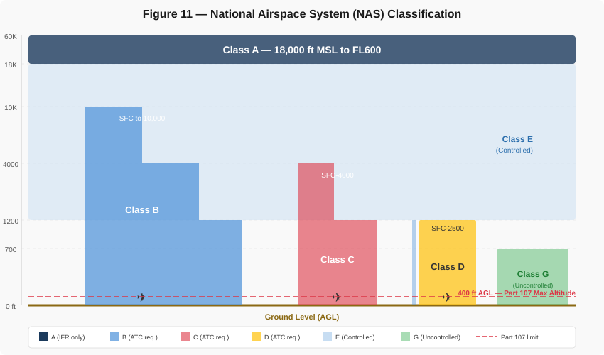
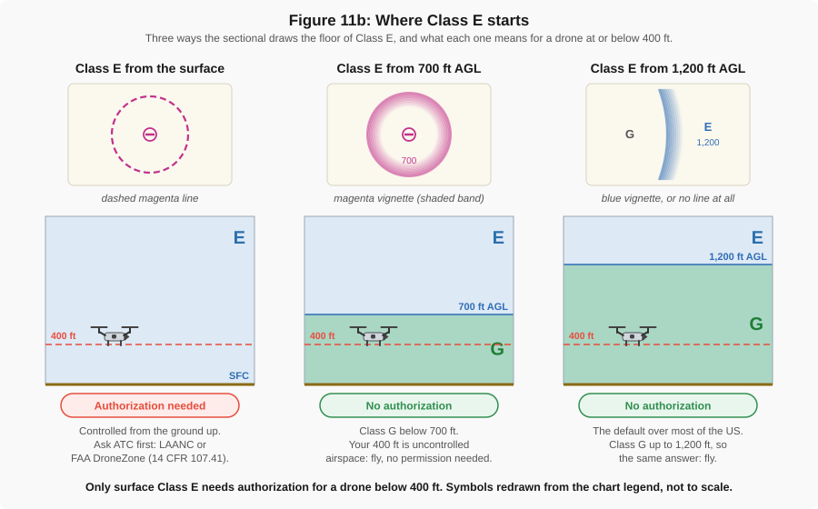

# Part 107, Week 5 — Airspace Classes and Authorization

!!! abstract "Key Takeaways"
    - The sky is divided into **classes**: A, B, C, D and E are controlled; G is uncontrolled.
    - Before flying in **Class B, C, D, or Class E that starts at the surface**, you need an **ATC authorization** (§107.41), usually through **LAANC**.
    - Class E with a floor at 700 or 1,200 ft AGL is above you. Under it you are in Class G and need no authorization, but every other Part 107 rule still applies.
    - **All of BYU campus is inside Provo's Class D airspace**, so every class flight on campus needs an authorization.

---

## The classes

{ width="100%" }
*Figure 11: The airspace classes in profile. The Part 107 limit of 400 ft AGL is the thin band at the bottom.*

| Class | Where | Authorization needed for a drone? |
|---|---|---|
| **B** | Around the busiest airports, such as Salt Lake City | **Yes** |
| **C** | Around medium-traffic airports | **Yes** |
| **D** | Around towered airports, such as Provo (PVU) | **Yes** |
| **E** at the surface | Around some airports, shown by a dashed magenta line | **Yes** |
| **E** starting at 700 or 1,200 ft AGL | Most of the sky above that floor | No; you are below it, in Class G |
| **G** | From the ground up to the Class E floor | No |
| **A** | 18,000 ft MSL and up | Not used by drones |

{ width="100%" }
*Figure 11b: The three Class E floors as a sectional chart shows them. Only the surface area (dashed magenta) needs authorization for a drone.*

---

## Getting authorization: LAANC

**LAANC** (Low Altitude Authorization and Notification Capability) is the FAA's automated system for approving flights in controlled airspace. You request it through an FAA-approved app or website. Requests at or below the ceiling on the FAA's grid map for that spot (never above 400 ft) are usually approved in near-real time. Anything else goes through **FAA DroneZone**, which can take weeks.

!!! note "What does not count as authorization"
    The FAA's **B4UFLY** app tells you what airspace you are in, but it does not grant authorization. A manufacturer's geofence unlock (DJI's, for example) is the manufacturer's software, not FAA permission.

**At BYU:** campus is inside Provo Class D, and the LAANC grid ceiling over campus is 400 ft, so the department's LAANC request is approved in near-real time. Campus flights also need BYU's own drone permit, which the department holds for class flights.

---

## Practice

!!! question "1. The dashed line"
    You plan to fly at 200 ft AGL near an airport surrounded by a dashed **blue** line. Do you need authorization?

    - (A) No, you are under 400 ft
    - (B) Yes, it is Class D airspace
    - (C) Only if the airport is open

??? success "Answer"
    **(B).** A dashed blue line marks Class D. §107.41 requires ATC authorization, usually through LAANC, before flying there at any height.

!!! question "2. Under the shaded edge"
    Your site sits under Class E airspace with a 700 ft AGL floor and nothing else is shown. You plan to fly at 300 ft AGL. Do you need authorization?

    - (A) Yes, Class E is controlled airspace
    - (B) No, below 700 ft AGL you are in Class G

??? success "Answer"
    **(B).** That Class E starts 400 ft above your highest point. You are in Class G, so no authorization is needed. Every other Part 107 rule still applies.

!!! question "3. The app says yes"
    The B4UFLY app shows your campus site in Class D. Does that count as permission to fly?

??? success "Answer"
    **No.** B4UFLY only shows the airspace. Authorization comes from a LAANC provider or from FAA DroneZone.

---

**Read more:** [Airspace Fundamentals](../faa_exam_planning_and_overview.md#iv-airspace-fundamentals) on the Week 3 reading. Back to [Part 107 Every Week](index.md).
