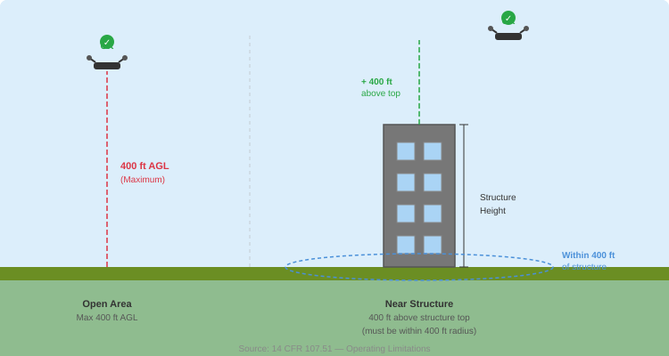
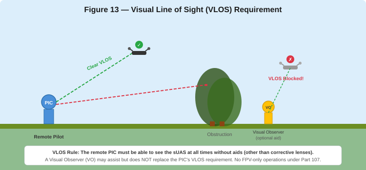

# Part 107, Week 6 — Operating Limits: How High, How Far, When

!!! abstract "Key Takeaways"
    - **400 ft AGL** is the ceiling, with one exception: within 400 ft of a structure you may fly up to 400 ft above its top.
    - Keep the aircraft in **visual line of sight**, with your own eyes (glasses are fine; binoculars are not).
    - You need **3 statute miles of visibility** and must stay **500 ft below and 2,000 ft sideways** from clouds.
    - **Night and twilight flying are legal** with anti-collision lighting visible for 3 statute miles; night also needs a test or training dated after April 6, 2021.
    - These limits shape a mission plan: pick an altitude for your ground sample distance, and then check it against them.

---

## The limits

| Rule | Requirement | Section |
|---|---|---|
| Maximum altitude | 400 ft AGL | 107.51(b) |
| Structure exception | Above 400 ft only within 400 ft horizontally of a structure, and no higher than 400 ft above its top | 107.51(b) |
| Visual line of sight | The pilot (or a visual observer) sees the aircraft unaided at all times | 107.31 |
| Visibility | At least 3 statute miles from the control station | 107.51(c) |
| Cloud clearance | 500 ft below clouds, 2,000 ft horizontally from them | 107.51(d) |
| Speed | 87 knots (100 mph) groundspeed | 107.51(a) |
| Night and twilight | Anti-collision lighting visible for 3 SM; for night, a test or training dated after April 6, 2021. Civil twilight is 30 minutes before sunrise and after sunset | 107.29 |
| Right of way | Yield to every other aircraft | 107.37 |

{ width="100%" }
*Figure 14: In open areas the limit is 400 ft AGL. Near a structure you may fly up to 400 ft above its top while staying within 400 ft of it horizontally.*

{ width="100%" }
*Figure 13: The remote pilot keeps the aircraft in sight. A visual observer can help but does not replace that duty.*

---

## Connecting to mission planning

This week's lecture picks a flight altitude from the ground sample distance you need. The plan then has to pass these rules: the altitude is AGL, so a site on a slope or below the takeoff point needs care; the whole flight path must stay in sight; and the flight has to finish before twilight unless the aircraft carries the right lighting.

---

## Practice

!!! question "1. Higher for a better footprint"
    To cover a large field faster, you plan a mapping flight at 450 ft AGL over open ground. Is this legal without a waiver?

??? success "Answer"
    **No.** Over open ground the limit is 400 ft AGL. The structure exception applies only within 400 ft horizontally of a structure.

!!! question "2. The building"
    You are inspecting a 250 ft building and stay within 400 ft of it. What is the highest you may fly?

    - (A) 400 ft AGL
    - (B) 650 ft AGL
    - (C) 250 ft AGL

??? success "Answer"
    **(B).** Up to 400 ft above the top of the structure: 250 + 400 = 650 ft AGL, as long as you stay within 400 ft of it horizontally.

!!! question "3. After sunset"
    Sunset was 20 minutes ago and your drone has a strobe visible for 3 statute miles. Can you keep flying?

??? success "Answer"
    **Yes.** This is civil twilight (up to 30 minutes after sunset), which needs only the anti-collision lighting. Night flying after that is also allowed with the lighting and current training; no waiver is needed.

---

**Read more:** [Key Operational Limitations](../faa_exam_planning_and_overview.md#a-key-operational-limitations) on the Week 3 reading. Back to [Part 107 Every Week](index.md).
