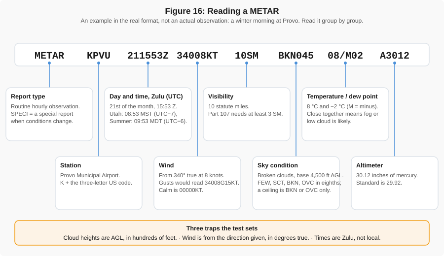

# Part 107, Week 8 — Reading a METAR

!!! abstract "Key Takeaways"
    - A **METAR** is an airport's current weather report, written in a fixed order of short codes.
    - Read it left to right: station, day and time (UTC), wind, visibility, weather, clouds, temperature and dew point, altimeter.
    - Wind direction is where the wind blows **from**, in degrees true; speed is in **knots**. Cloud heights are in **hundreds of feet AGL**.
    - Two Part 107 rules can be checked straight from a METAR: **3 statute miles of visibility**, and staying **500 ft below the clouds**.
    - This is the week of the Rock Canyon flight. Look up the Provo METAR (KPVU) before lab.

---

## Decoding a METAR

{ width="100%" }
*Figure 16: A METAR read left to right.*

```
METAR KSLC 121756Z 17010KT 10SM FEW080 SCT150 BKN250 27/06 A3012
```

| Group | Meaning |
|---|---|
| `KSLC` | Salt Lake City International |
| `121756Z` | The 12th of the month, 17:56 UTC ("Z"). Utah is UTC−7 in winter, so 10:56 a.m. |
| `17010KT` | Wind from 170° true at 10 knots. `G` adds gusts: `17010G20KT` |
| `10SM` | Visibility 10 statute miles |
| `FEW080` `SCT150` `BKN250` | Few clouds at 8,000 ft AGL, scattered at 15,000, broken at 25,000 |
| `27/06` | Temperature 27 °C, dew point 6 °C. `M` means minus: `M03` is −3 °C |
| `A3012` | Altimeter setting 30.12 inches of mercury |

The **ceiling** is the lowest layer reported as broken (`BKN`) or overcast (`OVC`). Common weather codes: `RA` rain, `SN` snow, `BR` mist, `FG` fog; `-` means light and `+` means heavy.

---

## Go or no-go

Before a flight, check two numbers in the METAR against Part 107:

1. **Visibility** must be at least 3 statute miles.
2. **Cloud clearance:** stay 500 ft below the clouds. With a ceiling at 800 ft AGL, the highest you can fly is 300 ft AGL.

Then check the wind against what the aircraft can handle; that limit comes from the aircraft, not from Part 107. Current METARs are free at [AviationWeather.gov](https://aviationweather.gov).

---

## Practice

!!! question "1. A winter morning in Provo"
    `METAR KPVU 231755Z 33012G22KT 2SM -SN BKN008 OVC015 M02/M04 A3004`

    Can you fly a Part 107 mapping mission right now?

??? success "Answer"
    **No.** Visibility is 2 statute miles (`2SM`), below the 3 SM minimum. The wind is also from 330° at 12 knots gusting to 22, there is light snow (`-SN`), and the ceiling is 800 ft AGL. It is −2 °C, which shortens battery life too.

!!! question "2. The cloud limit"
    Visibility is 10 statute miles and the METAR reports `BKN006`. What is the highest you may fly?

    - (A) 400 ft AGL
    - (B) 100 ft AGL
    - (C) 600 ft AGL

??? success "Answer"
    **(B).** The ceiling is 600 ft AGL, and you must stay 500 ft below the clouds: 600 − 500 = 100 ft AGL.

!!! question "3. Which way?"
    The wind group reads `09015KT`. Which way is the wind blowing?

??? success "Answer"
    **From the east (090°) toward the west,** at 15 knots. METAR wind is always the direction it comes from.

---

**Read more:** [METARs and TAFs](../faa_exam_planning_and_overview.md#b-metars-and-tafs) on the Week 3 reading. Back to [Part 107 Every Week](index.md).
