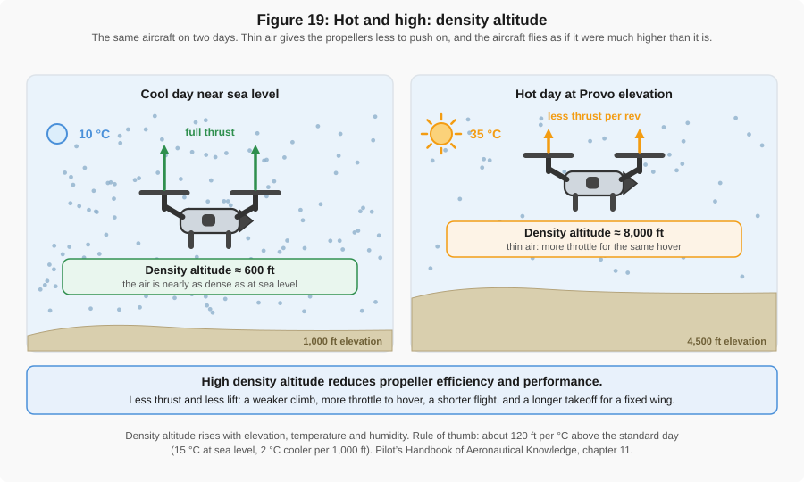

# Part 107, Week 9 — Weather, Density Altitude, and Batteries

!!! abstract "Key Takeaways"
    - When the **temperature and dew point** are within about 2 °C (4 °F) of each other, expect **fog or low clouds**.
    - A **TAF** is an airport forecast. It uses METAR codes plus change groups such as `FM` (from).
    - **Density altitude** is the altitude the aircraft "feels". Heat, high elevation, humidity, and low pressure all make it higher, and a higher density altitude means less thrust and shorter flights.
    - **Cold batteries** hold less charge. Warm them to at least 60 °F (15 °C) before winter flights.

---

## Weather in one page

- **Dew point** is the temperature at which the air becomes saturated. A small temperature–dew point spread means fog or low clouds are close.
- **Radiation fog** forms on clear, calm nights as the ground cools. It is why early-morning winter flights in Utah valleys get cancelled.
- **Stable air** is smooth but can hold fog and haze; **unstable air** brings turbulence, cumulus clouds, and thunderstorms.

A **TAF** (Terminal Aerodrome Forecast) covers about 24 to 30 hours for an airport:

```
TAF KPVU 231720Z 2318/2418 34010KT P6SM BKN040 FM240200 VRB03KT P6SM SCT050
```

Valid from the 23rd at 18:00 UTC to the 24th at 18:00 UTC: wind from 340° at 10 knots, visibility more than 6 statute miles (`P6SM`), broken clouds at 4,000 ft. **From** the 24th at 02:00 UTC (`FM240200`), light and variable wind and scattered clouds at 5,000 ft. Other change groups: `TEMPO` (temporary), `BECMG` (becoming), `PROB30` (30 % chance).

---

## Density altitude and performance

{ width="100%" }
*Figure 19: The same aircraft on a cold day and a hot day. In thinner air the propellers make less thrust, the motors work harder, and flight time drops.*

Density altitude goes **up** with higher temperature, higher elevation, higher humidity, and lower pressure. Provo sits at about 4,500 ft; on a 95 °F afternoon the air behaves as if it were above 7,500 ft. Expect less thrust, slower climbs, and shorter flights.

**Winter is the opposite problem.** Cold air is dense, which helps the propellers, but cold **batteries** lose voltage and capacity. Keep batteries warm until takeoff (at least 60 °F / 15 °C), plan shorter flights, and land with more reserve than in summer.

---

## Practice

!!! question "1. Early morning"
    At 6 a.m. the temperature is 1 °C and the dew point is 0 °C, with clear skies and no wind overnight. What should you expect?

??? success "Answer"
    **Fog,** most likely radiation fog. A 1 °C spread on a clear, calm night means the air is nearly saturated. Visibility could drop below the 3 statute mile minimum.

!!! question "2. The change group"
    In a TAF, what does `FM241500` mean?

    - (A) Forecast made on the 24th at 15:00 UTC
    - (B) From the 24th at 15:00 UTC, conditions change to what follows
    - (C) Fog and mist on the 24th

??? success "Answer"
    **(B).** `FM` starts a new set of forecast conditions at that day and UTC time.

!!! question "3. Hot and high"
    Compared with a cold morning, how will your drone perform at the same site on a hot afternoon?

??? success "Answer"
    **Worse.** Hot air is less dense, so density altitude is higher: less thrust, more power to hover, and shorter flight time.

---

**Read more:** [Weather](../faa_exam_planning_and_overview.md#vi-weather-aviation-weather-services) and [Loading and Performance](../faa_exam_planning_and_overview.md#vii-loading-performance-suas-limitations) on the Week 3 reading. Back to [Part 107 Every Week](index.md).
