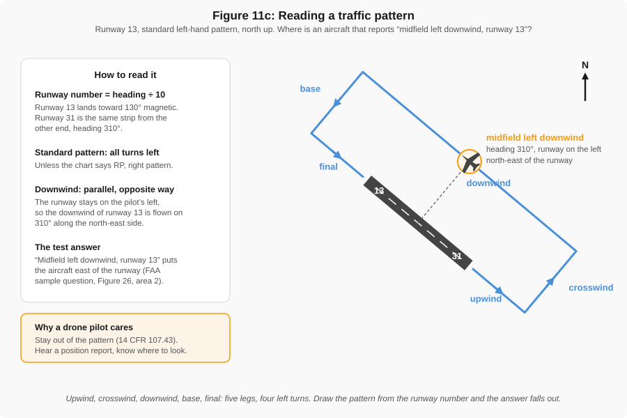

# Part 107, Week 11 — Airports, Traffic Patterns, and TFRs

!!! abstract "Key Takeaways"
    - Even where no authorization is needed, you may **not interfere with airport traffic** (§107.43), so you need to know where airplanes fly.
    - A **runway number** is its magnetic heading divided by ten: Runway 13 points about 130°.
    - The standard **traffic pattern** makes **left turns**, so the runway stays on the pilot's left.
    - A **Temporary Flight Restriction (TFR)** closes airspace for a time. Check for TFRs before every outdoor flight, including project flights.
    - On **BYU home football game days**, the stadium TFR closes campus to drones.

---

## Runways and the traffic pattern

Airplanes landing at an airport fly a rectangle around the runway in use: upwind, crosswind, **downwind**, base, and final. The downwind leg runs parallel to the runway in the opposite direction. With standard **left** traffic, the runway is on the pilot's left the whole way around.

{ width="100%" }
*Figure 11c: Left-hand traffic for Runway 13. An aircraft on the left downwind flies about 310°, to the northeast of the field.*

Test questions give a radio call such as "left downwind, Runway 13" and ask where that aircraft is. Work it out: face the runway direction, and the pattern is on your left.

---

## Temporary Flight Restrictions

A **TFR** closes airspace for a set time: wildfires, disaster response, VIP visits, and major sporting events. TFRs apply to drones (§107.47) and change daily. Check [tfr.faa.gov](https://tfr.faa.gov/) or your LAANC app before every outdoor flight.

!!! warning "Stadiums"
    A standing FAA restriction closes the airspace within **3 nautical miles** and up to **3,000 ft AGL** of any stadium seating **30,000 or more** during Division I college football, NFL and MLB games (and some major races), from **one hour before** the start until **one hour after** the end. LaVell Edwards Stadium seats about 62,000, so on a home game day all of campus and most of Provo is closed to drones.

---

## Practice

!!! question "1. Where is the airplane?"
    An airplane reports "left downwind, Runway 31". Which side of the airport is it on?

    - (A) Northeast
    - (B) Southwest
    - (C) Directly over the runway

??? success "Answer"
    **(B).** Runway 31 points about 310°, toward the northwest. Facing that way, your left is southwest, so the left-hand pattern and its downwind leg are on the southwest side. On the downwind leg the airplane flies about 130°.

!!! question "2. Game day"
    BYU has a home football game starting at 1:30 p.m. Your group wants to fly over the Engineering Building lot at 1:00 p.m. Can it?

??? success "Answer"
    **No.** Campus is within 3 nautical miles of the stadium, and the restriction starts one hour before the game, at 12:30 p.m. It lasts until one hour after the game ends.

!!! question "3. No authorization needed"
    You are in Class G airspace a mile from a small non-towered airport. Is there any rule about the airport's traffic?

??? success "Answer"
    **Yes.** §107.43 says you may not interfere with airport operations or traffic patterns, even where no authorization is required. Know where the pattern is and stay clear of it.

---

**Read more:** [Airports and Traffic Patterns](../faa_exam_planning_and_overview.md#d-airports-and-traffic-patterns) on the Week 3 reading. Back to [Part 107 Every Week](index.md).
