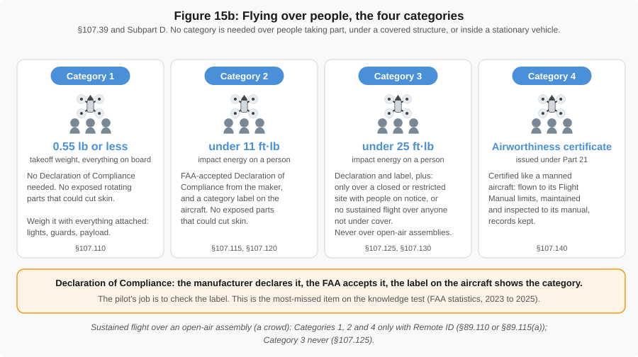
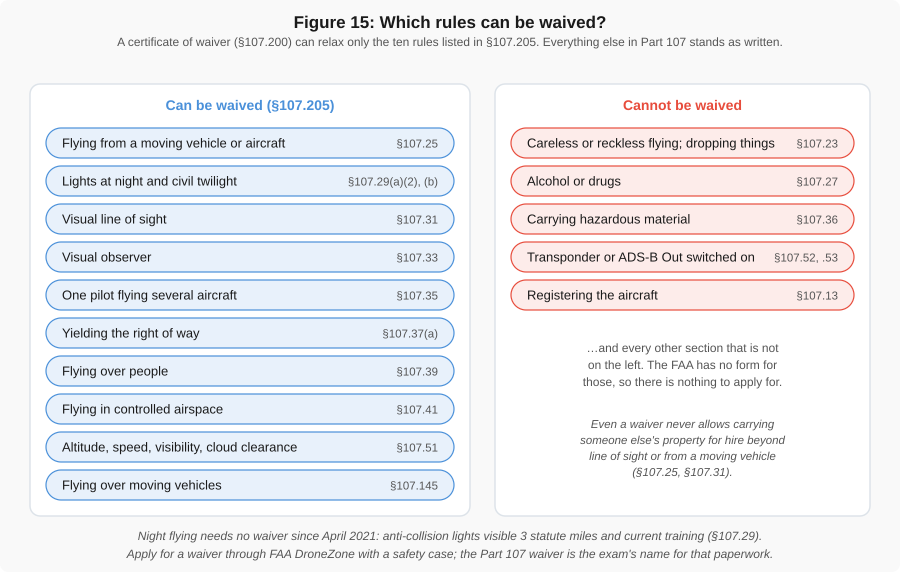

# Part 107, Week 12 — Flying Over People and Waivers

!!! abstract "Key Takeaways"
    - Flying over people who are **not part of your operation** is allowed only if the aircraft fits one of **four categories** (§107.39).
    - **Category 1** is 0.55 lb (250 g) or less with no exposed rotating parts that would cut skin. **Categories 2 and 3** need a manufacturer's **Declaration of Compliance**. **Category 4** needs an airworthiness certificate.
    - Most mapping drones fit **no category**, so they may not fly over bystanders at all.
    - Some rules can be **waived** by the FAA after a safety review; others, such as the alcohol limits and yielding right of way, never can.
    - This is the most-missed topic on the real test.

---

## Who counts as "people"

The rule protects people who are **not** taking part. Flying over your own crew, people under a solid roof, or people inside a stopped car is allowed. Flying over a bystander on a sidewalk is allowed only within a category.

| Category | What qualifies the aircraft | Over an open-air crowd? |
|---|---|---|
| **1** | 0.55 lb (250 g) or less at takeoff, and no exposed rotating parts that would lacerate skin | Only with Remote ID |
| **2** | Listed on an FAA-accepted **Declaration of Compliance** filed by the manufacturer (impact under 11 ft-lb), and labeled | Only with Remote ID |
| **3** | Declaration of Compliance (impact under 25 ft-lb), labeled; only over a closed site with people on notice, or passing over without hovering | **Never** |
| **4** | An FAA airworthiness certificate, flown within its manual | Only with Remote ID |

{ width="100%" }
*Figure 15b: The four categories. Categories 2 and 3 exist only because the manufacturer filed a Declaration of Compliance.*

It is the remote pilot's job to check that the aircraft is listed and labeled. The pilot does not file the declaration; the manufacturer does.

---

## Waivers

The FAA may waive some Part 107 rules when the applicant shows the flight can be done safely (§107.200). Applications go through FAA DroneZone and usually take 90 days or more.

{ width="100%" }
*Figure 15: Rules the FAA may waive (left) and rules it never waives (right).*

| Can be waived | Never waived |
|---|---|
| Beyond visual line of sight; visual observer rules | Alcohol and drug limits |
| Over people and over moving vehicles | Careless or reckless operation |
| Altitude, speed, visibility, cloud clearance | Yielding right of way |
| Several aircraft at once; flying from a moving vehicle | Holding a Remote Pilot Certificate |
| Night lighting | Airport interference and TFRs |

---

## Practice

!!! question "1. The mapping drone"
    Your 2 lb mapping drone has no Declaration of Compliance. Can you fly it over students walking to class?

??? success "Answer"
    **No.** It fits no category, so it may not fly over people who are not part of the operation. Plan the flight path around them, or fly when the area is closed off.

!!! question "2. Who files?"
    Who files the Declaration of Compliance for a Category 2 aircraft?

    - (A) The remote pilot, before each flight
    - (B) The manufacturer
    - (C) The FAA inspector

??? success "Answer"
    **(B).** The manufacturer files it. The pilot checks that the aircraft is on the FAA's accepted list and carries the label. About three quarters of test takers miss this question.

!!! question "3. Waiver or not"
    Which of these can the FAA waive?

    - (A) The 8-hour alcohol rule
    - (B) Flying beyond visual line of sight
    - (C) Yielding to manned aircraft

??? success "Answer"
    **(B).** Beyond visual line of sight can be waived with a strong safety case. The alcohol limits and right of way can never be waived.

---

**Read more:** [Operations Over People](../faa_exam_planning_and_overview.md#b-operations-over-people) and [Waivers](../faa_exam_planning_and_overview.md#c-waivers) on the Week 3 reading. Back to [Part 107 Every Week](index.md).
