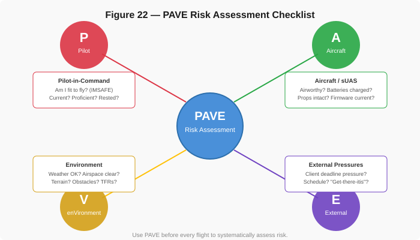
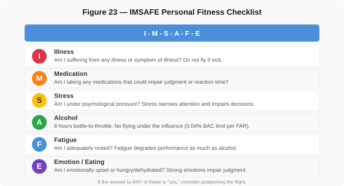
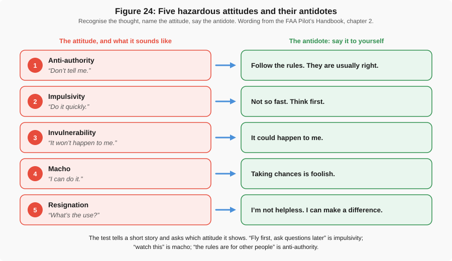

# Part 107, Week 13 — Decision-Making: PAVE, IMSAFE, and Hazardous Attitudes

!!! abstract "Key Takeaways"
    - **PAVE** is a pre-flight risk check: **P**ilot, **A**ircraft, en**V**ironment, **E**xternal pressures.
    - **IMSAFE** is a personal fitness check: **I**llness, **M**edication, **S**tress, **A**lcohol, **F**atigue, **E**motion and eating.
    - **No flying within 8 hours of drinking alcohol**, or at an alcohol concentration of 0.04 or above (§107.27).
    - The FAA names **five hazardous attitudes**, each with an antidote. The test gives a short story and asks which attitude it shows.

---

## PAVE: is this flight a good idea?

{ width="100%" }
*Figure 22: The four PAVE categories.*

- **Pilot:** fit, current, practiced on this aircraft?
- **Aircraft:** batteries charged and warm, propellers undamaged, firmware and maps updated?
- **enVironment:** weather, airspace, TFRs, terrain, people, obstacles?
- **External pressures:** a deadline, a client, a group waiting? Pressure is what pushes pilots to fly when they should not.

If any item worries you, fix it or decide not to fly.

## IMSAFE: am I fit to fly?

{ width="100%" }
*Figure 23: The IMSAFE self-check.*

---

## Hazardous attitudes

{ width="100%" }
*Figure 24: The five hazardous attitudes and the antidote to say to yourself.*

| Attitude | Sounds like | Antidote |
|---|---|---|
| Anti-authority | "The rules don't apply to me." | "Follow the rules; they exist for a reason." |
| Impulsivity | "Do something, quick!" | "Not so fast. Think first." |
| Invulnerability | "It won't happen to me." | "It could happen to me." |
| Macho | "I can handle it." | "Taking chances is foolish." |
| Resignation | "What's the use?" | "I'm not helpless. I can make a difference." |

---

## Practice

!!! question "1. The deadline"
    Your project flight is due tomorrow, and gusts are near the aircraft's limit. Your partner says, "We've flown in worse. We'll be fine." Which attitude is this, and which PAVE item is pushing it?

??? success "Answer"
    **Macho** ("I can handle it"), pushed by **External pressure** (the deadline). The antidote: "Taking chances is foolish." Reschedule with a TA.

!!! question "2. The late night"
    A pilot stopped drinking at 11:00 p.m. When is the earliest they may fly the next morning?

    - (A) 5:00 a.m.
    - (B) 7:00 a.m.
    - (C) Whenever they feel fine

??? success "Answer"
    **(B), and only if** their alcohol concentration is also below 0.04. Eight hours after 11:00 p.m. is 7:00 a.m. Fatigue (the F in IMSAFE) may still say wait.

!!! question "3. Name the attitude"
    A pilot loses sight of the drone and says, "It's gone anyway, nothing I can do." Which attitude is this?

??? success "Answer"
    **Resignation.** The antidote is "I'm not helpless": use return-to-home, check the map view, and follow the lost-aircraft steps in [Common Flight Issues](../../gen_reading/flight_issues.md).

---

**Read more:** [Aeronautical Decision-Making and Safety](../faa_exam_planning_and_overview.md#viii-aeronautical-decision-making-safety) on the Week 3 reading. Back to [Part 107 Every Week](index.md).
