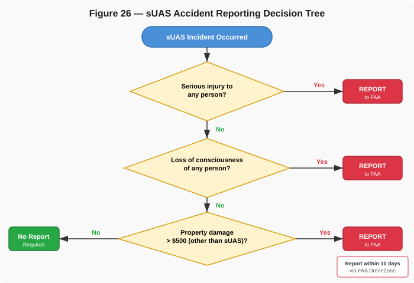
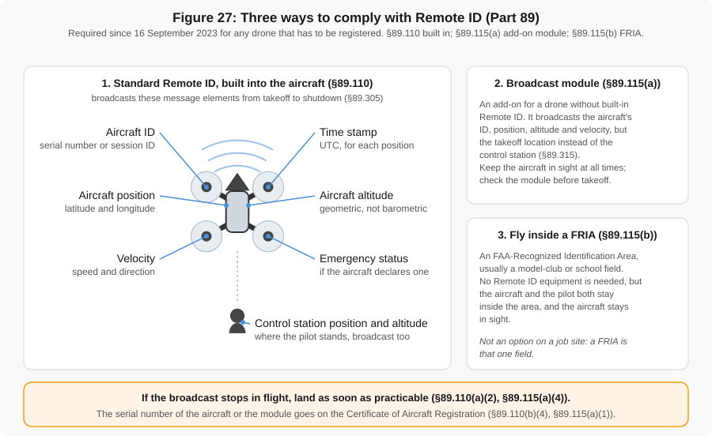
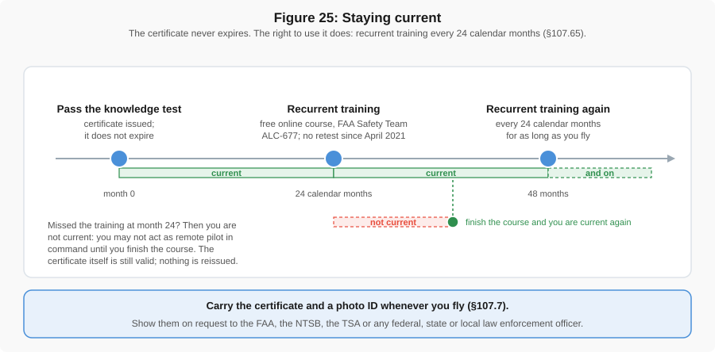

# Part 107, Week 14 — Emergencies, Reporting, Registration, and Remote ID

!!! abstract "Key Takeaways"
    - In an **emergency** the remote pilot may break any Part 107 rule as far as the emergency requires, and reports it only **if the FAA asks** (§107.21).
    - An **accident** must be reported to the FAA within **10 calendar days** if it causes serious injury, loss of consciousness, or more than **$500** of damage to property other than the drone (§107.9).
    - **Every aircraft flown under Part 107 is registered**, whatever its weight: $5, valid for 3 years.
    - **Remote ID** broadcasts the aircraft's identity and position. It is required on every registered aircraft.
    - The certificate never expires, but you must complete **free online recurrent training every 24 calendar months** to keep using it.

---

## Emergencies and accidents

These two are easy to mix up on the test:

| | Emergency deviation (§107.21) | Accident report (§107.9) |
|---|---|---|
| **When** | You break a rule to deal with an in-flight emergency | Serious injury, loss of consciousness, or over $500 of damage to someone else's property |
| **Report** | Only if the FAA asks | Within **10 calendar days**, through FAA DroneZone |

Damage to your own drone never triggers a report.

{ width="100%" }
*Figure 26: Does this event need an FAA report?*

---

## Registration and Remote ID

- **Register** every Part 107 aircraft at FAA DroneZone: $5 per aircraft, valid 3 years, with the registration number marked on the outside. The 0.55 lb (250 g) exemption is for recreational flying only.
- **Remote ID** works like a digital license plate. A Standard Remote ID aircraft broadcasts its ID, position, altitude, and speed, plus the **pilot's** position. An older aircraft can carry an add-on **broadcast module**, which sends the **takeoff** point instead. If the broadcast fails in flight, land as soon as practicable.

{ width="100%" }
*Figure 27: What a Standard Remote ID aircraft broadcasts.*

---

## Staying current

{ width="100%" }
*Figure 25: Test, then free recurrent training (ALC-677 at FAASafety.gov) before the end of the 24th calendar month, then every 24 months after. If you let it lapse, you cannot fly under Part 107 until you complete the training.*

---

## Practice

!!! question "1. The parked car"
    During a mapping flight the drone hits a parked car: $750 of damage to the car, the drone is broken, no one is hurt. Must you report it?

??? success "Answer"
    **Yes, within 10 calendar days.** Damage to property other than the drone is over $500. The broken drone does not count toward that figure.

!!! question "2. The light drone"
    A 230 g (0.5 lb) drone is used to photograph a construction site for a client. Must it be registered?

??? success "Answer"
    **Yes.** Every aircraft flown under Part 107 is registered, whatever its weight. The under-250 g exemption applies only to purely recreational flying.

!!! question "3. Current?"
    You passed the knowledge test in March 2025 and have done no training since. Through what date may you fly under Part 107?

    - (A) March 2026
    - (B) The end of March 2027
    - (C) Forever; the certificate never expires

??? success "Answer"
    **(B).** Currency runs 24 **calendar** months, to the last day of the month. The certificate itself never expires, but after March 2027 you must complete the free recurrent training before flying under it again.

---

**Read more:** [Maintaining Currency and Responsibilities](../faa_exam_planning_and_overview.md#ix-maintaining-currency-responsibilities) on the Week 3 reading. Back to [Part 107 Every Week](index.md).
