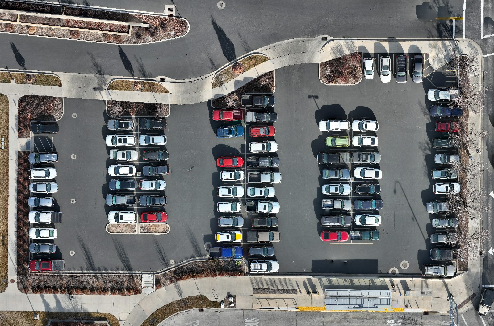

<!-- _class: title -->

# The Final Project

## Week 10 — Tuesday Lecture

<!--
Introduces the project on Tue Nov 3. Every rule here is on the Final Project pages of the site; point students there for details. Leave the last 10 minutes for forming groups.
-->

---

## The job

You have been hired as a **contractor** to fly a drone mission for a client: a city, a contractor, a property owner.

1. Find a civil or construction engineering question drone data can answer
2. Plan the project and the flight
3. Fly it
4. Process the data
5. Present it in class
6. Write a one-page technical memo

Anyone can make an orthomosaic. The engineering part is saying **who needs the data, why you flew it that way, and what it can and cannot support.**

---

## Groups and grade

**Groups of 2.** Both partners get the same score, except attendance and presenting.

| # | Turn-in | Weight | Due |
|---|---|---:|---|
| 1 | Project Proposal | 2.5% | **Thu, Nov 5, 11:59 PM** |
| 2 | Flight and Data Processing | 5% | One week after your flight |
| 3 | Presentation | 2.5% | Slides Mon, Dec 7; present Dec 8 or 10 |
| 4 | Technical Memo | 5% | Thu, Dec 10 |
| | **Total** | **15%** | |

Final project work cannot be turned in late.

---

## What could you fly?

- Pavement condition on a road or lot: where are repairs needed?
- Room for more parking stalls, a trail, or a new structure
- Roof, field, or paved area, for a runoff calculation
- Volume of a stockpile, or the shape of a slope
- Progress on a construction site

More, with what went wrong for past groups: **Final Project → Example Projects**

<!--
Push them toward a question with a client attached, not "we want to map the duck pond". Sites within walking distance of the EB make the 50-minute trip much easier.
-->

---

<!-- _class: prompt -->

# Weak or strong?

"We will make a 3D model of the Wilkinson Center."

vs.

"Facilities wants to know how much of the EB east lot needs resurfacing. We will map it and measure the cracked area."

<!--
The first is a product. The second has a client, a decision, and a measurement. Ask: who would pay for the first one?
-->

---

## Turn-in 1: the Proposal

Due **Thursday, Nov 5 at 11:59 PM**. Thursday's lab is work time.

1. **Project and purpose:** who is the client, what will they decide?
2. **Site:** map, why it fits, hazards
3. **Airspace, permissions, and safety**
4. **Time budget:** the whole trip in 50 minutes
5. **Flight plan:** built in the class planner, with a reason for every setting, and a backup drone
6. **Products and roles:** pilot, visual observer, data

Upload: proposal PDF + KMZ + Mission Log + permissions. **No approved proposal, no flight.**

---

## Permissions are your job

- **Airspace:** most of campus is in Provo's Class D. If you need **LAANC**, fill it out **with a TA** (it is filed under their Part 107 certificate).
- **Property:** private land, active construction, and some campus areas need the **owner's OK**, in writing. An email is fine.
- **People and traffic:** how will you stay off people and moving cars?

Turn in with the proposal: the LAANC request, and the owner's OK **or** who you contacted, how, and when.

You must have the OK **before you fly**. Proof is graded in turn-in 2.

---

## The 50-minute trip

| Step | Minutes |
|---|---:|
| Check out drone at EB B122 | |
| Travel to site | |
| Set up + pre-flight checklist | |
| Flight time (from your plan) | |
| Extra photos or measurements | |
| Post-flight + pack up | |
| Travel back to EB B122 | |
| **Total** | **≤ 50** |

Two trips each flight lab: **8:00–8:50** and **9:00–9:50**.

The drone goes out again with the next trip.

**Plan for 40, not 50.** Wind, a pedestrian, or a battery swap will use the rest.

---

## Flight days

| | 8:00–8:50 | 9:00–9:50 |
|---|---|---|
| Thu, Nov 12 | 3 groups | 2 groups |
| Thu, Nov 19 | 2 groups | 2 groups |

One of each drone per trip, so you sign up for a **drone on a trip**:

- **Mini:** regular photos. Use it unless you need the others.
- **Thermal** (Autel): roofs, pavement, moisture
- **Multispectral:** vegetation health (NDVI)

Sign-up sheet is linked on the Project Overview. First come, first served.

---

## Flight day

**Be at EB B122 by the start of your trip.** It leaves on time.

- A partner who is not there is left behind: **0 for attendance**.
- If **neither** partner is there: the group gets 0 and must find a new time with a TA.
- Run the pre-flight and post-flight checklists. Write down anything that changes.
- Start processing **that same week**. Bentley runs for hours on shared machines.

---

## Turn-in 2: Flight and Data Processing

Due **one week after you fly**. Most of the points are for **output**.

| Criterion | Points |
|---|---:|
| Mission plan and permissions | 10 |
| Flight attendance *(per student)* | 5 |
| Processed products: two or more, with a measurement | 25 |
| Raw data shared: every original photo | 10 |
| **Total** | **50** |

Products and screenshots go to Learning Suite; raw photos go to the class shared folder.

---

## Turn-ins 3 and 4

**Presentation:** 12 minutes + 5 minutes of questions

- Slides due **Mon, Dec 7**. Present **Tue Dec 8** (3 groups) or **Thu Dec 10** (6 groups)
- Both partners present. A student who does not present gets **0**.

**Technical Memo:** due **Thu, Dec 10**

- Written to a project manager who was not there
- **One page of writing**, plus figures
- See **Example Technical Memo** on the site

Check one number against something measured another way. Not required, but it is the strongest evidence your data can be trusted.

---

## Attendance, Weeks 10–15

| Taken | Only if your group flies | Optional | No class |
|---|---|---|---|
| Nov 3, 5, 10, 17 | Nov 12 | Nov 24 work day | Nov 26 |
| Dec 1, 8, 10 | Nov 19 | Dec 3 work day | |

---

<!-- _class: prompt -->

# Now

Find a partner.

Pick a question and a site.

Check the airspace.

Proposal due **Thursday, 11:59 PM**.

<!--
Have groups write their names and a one-line idea on the board or in Teams before they leave. Thursday's lab: TAs check sites and file LAANC requests.
-->
