<!-- _class: title -->

# How Photos Become 3D

## Week 7 — Tuesday Lecture

---

## Today

- Where 3D comes from: finding and matching points
- Where the cameras were
- From sparse to dense to mesh
- The products: orthophoto, DSM, DTM
- What the photo's metadata carries
- The software, briefly

---

<!-- _class: prompt -->

# Two photos of the same corner of a building.

What does the computer actually know?

---

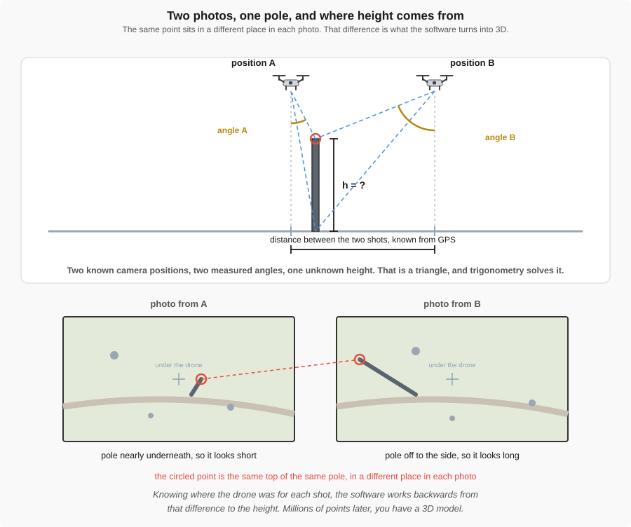

The same pole looks short from almost overhead and long from off to the side. That difference is the measurement.

---

## The triangle idea

- Two photos of the same thing, taken from different places
- Two **known** camera positions
- Two **measured** angles
- One **unknown** height — solve the triangle

---

Overlap is what puts every ground point into five to nine different photos.

---

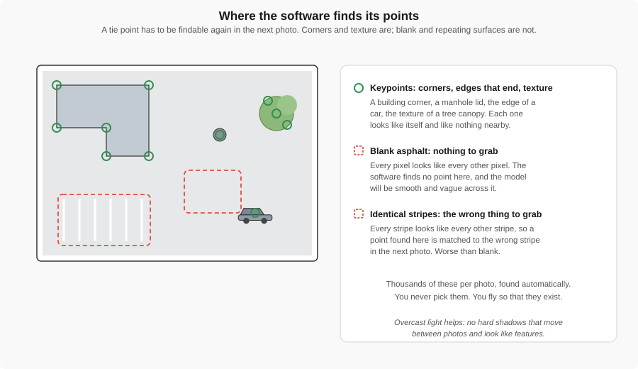

The software looks for corners and texture. Blank asphalt gives it nothing; a row of identical stripes gives it the wrong thing.

---

## What makes a good tie point

| Surface | Result |
|---|---|
| **Unique** — manhole, rock, corner, crack | Matched correctly |
| **Blank** — asphalt, snow, water, glass | Holes you can see |
| **Repeating** — stall lines, grass, row crops | Matched confidently and **wrongly** |

Overcast is good: flat light looks the same in every photo, and no moving shadows to fool the matcher.

---

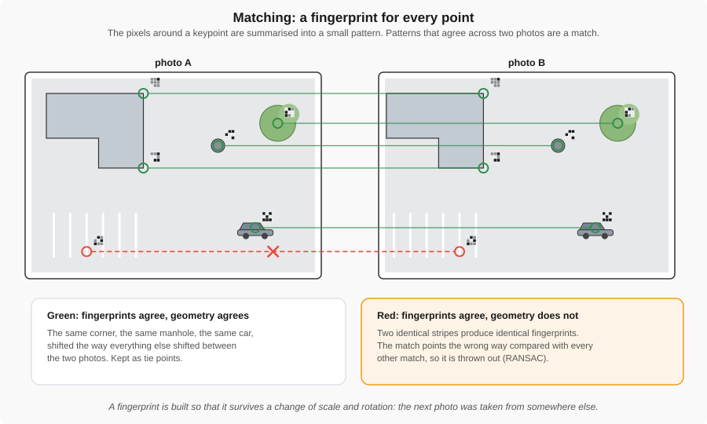

Each point gets a fingerprint of the pixels around it. Fingerprints that agree are matched; a match that disagrees with all the others is thrown out.

---

## SIFT, in plain words

- Finds **blobs and corners** that still stand out at several zoom levels
- Gives each one an **orientation**
- Summarises the pixels around it as **128 numbers** — the fingerprint
- Same corner, different photo: nearly the same numbers
- So a change of scale or rotation does not break the match

---

## Matching, then cleaning up

- Compare fingerprints; keep a match only if the best is **clearly better than the second best** — the ratio test
- **RANSAC**: guess a camera geometry from a few matches, count who agrees, repeat
- Matches that never agree with anything are **thrown out**
- Once the geometry is known, a partner point lies on **one line** in the other photo

---

<!-- _class: prompt -->

# A parking lot of identical stripes.

Why is that worse than a blank field? Which test catches it — the ratio test, or RANSAC?

---

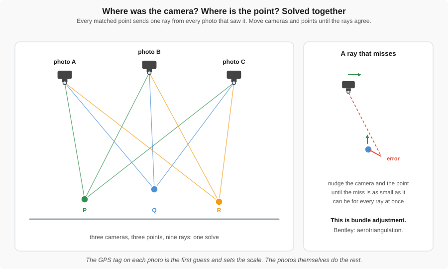

Cameras and points are solved together: nudge both until every ray through a matched point agrees. Bentley calls this aerotriangulation.

---

## Shape is not size

- GPS tags give the software a **first guess** and the **scale**
- With no known positions: right shape, wrong size, wrong place
- A building can come out perfectly proportioned and twice life size
- A reference, ground control, or **RTK** supplies the missing scale and position

---

<!-- _class: prompt -->

# Think like the software

A rocky canyon and a snowfield, same day. Which one worries you? What do you change about the flight?

---

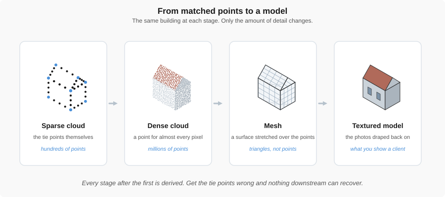

The same building at four stages: sparse, dense, mesh, textured.

---

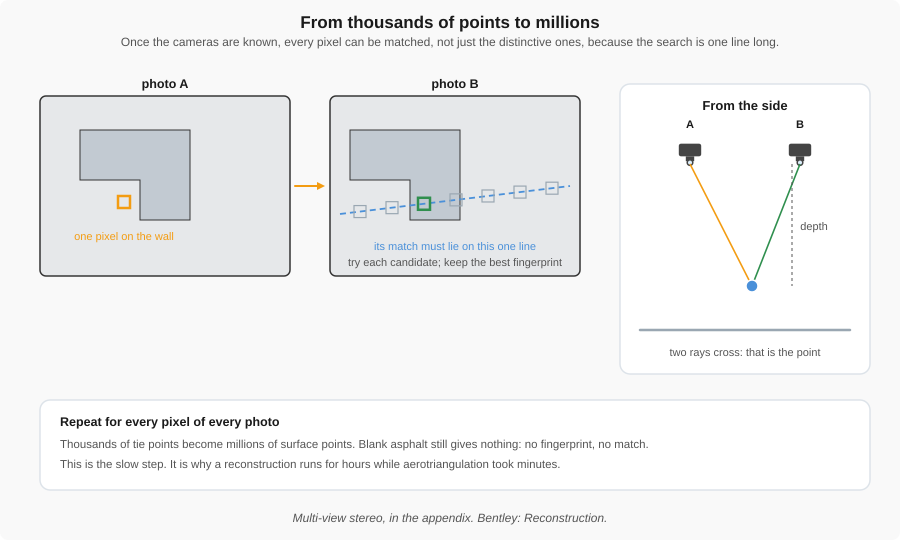

For one pixel in photo A, the match in photo B lies on one known line. Find it, read the depth, repeat for every pixel.

---

## Sparse to dense

- Thousands of points become **millions**
- Once cameras are known, the search is along one line, not the whole image
- Needs **texture**, **overlap**, and **sharp** photos

---

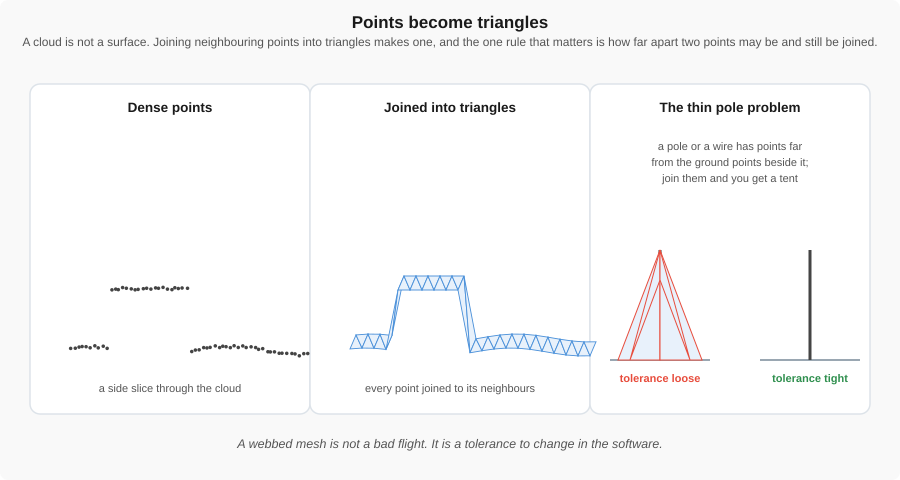

Points become triangles. A thin pole gets webbed to the ground unless the tolerance is tightened.

---

## Mesh and textured model

- **Mesh:** a skin of triangles over the points; thin things like railings and wires often vanish
- **Texture:** each triangle colored from the photo that saw it best — recognizable, not more accurate
- Mesh looks webbed? **Tighten the tolerance.** More honest gaps, fewer invented surfaces

---

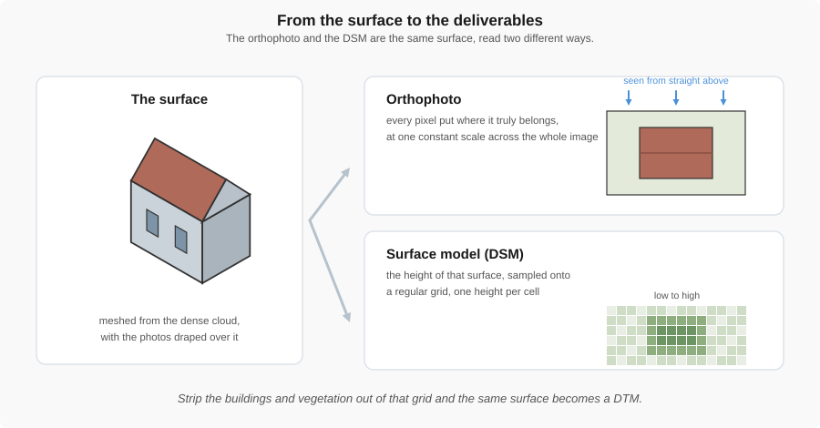

The orthophoto and the DSM are the same surface read two ways: a picture, and a grid of heights.

---

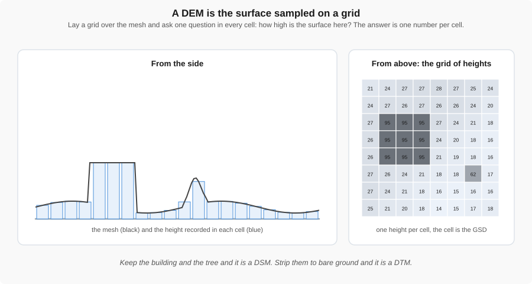

Sample the surface on a grid and every cell gets a height. Keep the trees and cars for a DSM; strip them for a DTM.

---

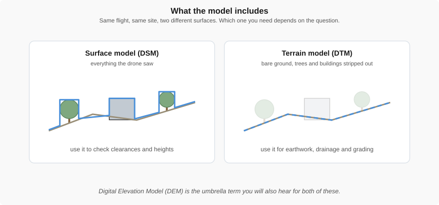

DSM keeps the trees and buildings. DTM strips them out — only one is right for earthwork.

---

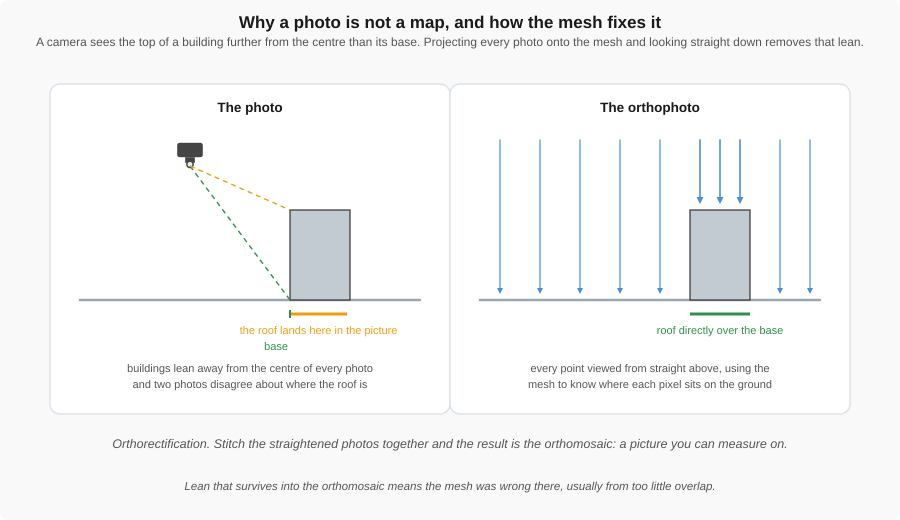

A photo leans every building away from the camera. Drape each photo on the mesh and look straight down at every point, and the lean is gone.

---

<!-- _class: prompt -->

# Which product answers which question?

"How much gravel is in that pile?" and "Where does the curb run?"

---

## Metadata: data about data

- The **can of soup**: the soup is the data, the label is the metadata
- A photo of a site is not much use without its context
- Drones depend on it: **where, when, which way**
- Bad metadata can make good data useless

---

## What EXIF carries

- **Position:** latitude and longitude
- **Altitude:** sets the scale of the image
- **Time:** the timestamp, for change over time
- **Camera and lens settings:** ISO, shutter speed
- **Orientation:** heading (yaw) and gimbal pitch, nadir or oblique

Stored inside the image file. Right-click, Properties, Details to see it.

---

## One real photo's EXIF

Parrot Anafi, Utah Lake shore, May 2023

| Field | Value |
|---|---|
| Position | 40° 20′ 12.9″ N, 111° 46′ 39.5″ W |
| Altitude | 1417.2 m above sea level |
| Time | 2023-05-26 13:14:08 |
| Image | 4608 × 3456 px |
| Lens | 4.0 mm, f/2.4 |
| Exposure | 1/3846 s, ISO 142 |
| Camera pitch | 6.4° — nearly nadir |

---

## Metadata and privacy

- Exact GPS coordinates are in every photo — and this one also carried the aircraft **serial number** and firmware
- Social media strips them on upload to protect you
- For engineering we **must keep** them intact
- Check the drone's clock and GPS lock before you fly

---

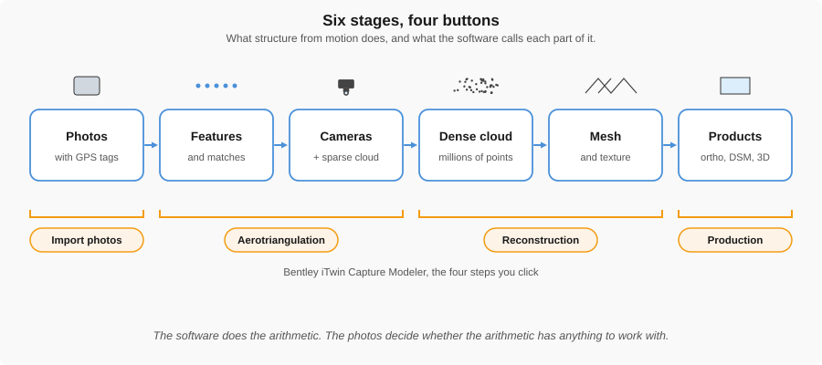

Six stages, four buttons. Every product on the right is built from the photos on the left.

---

## Bentley iTwin Capture Modeler

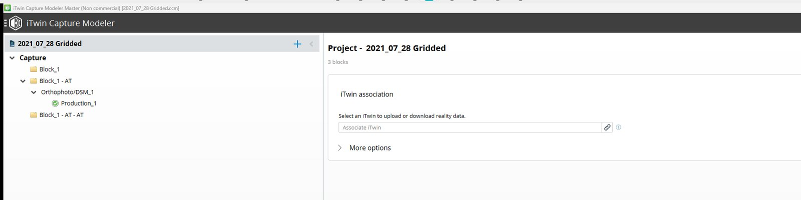

One project: a block of photos, its aerotriangulated copy, a reconstruction, and a production. iTwin Capture Modeler, Bentley Systems.

---

## Create your Bentley account

Before the processing lab. Learning Suite has the link.

- [Lab deck: Bentley iTwin Capture Modeler](bentley_itwin.html)
- [Bentley iTwin](../software/bentley_itwin.md)

---

## What to do Thursday

- **Rock Canyon flight day:** [Rock Canyon Park Flight](../labs/4_rock_canyon_flight.md)
- Fly the plan from the Week 6 lab
- Bring back the photos — they become next week's model
- Create your **Bentley account** before the processing lab
