<!-- _class: title -->

# Beyond the Camera

## Week 8 — Tuesday Lecture

<!--
Format for every question slide today: groups of 2–3 talk for the time given, then one group answers and the class discusses. Not a quiz. Reveal on the next slide.
-->

---

<!-- _class: prompt -->

# Your drone map is perfect. Which question can it answer?

A) Where is the ground under those trees? · B) Is the roof insulation wet? · C) Is this lawn about to turn brown? · D) How big is this stockpile?

<!--
Groups 1.5 min, then class.
Likely answer: A, because Week 7 showed DTMs and students assume software can strip trees anywhere.
Follow-up: "What would you need to see the ground under a tree?"
-->

---

<!-- _class: answer -->

## Only D

- **A** needs to reach the ground through the canopy — **LiDAR**
- **B** needs heat, not colour — **thermal**
- **C** needs light the eye can't see — **multispectral**
- Today: one sensor for each question an RGB camera can't answer, and what fools each one

---

## Today

- Three sensors, one question each
- What fools each one
- How processing changes with the sensor
- The other sensors drones carry
- Pick the sensor

---

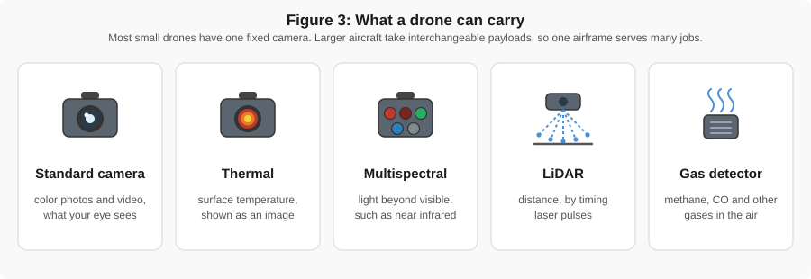

The same aircraft can carry a different instrument. Which one depends on the question, not the drone.

<!--
Mention the gas detector here: methane at landfills, wastewater plants and pipelines. More on the "other sensors" slide later.
-->

---

<!-- _class: prompt -->

# Can a drone LiDAR map the ground under a tree?

A) No · B) Yes — the laser goes through the leaves · C) Yes — through gaps in the leaves

<!--
Groups 1 min, then class.
Likely answer: B. "Lasers penetrate" sounds right.
Follow-up: "Then why do winter flights work better?"
-->

---

<!-- _class: answer -->

## C — through the gaps

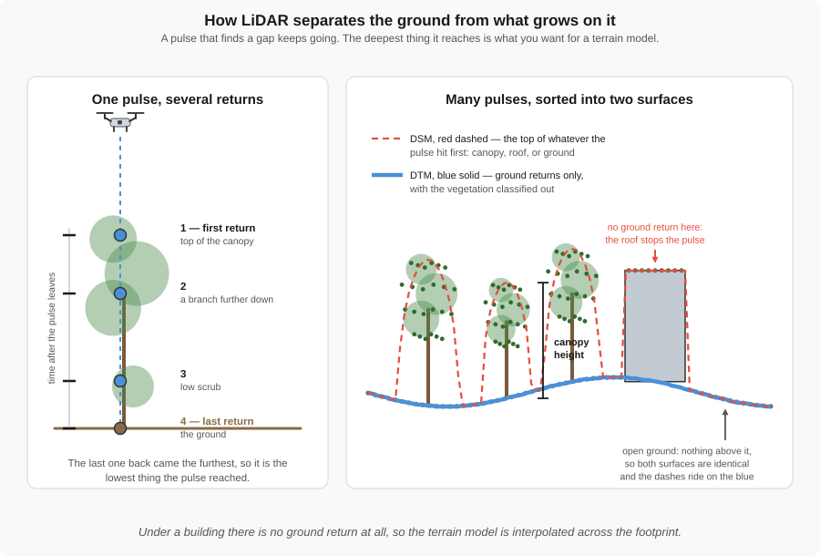

A leaf stops the pulse. Pulses that find a gap come back from the ground: one pulse, several returns.

---

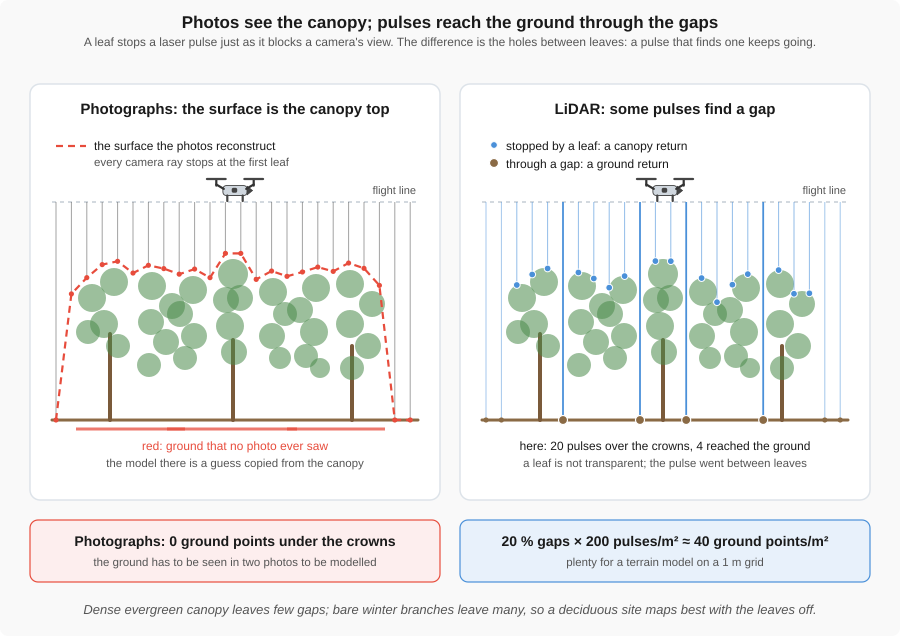

Photos see the top of the canopy. Laser pulses reach the ground wherever there is a gap.

---

<!-- _class: prompt -->

# 200 pulses per m² · 20&nbsp;% gaps

A canopy lets 20&nbsp;% of the pulses through. How many ground points per m²? Is that enough for a 1&nbsp;m DTM? *(Illustrative numbers.)*

<!--
Pairs 2 min, then class.
Likely answers: 0 ("leaves block lasers") or 200 ("LiDAR sees through").
Follow-up: "What if it's a dense evergreen with 2 % gaps?"
-->

---

<!-- _class: answer -->

## About 40 per m² — plenty

- 200 × 0.20 = **40** ground points in every square metre: a 1 m grid, even 0.5 m, is fine
- Dense evergreen, 2 % gaps: about **4** per m² — usable, but rough
- Photos under the same canopy: **zero** ground points
- Fly in winter, when leaves are off, and the gaps get bigger

---

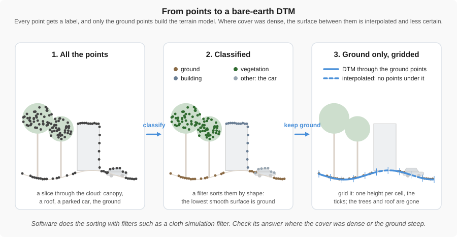

Processing LiDAR: label every point, keep the ground, then grid it into a bare-earth DTM.

---

## Our own LiDAR: removing the vegetation

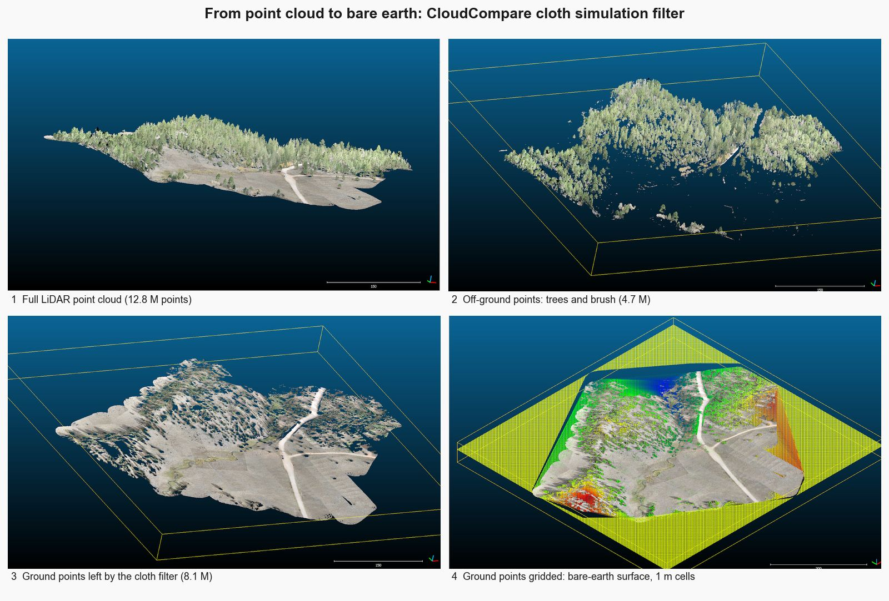

A BYU LiDAR flight processed with a cloth-simulation filter: full cloud, ground separated from vegetation, bare-earth surface.

---

<!-- _class: prompt -->

# You route stormwater across a brushy slope using the DSM.

Where does the water go wrong?

<!--
Groups 2 min, then class.
Likely answer: "Hardly anywhere — bushes are small."
This is the drainage activity at the end of the LiDAR reading.
-->

---

<!-- _class: answer -->

## Every bush becomes a hill

- To a **DSM**, a shrub is a mound: flow bends around crowns and ponds behind hedges
- A bridge or culvert in a DSM is a **dam**: the model floods upstream
- Water runs on the **ground** — use the **DTM**
- A DSM gives *confidently wrong* answers here

---

<!-- _class: prompt -->

# Can a thermal camera see a leaking pipe inside a wall?

A) Yes · B) No · C) Only if the leak changes the wall's surface temperature

<!--
Groups 1 min, then class.
Likely answer: A, from movies.
Follow-up: "So what would the leak look like on the wall's surface?"
-->

---

<!-- _class: answer -->

## C — it reads surfaces

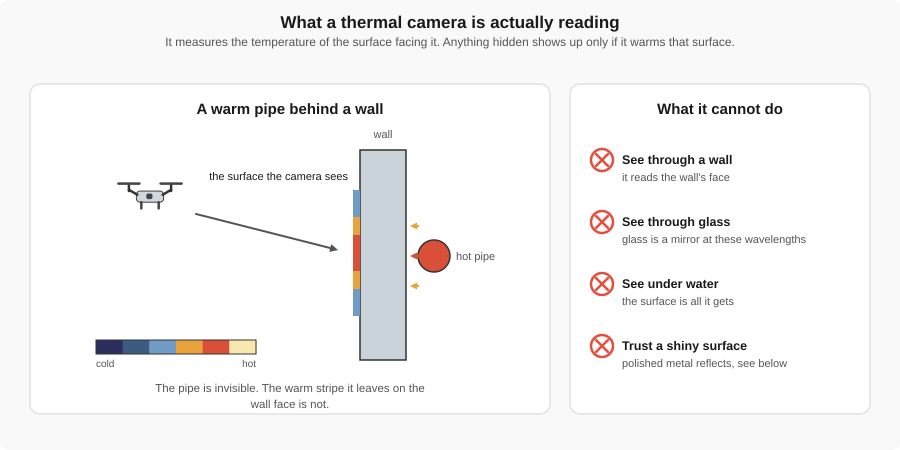

A thermal camera measures the temperature of the surface it sees. You work backward from the pattern to the cause.

---

<!-- _class: prompt -->

# Saved as a colour JPG

Our Rock Canyon thermal. How hot was the warmest spot? A) Estimate it from the colours · B) We can't tell

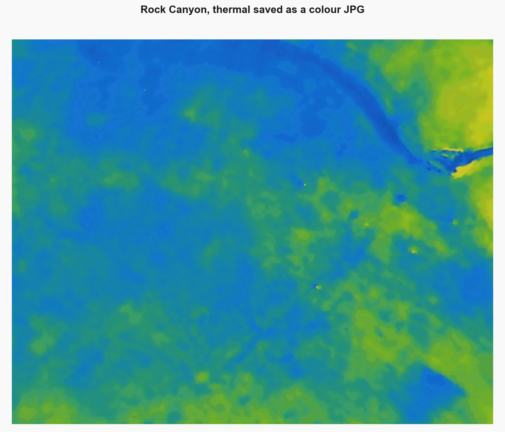

<!--
Groups 1.5 min, then class.
Likely answer: A.
Follow-up: "What would you check on the camera before takeoff?"
-->

---

<!-- _class: answer -->

## B — a picture is not a measurement

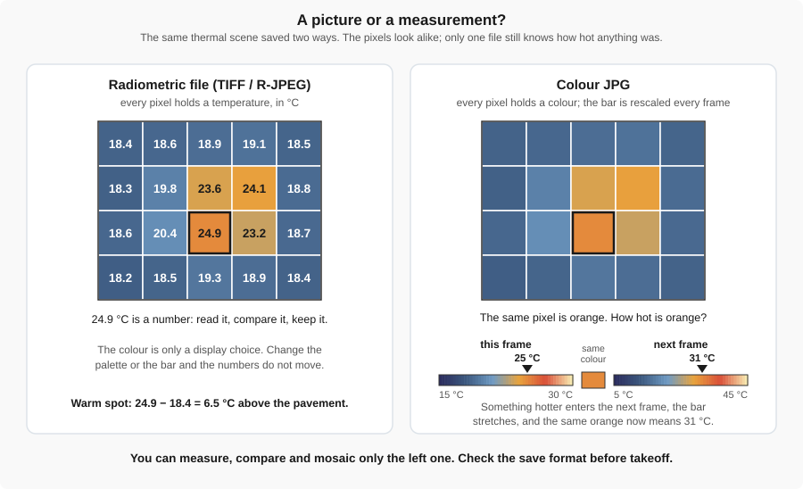

A radiometric file stores a temperature in every pixel. A colour JPG stores a colour, rescaled every frame.

<!--
Check the save format before takeoff, the same way you check the gimbal.
-->

---

<!-- _class: prompt -->

# Dark shapes beside every car

Parking lot, 10 a.m. What are they, and why are they cooler?

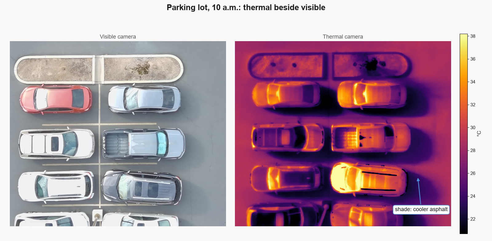

<!--
Groups 2 min, then class.
Likely answers: puddles, a glitch, "cold cars".
Follow-up: "What would they look like an hour later, once the sun has moved?"
-->

---

<!-- _class: answer -->

## Shade

- Sunlit asphalt has been warming since sunrise; shaded asphalt has not
- A thermal image shows **heat history** — minutes to hours — not just this moment
- A shadow that has just moved still reads cool for a while
- On a bridge deck, a patch like this could be mistaken for a defect

---

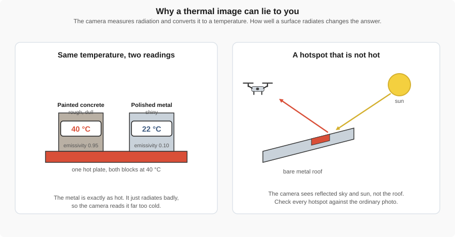

Shiny surfaces reflect their surroundings instead of glowing on their own. The camera reads both.

---

<!-- _class: prompt -->

# Sunlit asphalt at −8&nbsp;°C?

Our camera's reading at 9:25 a.m. Do you believe it? What would you check?

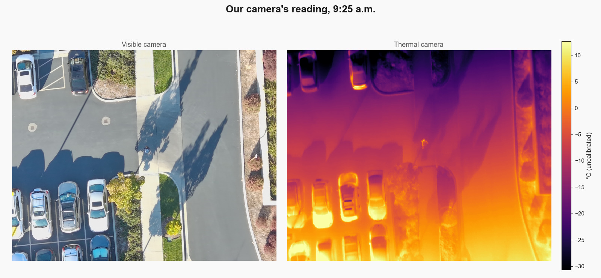

<!--
Groups 2 min, then class.
Likely answers: "Trust it, it's the instrument" or "the camera is broken."
This is our own data, and the reading really was wrong. Let them argue before the reveal.
The conversion itself is verified against Autel's SDK (autel-thermal project, FINDINGS.md); the cause was the camera's state.
-->

---

<!-- _class: answer -->

## No — and here it was wrong

- The camera had been switched on **90 seconds** earlier and was still cooling
- Until its first **self-calibration**, the top of every frame read up to **30 °C too cold**
- Ten seconds later the same asphalt read **5 °C** — the air was 5 °C
- Warm the camera up outdoors, and put something of **known temperature** in the frame

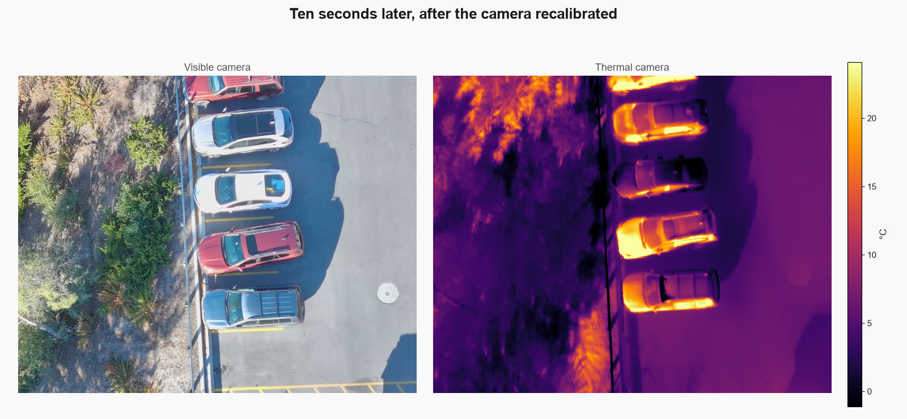

<!--
Source: autel-thermal FINDINGS.md section 3. Frames IRX_0001-0036 carry a ~30 C top-to-bottom ramp that vanishes between IRX_0036 and IRX_0037 with no change in height, pitch or heading: the microbolometer's non-uniformity correction catching up after a cold start. Air at KPVU was 5.2 C at 09:25.
-->

---

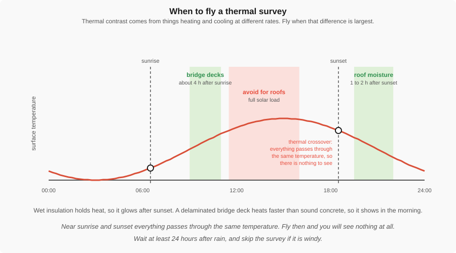

When you fly decides what you can see.

---

<!-- _class: prompt -->

# Cracks show. Is it delamination?

Bridge approach, 9:44 a.m., late October. Can we report delamination? When should we have flown?

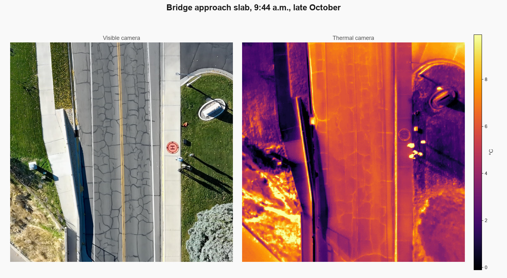

<!--
Groups of 3, 3 min, then class.
Likely answers: "Yes, we can see damage" and "at dawn, when it's coldest."
-->

---

<!-- _class: answer -->

## Cracks, yes. Delamination, not yet.

- Cracks are on the surface, and the RGB photo shows them too
- Delamination is a hidden void that shows only while **heat is flowing** into the deck
- Under two hours after sunrise, with a low autumn sun: too little heat had gone in
- Fly several hours into a sunny day, on a dry deck with low wind
- Report: *cracks mapped, delamination inconclusive, refly*

---

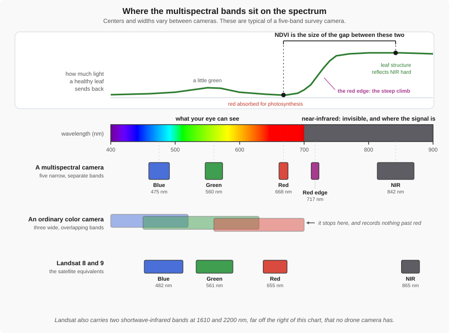

Healthy leaves absorb red light and reflect near-infrared strongly.

---

<!-- _class: prompt -->

# Three patches of the same lawn. Which one is stressed?

A, sunlit: NIR 4000, Red 400 · B, shaded: NIR 2000, Red 200 · C, sunlit: NIR 2800, Red 1200

$$\text{NDVI} = \frac{\text{NIR} - \text{Red}}{\text{NIR} + \text{Red}}$$

<!--
Pairs 3 min, then class. Illustrative numbers.
Likely answer: B, because its raw NIR is the lowest.
-->

---

<!-- _class: answer -->

## C — the shade cancels out

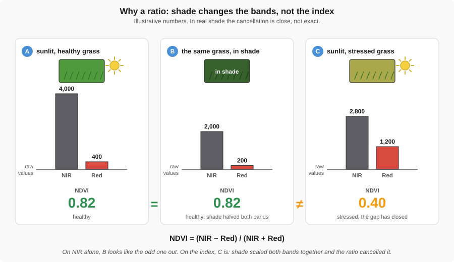

NDVI: A 0.82, B 0.82, C 0.40. Shade halved both bands, so the ratio did not change.

---

<!-- _class: prompt -->

# Low spots on the NDVI

Our map of the lawn east of the EB. Does a low spot prove it needs water?

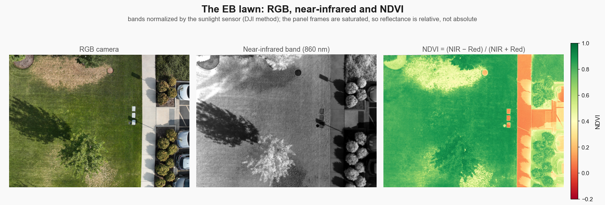

<!--
Groups 1.5 min, then class.
Likely answer: yes.
-->

---

<!-- _class: answer -->

## It shows less green leaf — not why

- Low NDVI means less healthy leaf here; it does not say what caused it
- Sprinkler gaps, compacted soil, disease, bare soil and fresh mowing all lower it
- Arcs that line up with sprinkler heads point at irrigation
- Walk to one spot and look before you spend money

---

<!-- _class: prompt -->

# Same lawn: NDVI 0.70 in May, 0.60 in August.

Did it get worse? A) Yes · B) We can't tell yet

<!--
Groups 1.5 min, then class.
Likely answer: A. Students over-apply "ratios cancel the lighting".
-->

---

<!-- _class: answer -->

## B — not without calibration

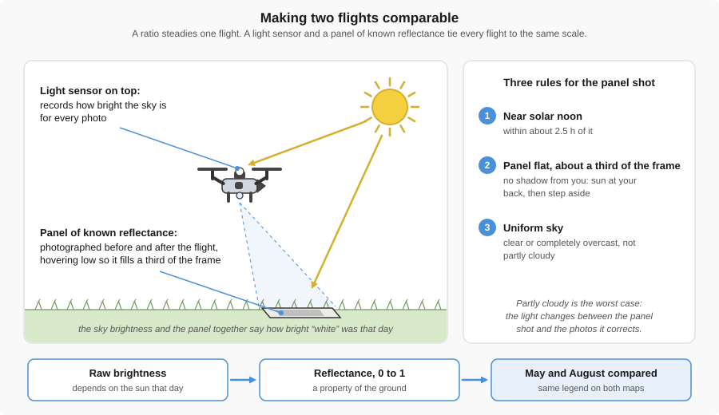

A ratio steadies one flight. A light sensor and a reflectance panel make two flights comparable.

---

## Same flight plan, different last step

| Sensor | What processing adds | You get |
|---|---|---|
| RGB | The Week 7 pipeline | Orthophoto, DSM, mesh |
| LiDAR | Classify every point; keep the ground | DTM under vegetation |
| Thermal | Keep the radiometric file; set emissivity | Surface temperatures |
| Multispectral | Light sensor and panel; reflectance; index | NDVI you can compare |

---

## Other sensors drones carry

| Sensor | Measures | Civil use | On drones today |
|---|---|---|---|
| Ground-penetrating radar | Radar echoes from buried layers | Utilities, voids, pavement layers | Specialised; soil limits depth |
| Imaging radar (InSAR) | Millimetres of ground movement | Subsidence, dam and levee movement | Satellite, not drone |
| Magnetometer | Distortion of Earth's magnetic field | Buried steel pipe, tanks, old wells | Specialised, well proven |
| Gravimeter | Tiny changes in gravity | Large density contrasts, geology | Experimental; too coarse for small voids |
| Methane laser, gas camera | Gas absorbing laser or infrared light | Landfill, pipeline, wastewater leaks | Laser routine; camera specialised |
| Hyperspectral camera | Hundreds of narrow colour bands | Minerals, water quality, plant species | Specialised; heavy data |
| Green LiDAR, sonar | Water depth | River and reservoir depth, scour | Specialised; clear water for LiDAR |
| Air-quality sensors | Particles and gases in the air | Dust and smoke plumes | Experimental; rotor wash skews it |
| Gamma spectrometer | Radioactivity | Mine tailings, contaminated land | Specialised |

<!--
GPR: soil sets the depth, not the sensor. Wet clay can cut it to under a metre; dry sand allows several. Drone GPR flies within about a metre of the ground; most GPR is still pushed on a cart.
InSAR: a satellite product you download (USGS uses it for subsidence from groundwater pumping). It is the "radar" in most subsidence stories.
Magnetometer: ferrous metal only. DOE's NETL switched from helicopters to drones around 2015 to find undocumented oil and gas wells.
Gravimeter: drone systems err by about 0.5-3 mGal; a sinkhole void is about 0.01-0.13 mGal. Ground surveys can find voids by gravity; drones cannot yet.
Methane laser: reads concentration times path length (ppm·m), not a point value; a leak rate needs wind and a model.
Hyperspectral: 100+ narrow bands against multispectral's 4-10; gigabytes per flight.
Water depth: green LiDAR reaches about twice the Secchi depth in clear water; tethered sonar works in muddy water.
Air quality: finds the plume; weak for compliance numbers.
Gamma: legacy uranium mines on the Colorado Plateau.
Sources: .claude/local/scratch/week08_check/other_sensors.md in the course repo.
-->

---

<!-- _class: prompt -->

# Is there an old well under this field?

A field becoming a park may hide an unrecorded oil well and a buried steel tank. The soil is wet clay. A teammate says "fly ground-penetrating radar." What would you fly instead, and what could it miss?

<!--
Groups 2 min, then class.
Likely answer: GPR, because "radar sees underground".
-->

---

<!-- _class: answer -->

## A magnetometer

- Steel well casing and steel tanks bend Earth's magnetic field strongly
- Wet clay is where ground-penetrating radar does worst
- It misses anything not made of steel: a wood-cased old well, a fibreglass tank, plastic pipe
- Confirm with a records search and test pits before grading

---

<!-- _class: prompt -->

# Pick the sensor — and say what would fool it

Groups of 3 · 5 minutes

1. Volume of a gravel stockpile
2. Ground surface under scrub on a hillside
3. Delamination in a bridge deck
4. Vegetation cover on a reseeded construction slope (stormwater permit)

<!--
Each group takes all four; one group reports each.
-->

---

<!-- _class: answer -->

## Answers

1. **RGB photogrammetry** — the honest cheap case; fooled by a wet or shiny pile and by missing ground control
2. **LiDAR** — gaps reach the ground; fooled by dense evergreen cover
3. **Thermal, timed right** — fooled by shade, patches and reflections; confirm with a chain drag
4. **Multispectral or RGB** — RGB is often enough to count cover; fooled by comparing uncalibrated flights

---

## What to do Thursday

- **Data Processing lab:** [Data Processing](../labs/5_data_processing.md)
- Bring the photos your team flew at Rock Canyon
- Lab slides: [Bentley iTwin Capture Modeler](bentley_itwin.html)
- Readings for reference: [LiDAR](../gen_reading/lidar.md) · [Thermal](../gen_reading/thermal.md) · [Multispectral](../gen_reading/multispectral.md)
