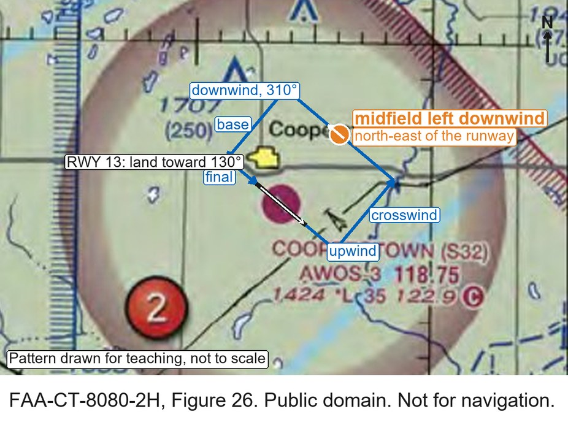
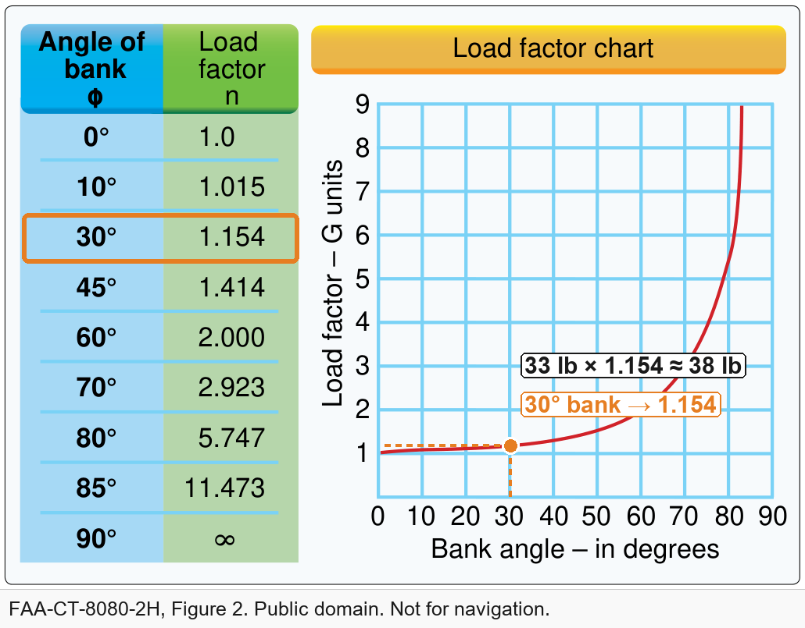

<!-- _class: title -->

# Passing the Part 107 Test

## Week 9 — Tuesday Lecture

<!--
Format for every question slide today: groups of 2–3, then one group answers and the class discusses. Questions marked "FAA sample" are adapted from the FAA's published UAG sample question set (public domain), keeping its answer choices; the others are written for this course in the same style.
Slides tagged "Seen in Week 3" are review.
-->

---

## The test

| | |
|---|---|
| Questions | 60 scored + 5 unscored, multiple choice A/B/C |
| Time | 2 hours |
| Pass | 70 % (42 of 60) |
| Where | PSI testing centres — locally, UVU's centre at the Provo airport |
| Bring | Photo ID with date of birth, signature and address |
| Provided | Calculator built in; the figures (on screen or the supplement book) |
| Retake | After 14 days, with your failed test report |
| Fee | *As of October 2026, about $175 — check PSI when you book* |

---

## Where to start studying

| # | Start with | Why | Time |
|---|---|---|---|
| 1 | Our readings: The Part 107 Exam and the Knowledge Review | Written for this class and current to the 2026 rules | 3 h |
| 2 | AC 107-2A, chapters 5, 6 and 8 | The FAA's own rules guide; regulations are half the test | 3 h |
| 3 | Testing supplement chart excerpts, legend open beside them | Charts are the most-missed area; the test shows these figures | 4 h |
| 4 | Matt Kendall's full video review (2024) | The one recent full review; watch one, not four | 2 h |
| 5 | FAA sample questions, then timed practice exams | Real test wording; log every miss by topic | 3 h |

The full ranked list, a drill-by-topic table and every link: **Study Resources → Start here**. Thursday's lab walks you through finding each one.

<!--
The ranking is the top of the Study Resources page (part_107_resources.md#the-top-8-ranked). Older material (FAA study guide 2016, some videos from 2017-2018) predates the 2021 rules on night, people and Remote ID: use it for charts and weather, not rules.
-->

---

Half the test is regulations. Weather and loading are small, but they are on it.

<!--
Weights from PSI's applicant bulletin, effective 29 September 2025. Older study guides still show the previous ranges.
-->

---

## How to read a figure question

"(Refer to FAA-CT-8080-2H, Figure 26, area 2.)"

1. Find **Figure 26** in the testing supplement — or on screen, inside the question
2. Find the **red number 2** on the chart
3. Read the question about *that* spot
4. When a symbol is unfamiliar, **use the legend** — it is in the supplement too

Figure 26, area 2: the red circled 2 sits beside Cooperstown airport.

<!--
Point at the red 2, then at the airport symbol and its label block (elevation, runway length, CTAF with the C in a circle). Every chart question on the test starts this way.
-->

---

<!-- _class: prompt -->

# Rapid round — seen in Week 3

1. Maximum altitude away from structures? A) 400 ft AGL · B) 400 ft MSL · C) 500 ft AGL
2. Minimum visibility? A) 1 SM · B) 3 SM · C) 5 SM
3. Flying 20 minutes after sunset needs? A) a waiver · B) anti-collision lights · C) nothing
4. Hours from last drink to flying? A) 4 · B) 8 · C) 12
5. Which Part 107 aircraft must be registered? A) over 0.55 lb · B) all of them · C) over 55 lb
6. Damage that must be reported? A) any · B) over $500 · C) over $1,000

<!--
Groups, 3 minutes for all six. Then read out answers fast.
-->

---

<!-- _class: answer -->

## A · B · B · B · B · B

1. **400 ft AGL** — or 400 ft above a structure you are within 400 ft of
2. **3 statute miles** from the control station
3. **Anti-collision lights** visible 3 SM — night flying is allowed since 2021
4. **8 hours**, and below 0.04 % blood alcohol
5. **All of them** — 0.55 lb is the *recreational* threshold
6. **Over $500**, not counting the drone itself — report to the FAA within 10 days

---

<!-- _class: prompt -->

# Who issues a Declaration of Compliance?

A) The remote pilot · B) The aircraft's manufacturer, accepted by the FAA · C) The owner, after registering

<!--
Groups 1 min, then class. Seen in Week 3.
This is the most-missed item on the real test — about three in four people get it wrong.
-->

---

<!-- _class: answer -->

## B — the manufacturer declares, the FAA accepts

- Category 2 and 3 aircraft are on an **FAA-accepted Declaration of Compliance** from the manufacturer
- The pilot's job is to **check the category on the label** before flying over people
- Category 1: 0.55 lb or less, no exposed parts that could cut skin — no declaration needed
- Category 4: an airworthiness certificate

---

The four categories on one page. The label on the aircraft tells you which one it is.

<!--
Seen in Week 3. Walk the four cards left to right, then the amber strip: the manufacturer declares, the FAA accepts, the pilot checks the label.
-->

---

<!-- _class: prompt -->

# You climb above 600 ft AGL to avoid a manned aircraft.

To whom must you report the deviation? A) Air traffic control · B) The NTSB · C) The FAA, upon request

<!--
FAA sample question, adapted. Groups 1 min.
Likely answer: B.
-->

---

<!-- _class: answer -->

## C — the FAA, upon request

- In an emergency you may deviate from any rule to the extent needed (§107.21)
- You report it **only if the FAA asks**
- Accidents are different: those go to the FAA **within 10 days**, whether asked or not

---

The sectional legend's airspace symbols (FAA-CT-8080-2H). When a chart symbol is unfamiliar, this is where the answer is.

---

Class E can start at the surface, 700 ft or 1,200 ft. Only surface Class E needs authorization below 400 ft.

---

<!-- _class: prompt chart -->

# Savannah, area 3: what is the floor of the Class C shelf (outer circle)?

- A) 1,300 ft AGL
- B) 1,300 ft MSL
- C) 1,700 ft MSL

<!--
FAA sample question, adapted (Figure 23, area 3). Groups 1.5 min.
Likely answer: A — students forget chart altitudes are MSL.
-->

---

<!-- _class: answer -->

## B — 1,300 ft MSL

- "41/13" means **ceiling 4,100 ft, floor 1,300 ft**, in hundreds of feet
- Airspace altitudes on a sectional are **MSL** — above sea level
- The 400 ft drone limit is **AGL** — above the ground
- **Ground elevation is on the chart:** the airport's data block ("SAVANNAH/HILTON HEAD INTL … **50** L 93": field at 50 ft), or any obstacle — "559 **(505)**" is a top at 559 ft MSL, 505 ft tall, so the ground is about 54 ft
- Shelf floor above the ground: 1,300 − 50 ≈ **1,250 ft AGL**

<!--
Point at the airport data block in the lower right of the crop, then at an obstacle near the shelf. Obstacle numbers: bold = top in MSL, (brackets) = height above ground. Top minus height = ground elevation. Contour tints and spot elevations also give ground height, but on the test the airport block and obstacles are quickest.
-->

---

<!-- _class: prompt chart -->

# Inspecting a tower near Jamestown Regional, area 4. What do you need first?

- A) Military authorization
- B) ATC authorization
- C) National Park Service authorization

<!--
FAA sample question, adapted (Figure 26, area 4). Groups 1.5 min.
Likely answer: "nothing" — students who miss the dashed magenta line think it is uncontrolled.
-->

---

<!-- _class: answer -->

## B — it is surface Class E

- The **dashed magenta line** around Jamestown marks Class E that starts at the **surface**
- Surface Class E is controlled: you need **ATC authorization** (§107.41), usually through LAANC
- A **magenta** shaded edge means Class E from 700 ft; **blue** means 1,200 ft — no authorization needed below 400 ft

---

<!-- _class: prompt chart -->

# Area 2: the gray line labelled "VR1667, VR1617…". Is it a hazard?

- A) No, all operations are above 400 ft
- B) Yes, a military training route from the surface to 1,500 ft AGL
- C) Yes, the route separates traffic

<!--
FAA sample question, adapted (Figure 59, area 2). Groups 1 min.
-->

---

<!-- _class: answer -->

## B — a military training route, surface to 1,500 ft AGL

- **VR** = flown under visual flight rules; **IR** = instrument rules
- **Four digits**: at or below 1,500 ft AGL. **Three digits**: some segments above 1,500 ft
- Military jets fly these fast and low — be alert near them, though they are not off-limits

---

<!-- _class: prompt -->

# So can you fly a survey under that route at 300 ft?

It is a hazard. Is it allowed? What would you do first?

<!--
Groups 2 min, then class. Follow-on discussion, not an FAA sample question.
Likely answers: "No, it's military airspace" or "Yes, we're below 400 ft so we're fine."
Both miss the point: legal, but you must manage the risk.
-->

---

<!-- _class: answer -->

## Yes — legal, but plan for the jets

- An MTR is **not restricted airspace**: no permission is needed beyond the airspace class underneath
- The jets can fly **as low as 100 ft AGL** at **well over 250 knots** — your 400 ft ceiling overlaps their route
- The line is a **centreline**; the route can be several miles wide
- You must **yield** (§107.37), and a jet can close a mile in about ten seconds
- So: ask Flight Service (1-800-WX-BRIEF) if the route is active, add a visual observer, stay low, and be ready to land

---

<!-- _class: prompt chart -->

# A crop survey in the Devils Lake West MOA. How do you find out whether it is active?

- A) The chart legend
- B) A small UAS database
- C) A military operations directory

<!--
FAA sample question, adapted (Figure 21). Groups 1 min.
-->

---

<!-- _class: answer -->

## A — the chart legend

- A full sectional lists each special-use area's times of use in its legend and margin tables
- A **military operations area (MOA)** is a hazard to know about, not a ban
- A **restricted area** needs the controlling agency's permission
- A **TFR — temporary flight restriction** — closes airspace for a while: a wildfire, a stadium game, a VIP visit. It is **not printed on the chart**
- A **NOTAM — notice to air missions** — is the FAA's bulletin of short-term changes, and it is how TFRs are announced
- Check both before every flight: tfr.faa.gov, or your LAANC app

<!--
Beginners have never seen either word. A TFR is the restriction; a NOTAM is the message that announces it (and other temporary changes, like a closed runway or a crane near an airport).
-->

---

<!-- _class: prompt chart -->

# Area 2: what is the CTAF at Coeur d'Alene?

- A) 122.05
- B) 135.075
- C) 122.8

<!--
FAA sample question, adapted (Figure 22, area 2). Groups 1 min.
-->

---

<!-- _class: answer -->

## C — 122.8

- **CTAF**: the common traffic advisory frequency, where pilots announce their positions at an airport without an operating tower
- On the chart it is the frequency with a **C in a circle** after it
- A drone pilot doesn't have to transmit, but **listening** tells you where manned traffic is

---

Runway 13 points about 130° magnetic. A left pattern turns left; downwind runs parallel, the opposite way.

---

<!-- _class: prompt chart -->

# Midfield left downwind — the test version

(Refer to FAA-CT-8080-2H, Figure 26, area 2.) While monitoring the Cooperstown CTAF you hear an aircraft announce that they are midfield left downwind to RWY 13. Where would the aircraft be relative to the runway?

- A) The aircraft is East.
- B) The aircraft is South.
- C) The aircraft is West.

<!--
FAA sample question 18, word for word (UAG sample set, public domain; ACS code UA.V.A.K3). Pairs 2 min: find the runway on the chart, draw the landing direction toward 130 degrees, turn left four times. The previous slide (Figure 11c) is the worked picture; ask them to apply it to this chart without looking back.
-->

---

<!-- _class: answer -->

## A — east of the runway

- Runway 13: landing toward about **130°** magnetic
- Left traffic: every turn is to the **left**, so the pattern sits on the **left** of the landing direction
- Downwind runs the opposite way, **310°**, on that side — **north-east**, so "east" of the runway
- On the test: find the runway, draw the landing arrow, turn left four times

---

<!--
The same Figure 26 crop as the question, with the left-hand pattern for runway 13 sketched on it (not to scale). Trace it with the class: land toward 130, upwind, turn left onto crosswind, left onto downwind heading 310 (the north-east side), then base and final.
-->

---

Five hazardous attitudes, and what to tell yourself instead.

---

<!-- _class: prompt -->

# Which hazardous attitude?

You have been hired as a remote pilot by a local TV news station to film breaking news with a small UA. You expressed a safety concern and the station manager has instructed you to "fly first, ask questions later." What type of hazardous attitude does this attitude represent?

A) Machismo. · B) Invulnerability. · C) Impulsivity.

<!--
FAA sample question 16, word for word (UAG sample set, public domain; ACS code UA.V.D.K4). Groups 1 min.
-->

---

<!-- _class: answer -->

## C — impulsivity

- Impulsivity: "Do it quickly." Antidote: **"Not so fast. Think first."**
- Machismo (macho) is "I can do it"; invulnerability is "It won't happen to me"
- On the test, match the **words** to the attitude

---

IMSAFE: check yourself before you check the aircraft.

---

<!-- _class: prompt -->

# A battery is swollen and warm before a flight.

What do you do? A) Fly a short flight · B) Cool it in the fridge · C) Don't fly it; move it outdoors onto a non-flammable surface

<!--
Course question. Groups 1 min.
-->

---

<!-- _class: answer -->

## C — never fly a damaged lithium battery

- Swelling, heat or smell means the cell is damaged and can catch fire
- Move it **outdoors**, onto sand or concrete, away from people and anything that burns
- Follow the manufacturer's disposal instructions
- Lithium fires are hard to put out — keep a fire bag or sand bucket in the kit

---

A METAR, decoded. Weather is about 5 % of the test.

---

<!-- _class: prompt -->

# Current conditions at Chicago Midway (KMDW)?

(Refer to FAA-CT-8080-2H, Figure 12.) The full report is the **SPECI KMDW** line in the table — find it first.

A) Sky 700 feet overcast, visibility 1-1/2SM, rain. · B) Sky 7,000 feet overcast, visibility 1-1/2SM, heavy rain. · C) Sky 700 feet overcast, visibility 11, occasionally 2SM, with rain.

<!--
FAA sample question 25, word for word (UAG sample set, public domain). Groups 1.5 min.
The first skill is finding the right line: five reports, one for Midway. Then read it left to right.
-->

---

<!-- _class: answer -->

## A — overcast at 700 ft AGL, 1½ statute miles, rain

- Cloud height in **hundreds of feet AGL**: 007 = 700 ft
- A **ceiling** is the lowest **broken (BKN)** or **overcast (OVC)** layer
- Visibility below 3 SM: **no Part 107 flight**
- **RA** alone is moderate rain; **+RA** would be heavy
- Watch for: times are **Zulu** (Utah is UTC−7 in winter, −6 in summer); winds are **true**

---

## Decoding the KMDW report, group by group

`SPECI KMDW 121856Z 32005KT 1 1/2SM RA OVC007 17/16 A2980 RMK RAB35`

| Group | Means |
|---|---|
| `SPECI` | A special report, issued because conditions changed (a routine one says METAR) |
| `KMDW` | Chicago Midway International Airport |
| `121856Z` | 12th of the month, 18:56 Zulu (UTC) |
| `32005KT` | Wind from 320° true at 5 knots |
| `1 1/2SM` | Visibility 1½ statute miles — below the 3 SM Part 107 needs |
| `RA` | Rain, moderate (`-RA` light, `+RA` heavy) |
| `OVC007` | Overcast at 700 ft above the ground — this is the ceiling |
| `17/16` | Temperature 17 °C, dew point 16 °C — only 1° apart, so fog or low cloud is likely |
| `A2980` | Altimeter setting 29.80 inches of mercury |
| `RMK RAB35` | Remarks: rain began at 35 minutes past the hour |

---

Hot and high: thinner air means less lift. Loading and performance is about 2 % of the test.

---

<!-- _class: prompt chart -->

# A 33 lb unmanned airplane in a 30° level banked turn.

What load must its structure support?

- A) 34 lb
- B) 47 lb
- C) 38 lb

<!--
FAA sample question, adapted (Figure 2). Pairs 2 min. Calculator allowed.
-->

---

<!-- _class: answer -->

## C — about 38 lb

- Find **30°** in the table, or go up from 30° to the curve: load factor **1.154**
- 33 lb × 1.154 ≈ **38 lb**
- 45° → 1.41; 60° → 2.0 — steep turns get expensive fast
- The table is the faster read; the curve shows why steep turns are risky

---

## The traps

- Chart altitudes are **MSL**; cloud heights and the 400 ft limit are **AGL**
- A **ceiling** is BKN or OVC only
- METAR times are **Zulu**; METAR winds are **true**
- **Surface** Class E needs authorization; 700 ft and 1,200 ft Class E don't, below 400 ft
- MOA = hazard; restricted = permission; temporary flight restriction (TFR) = announced by NOTAM, not on the chart
- Emergency deviations: report to the FAA **on request**; accidents: **within 10 days**

---

## A two-week study plan

- **Week 1:** the overview reading and the knowledge review; FAA sample questions; AC 107-2A
- **Week 2:** charts every day — the supplement figures and the legend; the practice exams here
- **Day before:** the traps list; sleep
- Free: FAA sample questions · AC 107-2A · the Pilot's Handbook of Aeronautical Knowledge · PSI's sample test
- [Knowledge Review](../part_107_license/part_107_knowledge_review.md) · [Study Resources — Start here](../part_107_license/part_107_resources.md#start-here-how-to-study) · ranked list on slide 3

---

## What to do Thursday

- **Part 107 study lab:** [Part 107 Studying](../labs/6_part_107_studying.md)
- The **practice exam** opens this week — see Learning Suite
- Practice: [Mini Practice Exam](../part_107_license/mini_exam.md) · [Full Practice Exam](../part_107_license/60_question_exam.md)
