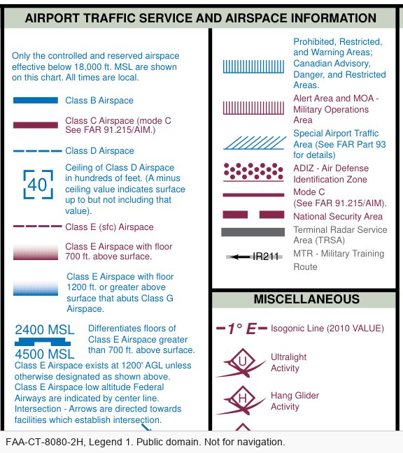
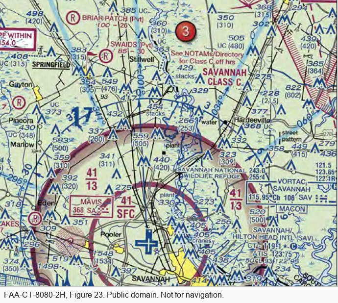
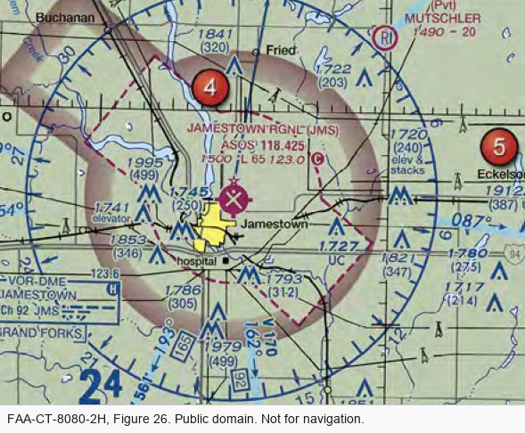
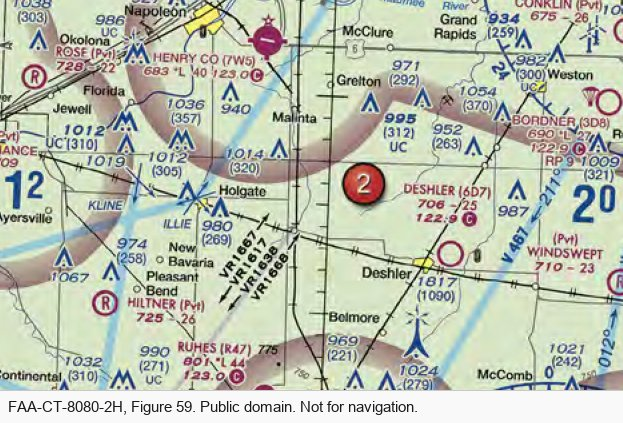
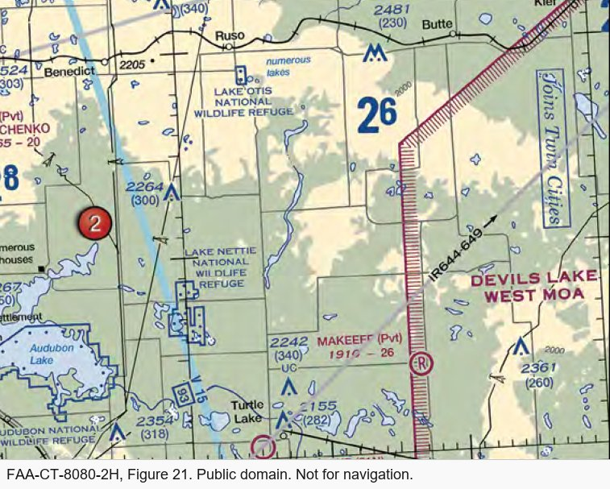
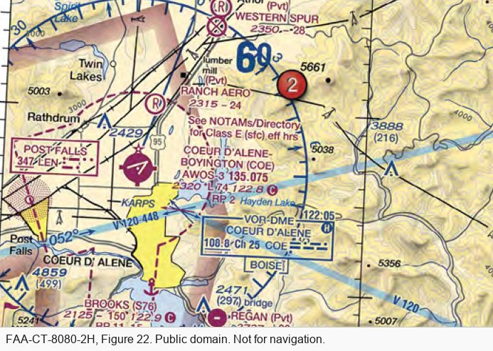
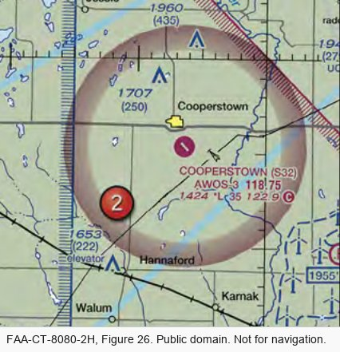
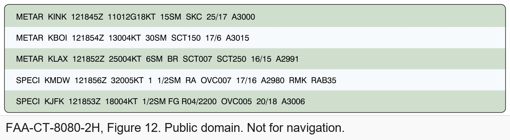
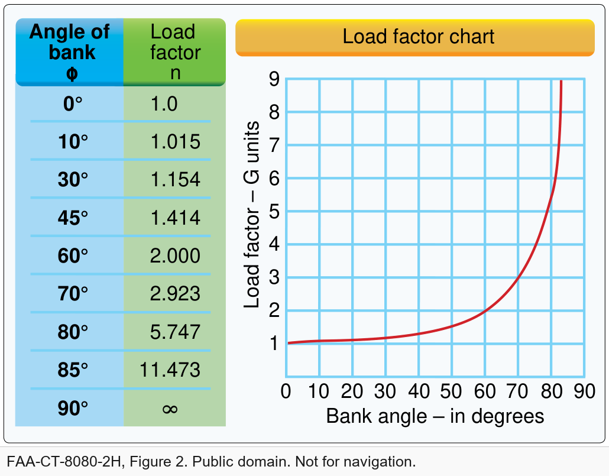

<!-- _class: title -->

# Passing the Part 107 Test

## Week 9 — Tuesday Lecture

<!--
Format for every question slide today: groups of 2–3, then one group answers and the class discusses. Questions marked "FAA sample" are adapted from the FAA's published UAG sample question set (public domain), keeping its answer choices; the others are written for this course in the same style.
Slides tagged "Seen in Week 3" are review.
-->

---

## The test

| | |
|---|---|
| Questions | 60 scored + 5 unscored, multiple choice A/B/C |
| Time | 2 hours |
| Pass | 70 % (42 of 60) |
| Where | PSI testing centres — locally, UVU's centre at the Provo airport |
| Bring | Photo ID with date of birth, signature and address |
| Provided | Calculator built in; the figures (on screen or the supplement book) |
| Retake | After 14 days, with your failed test report |
| Fee | *As of October 2026, about $175 — check PSI when you book* |

---

Half the test is regulations. Weather and loading are small, but they are on it.

<!--
Weights from PSI's applicant bulletin, effective 29 September 2025. Older study guides still show the previous ranges.
-->

---

## How to read a figure question

"(Refer to FAA-CT-8080-2H, Figure 26, area 2.)"

1. Find **Figure 26** in the testing supplement — or on screen, inside the question
2. Find the **red number 2** on the chart
3. Read the question about *that* spot
4. When a symbol is unfamiliar, **use the legend** — it is in the supplement too

---

<!-- _class: prompt -->

# Rapid round — seen in Week 3

1. Maximum altitude away from structures? A) 400 ft AGL · B) 400 ft MSL · C) 500 ft AGL
2. Minimum visibility? A) 1 SM · B) 3 SM · C) 5 SM
3. Flying 20 minutes after sunset needs? A) a waiver · B) anti-collision lights · C) nothing
4. Hours from last drink to flying? A) 4 · B) 8 · C) 12
5. Which Part 107 aircraft must be registered? A) over 0.55 lb · B) all of them · C) over 55 lb
6. Damage that must be reported? A) any · B) over $500 · C) over $1,000

<!--
Groups, 3 minutes for all six. Then read out answers fast.
-->

---

<!-- _class: answer -->

## A · B · B · B · B · B

1. **400 ft AGL** — or 400 ft above a structure you are within 400 ft of
2. **3 statute miles** from the control station
3. **Anti-collision lights** visible 3 SM — night flying is allowed since 2021
4. **8 hours**, and below 0.04 % blood alcohol
5. **All of them** — 0.55 lb is the *recreational* threshold
6. **Over $500**, not counting the drone itself — report to the FAA within 10 days

---

<!-- _class: prompt -->

# Who issues a Declaration of Compliance?

A) The remote pilot · B) The aircraft's manufacturer, accepted by the FAA · C) The owner, after registering

<!--
Groups 1 min, then class. Seen in Week 3.
This is the most-missed item on the real test — about three in four people get it wrong.
-->

---

<!-- _class: answer -->

## B — the manufacturer declares, the FAA accepts

- Category 2 and 3 aircraft are on an **FAA-accepted Declaration of Compliance** from the manufacturer
- The pilot's job is to **check the category on the label** before flying over people
- Category 1: 0.55 lb or less, no exposed parts that could cut skin — no declaration needed
- Category 4: an airworthiness certificate
- Figure 15b in the reading has all four categories on one page

---

<!-- _class: prompt -->

# You climb above 600 ft AGL to avoid a manned aircraft.

To whom must you report the deviation? A) Air traffic control · B) The NTSB · C) The FAA, upon request

<!--
FAA sample question, adapted. Groups 1 min.
Likely answer: B.
-->

---

<!-- _class: answer -->

## C — the FAA, upon request

- In an emergency you may deviate from any rule to the extent needed (§107.21)
- You report it **only if the FAA asks**
- Accidents are different: those go to the FAA **within 10 days**, whether asked or not

---

The sectional legend's airspace symbols (FAA-CT-8080-2H). When a chart symbol is unfamiliar, this is where the answer is.

---

Class E can start at the surface, 700 ft or 1,200 ft. Only surface Class E needs authorization below 400 ft.

---

<!-- _class: prompt -->

# Savannah, area 3: what is the floor of the Class C shelf (outer circle)?

A) 1,300 ft AGL · B) 1,300 ft MSL · C) 1,700 ft MSL

<!--
FAA sample question, adapted (Figure 23, area 3). Groups 1.5 min.
Likely answer: A — students forget chart altitudes are MSL.
-->

---

<!-- _class: answer -->

## B — 1,300 ft MSL

- "41/13" means **ceiling 4,100 ft, floor 1,300 ft**, in hundreds of feet
- Airspace altitudes on a sectional are **MSL** — above sea level
- The 400 ft drone limit is **AGL** — above the ground
- Subtract the ground elevation to compare the two

---

<!-- _class: prompt -->

# Inspecting a tower near Jamestown Regional, area 4. What do you need first?

A) Military authorization · B) ATC authorization · C) National Park Service authorization

<!--
FAA sample question, adapted (Figure 26, area 4). Groups 1.5 min.
Likely answer: "nothing" — students who miss the dashed magenta line think it is uncontrolled.
-->

---

<!-- _class: answer -->

## B — it is surface Class E

- The **dashed magenta line** around Jamestown marks Class E that starts at the **surface**
- Surface Class E is controlled: you need **ATC authorization** (§107.41), usually through LAANC
- A **magenta** shaded edge means Class E from 700 ft; **blue** means 1,200 ft — no authorization needed below 400 ft

---

<!-- _class: prompt -->

# Area 2: the gray line labelled "VR1667, VR1617…". Is it a hazard?

A) No, all operations are above 400 ft · B) Yes, a military training route from the surface to 1,500 ft AGL · C) Yes, the route separates traffic

<!--
FAA sample question, adapted (Figure 59, area 2). Groups 1 min.
-->

---

<!-- _class: answer -->

## B — a military training route, surface to 1,500 ft AGL

- **VR** = flown under visual flight rules; **IR** = instrument rules
- **Four digits**: at or below 1,500 ft AGL. **Three digits**: some segments above 1,500 ft
- Military jets fly these fast and low — be alert near them, though they are not off-limits

---

<!-- _class: prompt -->

# A crop survey in the Devils Lake West MOA. How do you find out whether it is active?

A) The chart legend · B) A small UAS database · C) A military operations directory

<!--
FAA sample question, adapted (Figure 21). Groups 1 min.
-->

---

<!-- _class: answer -->

## A — the chart legend

- A full sectional lists each special-use area's times of use in its legend and margin tables
- A **military operations area (MOA)** is a hazard to know about, not a ban
- A **restricted area** needs the controlling agency's permission
- A **TFR** comes by NOTAM — check before every flight

---

<!-- _class: prompt -->

# Area 2: what is the CTAF at Coeur d'Alene?

A) 122.05 · B) 135.075 · C) 122.8

<!--
FAA sample question, adapted (Figure 22, area 2). Groups 1 min.
-->

---

<!-- _class: answer -->

## C — 122.8

- **CTAF**: the common traffic advisory frequency, where pilots announce their positions at an airport without an operating tower
- On the chart it is the frequency with a **C in a circle** after it
- A drone pilot doesn't have to transmit, but **listening** tells you where manned traffic is

---

Runway 13 points about 130° magnetic. A left pattern turns left; downwind runs parallel, the opposite way.

---

<!-- _class: prompt -->

# On the Cooperstown CTAF: "midfield left downwind, runway 13."

Where is that aircraft? A) East of the runway · B) South of the runway · C) West of the runway

<!--
FAA sample question, adapted (Figure 26, area 2). Pairs 2 min: draw the runway, then the pattern.
-->

---

<!-- _class: answer -->

## A — east of the runway

- Runway 13: landing toward about **130°** magnetic
- Left traffic: all turns are to the **left**, so the pattern sits on the **left** of the landing direction
- Downwind runs the opposite way, about 310°, on that side — **northeast, to the east** of the runway
- Draw it: runway, landing arrow, turn left four times

---

Five hazardous attitudes, and what to tell yourself instead.

---

<!-- _class: prompt -->

# Your station manager says "fly first, ask questions later." Which hazardous attitude?

A) Macho · B) Invulnerability · C) Impulsivity

<!--
FAA sample question, adapted. Groups 1 min.
-->

---

<!-- _class: answer -->

## C — impulsivity

- Impulsivity: "Do it quickly." Antidote: **"Not so fast. Think first."**
- Macho is "I can do it"; invulnerability is "It won't happen to me"
- On the test, match the **words** to the attitude

---

IMSAFE: check yourself before you check the aircraft.

---

<!-- _class: prompt -->

# A battery is swollen and warm before a flight.

What do you do? A) Fly a short flight · B) Cool it in the fridge · C) Don't fly it; move it outdoors onto a non-flammable surface

<!--
Course question. Groups 1 min.
-->

---

<!-- _class: answer -->

## C — never fly a damaged lithium battery

- Swelling, heat or smell means the cell is damaged and can catch fire
- Move it **outdoors**, onto sand or concrete, away from people and anything that burns
- Follow the manufacturer's disposal instructions
- Lithium fires are hard to put out — keep a fire bag or sand bucket in the kit

---

A METAR, decoded. Weather is about 5 % of the test.

---

<!-- _class: prompt -->

# KMDW: "32005KT 1 1/2SM RA OVC007". What are the conditions?

A) 700 ft overcast, visibility 1½ SM, rain · B) 7,000 ft overcast, 1½ SM, heavy rain · C) 700 ft overcast, visibility 11, occasionally 2 SM, rain

<!--
FAA sample question, adapted (Figure 12). Groups 1.5 min.
-->

---

<!-- _class: answer -->

## A — overcast at 700 ft AGL, 1½ statute miles, rain

- Cloud height in **hundreds of feet AGL**: 007 = 700 ft
- A **ceiling** is the lowest **broken (BKN)** or **overcast (OVC)** layer
- Visibility below 3 SM: **no Part 107 flight**
- **RA** alone is moderate rain; **+RA** would be heavy
- Watch for: times are **Zulu** (Utah is UTC−7 in winter, −6 in summer); winds are **true**

---

Hot and high: thinner air means less lift. Loading and performance is about 2 % of the test.

---

<!-- _class: prompt -->

# A 33 lb unmanned airplane in a 30° level banked turn.

What load must its structure support? A) 34 lb · B) 47 lb · C) 38 lb

<!--
FAA sample question, adapted (Figure 2). Pairs 2 min. Calculator allowed.
-->

---

<!-- _class: answer -->

## C — about 38 lb

- Load factor in a 30° bank is **1.154**, read from the chart (it is 1 ÷ cos 30°)
- 33 lb × 1.154 ≈ **38 lb**
- 45° → 1.41; 60° → 2.0 — steep turns get expensive fast
- Figure 20b in the reading draws all four bank angles

---

## The traps

- Chart altitudes are **MSL**; cloud heights and the 400 ft limit are **AGL**
- A **ceiling** is BKN or OVC only
- METAR times are **Zulu**; METAR winds are **true**
- **Surface** Class E needs authorization; 700 ft and 1,200 ft Class E don't, below 400 ft
- MOA = hazard; restricted = permission; TFR = by NOTAM
- Emergency deviations: report to the FAA **on request**; accidents: **within 10 days**

---

## A two-week study plan

- **Week 1:** the overview reading and the knowledge review; FAA sample questions; AC 107-2A
- **Week 2:** charts every day — the supplement figures and the legend; the practice exams here
- **Day before:** the traps list; sleep
- Free: FAA sample questions · AC 107-2A · the Pilot's Handbook of Aeronautical Knowledge · PSI's sample test
- [Knowledge Review](../part_107_license/part_107_knowledge_review.md) · [Study Resources](../part_107_license/part_107_resources.md)

---

## What to do Thursday

- **Part 107 study lab:** [Part 107 Studying](../labs/6_part_107_studying.md)
- The **practice exam** opens this week — see Learning Suite
- Practice: [Mini Practice Exam](../part_107_license/mini_exam.md) · [Full Practice Exam](../part_107_license/60_question_exam.md)
