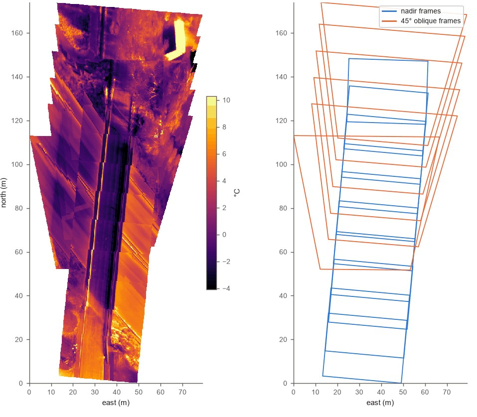

<!-- _class: title -->

# Final Project: You Are the Contractor

## Week 10 — Tuesday Lecture

---

## Today

- What the project is, and what makes it engineering
- Four turn-ins, two flight days, one 50-minute trip
- Permissions: airspace, property, people
- Project ideas, old and new — including a 3D model of your own group
- **Before you leave:** a partner and two candidate sites

<!--
Groups form today; the proposal is due Thursday night. Keep the lecture to about 40 minutes and leave 10 for pairing up and picking sites.
-->

---

## The job

You have been hired to fly a drone mission for a client: a city, a contractor, BYU Physical Facilities.

1. Find a civil or construction use for drone data
2. Plan the project, then the flight
3. Fly it, process it, measure something
4. Present it, and write a one-page memo

**Anyone can produce an orthomosaic.** The engineering is saying who needs the data, why you flew it that way, and what it can and cannot be used for.

---

<!-- _class: prompt -->

# "We flew over a parking lot."

Is that a project? What is missing?

<!--
Pairs 1 min, then take three answers.
Likely answer: "it needs a better site" or "a 3D model". Push toward who and why.
-->

---

<!-- _class: answer -->

## A client, a question, and a product that answers it

| Weak | Strong |
|---|---|
| "We flew over a parking lot." | "How much asphalt would it take to repave this lot, and what would it cost?" |
| No one needs the data | Physical Facilities budgets the work from it |
| A pretty 3D model | An area, a volume, a count, a slope, a map of damage |

The question decides the drone, the altitude, the pattern — and the measurement.

---


<!--
Weights: proposal 2.5 %, flight and processing 5 %, presentation 2.5 %, memo 5 % — 15 % of the course.
Nothing in the project can be turned in late. Learning Suite has the official dates.
-->

---

## Groups and flight days

- **Groups of 2.** Same score for both, except the presentation: a student who does not present gets a zero
- **Thu Nov 12** (5 groups) or **Thu Nov 19** (4 groups), trips at **8:00–8:50** or **9:00–9:50**
- Meet at **EB B122**. The trip leaves on time — a partner who is late is left behind
- Sign up for a **drone on a trip** on the sign-up sheet; first come, first served
- A second flight on another day can be arranged with the TAs, if your project needs one
- No class on a flight day for the groups not flying

---

## Three drones per trip

| Drone | Use it for |
|---|---|
| **Mini** | Regular photos: orthomosaics, 3D models, areas, counts |
| **Thermal** | Regular photos plus heat: roofs, pavement, moisture |
| **Multispectral** | Plant health (NDVI) plus regular photos |

The thermal and multispectral slots go first. **If regular photos answer your question, plan on the Mini** — and name a backup drone in your proposal.

---

<!-- _class: prompt -->

# Your site is a 12-minute walk from EB.

The flight itself is 8 minutes. Does the trip fit in 50?

<!--
Pairs 2 min: make them list every step, not just the flight.
Likely answer: "yes, 12 + 8 + 12 = 32". The missing pieces are checkout, setup, checklists, extra photos, pack-up.
-->

---

<!-- _class: answer -->


<!--
The flight is the small part. Walking both ways and the checklists are most of the trip.
Plan for 40 and keep 10 for wind, a pedestrian, or a battery swap. Time your own walk this week.
-->

---

## Permissions are your job

- **Airspace.** Most of campus is in Provo's **Class D**. Flying there needs **LAANC** authorization — Low Altitude Authorization and Notification Capability. A TA files it with you on Thursday, under their Part 107 certificate
- **Property.** Private property, active construction sites and some campus areas need the owner's OK, in writing. An email is fine
- **People and traffic.** Plan the flight so it never passes over people or moving cars

Every flight has a certified TA or instructor supervising.

---

<!-- _class: prompt -->

# LAANC approved for 200 ft. Can you fly over the Quad at noon?

<!--
Pairs 1 min. Likely answer: "yes, we have authorization".
-->

---

<!-- _class: answer -->

## No — LAANC is airspace only

- LAANC answers one question: may you be in this controlled airspace, this high, at this time
- It says nothing about **people** under you (§107.39), the **owner** of the ground, or **moving vehicles**
- Fly the Quad at 7 a.m., or pick a site where no one walks under the grid

Three separate checks: airspace, property, people. The proposal names all three.

---

## The proposal — due Thursday 11:59 PM

About one page, plus the flight-plan screenshot and Mission Log:

1. **Project and purpose** — client, problem, decision
2. **Site** — map, why it fits, hazards
3. **Airspace, permissions, safety** — with the LAANC request attached
4. **Time budget** — every minute, 50 or less
5. **Flight plan** — every setting with a reason
6. **Products and roles** — what you will measure, who flies, who watches

---

## Every setting gets a "because"

| Setting | Your value | Why |
|---|---|---|
| Drone, and a backup | | |
| Altitude above ground | | |
| Ground sample distance (GSD) | | |
| Front and side overlap | | |
| Gimbal angle | | |
| Pattern: grid, double grid, orbit, ascending circle | | |
| Flight time and batteries | | |

"110 ft, 80 % front" is a list. "110 ft, because a 0.5 in GSD shows the cracks" is a plan.

---

## Two gates

A proposal whose flight is **not legal**, or **does not fit in 50 minutes**, comes back — whatever else it does well.

Fix it and resubmit before your flight day. **You are not cleared to fly until the TAs approve it.**

---

<!-- _class: title -->

# Project ideas

## Use one, adapt one, or bring your own

---

## Proven ideas from past semesters

<style scoped>
table { font-size: 20px; }
th, td { padding: 3px 10px; }
</style>

| Idea | Product | What went wrong before |
|---|---|---|
| Parking lot resurfacing | Area, stall count, cost | Missed a corner — run the grid past every edge |
| Pavement condition | Map of the worst failures | Trees modeled badly; fly low enough for a 0.5 in GSD |
| Court or park remodel | Orthomosaic, DSM for drainage | Smooth surface left holes — raise the overlap |
| Earthwork volume | Area × depth, or a DSM | Area came out as 100,000 square miles: wrong CRS |
| Room for more parking | Proposed stalls, dimensioned | Measure one real stall first to check the scale |

Full notes on the [Example Projects](../final_project/project_ideas/) page.

---

## New: quick projects near campus

<style scoped>
table { font-size: 20px; }
th, td { padding: 3px 10px; }
</style>

Walkable from EB, one battery, about 30 minutes on site.

| Idea | Drone | Pattern | Check one number |
|---|---|---|---|
| **A 3D model of your group** | Mini | Ascending circle | Tape one person's height |
| **How tall is it?** A light pole, flagpole, building corner | Mini | Ascending circle | Plans, or tape the shadow |
| **Roof heat loss at 8 a.m.** | Thermal | Grid | Thermometer on one surface |
| **Is this ramp accessible?** | Mini | Low grid + oblique line | A level on the ramp |
| **Count the lot by computer** | Mini | Grid, two days | Hand-count one row |

Your proposal names the exact site. These are starting points.

---


<!--
The fun one. DJI's tower-inspection missions fly exactly this: an ascending circle with the camera locked on the centre. A TA sets it up with you.
The measurement: tape one person's height and compare it with the mesh. That one number is the whole engineering point.
Anyone who moves becomes a ghost — that is a real lesson about what photogrammetry assumes (nothing moves between photos).
-->

---

<!-- _class: prompt -->

# The group portrait: is that a flight over people?

The drone circles 25 ft out with the camera pointed in.

<!--
Pairs 1 min. Likely answers split between "yes, they are under it" and "no, they are participating".
-->

---

<!-- _class: answer -->

## Not if the circle stays outside the group

- §107.39: no flight **over** a person who is not directly taking part in the operation
- The drone circles **around** the group; it never passes over a head
- Anyone else who wanders inside the circle: pause the mission
- Pick a spot with no foot traffic — a lawn at 8 a.m., not the Quad at noon

---

<!-- _class: prompt -->

# You want the height of a light pole. Will a nadir grid do it?

A nadir grid: camera straight down, lawnmower lines.

<!--
Pairs 1 min. Likely answer: "yes, the DSM gives the height".
Follow-up: what does a thin pole look like from straight above?
-->

---

<!-- _class: answer -->

## No — straight down, a pole is a dot

- From above you see the top of the pole and almost none of its side
- A thin object gets too few matches; it comes out as a blob, or a web, or not at all
- Circle it with the camera tilted in, climbing as you go — the same plan as the group portrait


---

## A class 3D object: the Rock Canyon water tank


<p class="caption">Flown by a class in March 2026: a grid plus one line of oblique photos at −45°. The wall is there because the oblique line saw it.</p>

---

## Roof heat loss at 8 a.m.

- Cold November morning, before the sun reaches the roof: the building has heated all night, so a warm patch is heat leaking out — wet insulation, a gap, an unsealed vent
- Fly the Autel on a grid with about **90 %** front and side overlap; thermal photos have little texture
- **Power on 10 minutes early**, then run the shutter calibration (FFC). A cold camera read up to 30 °C too cold — Week 8's −8 °C parking lot
- Photo format **JPG + TIFF**: the `.irg` and `.TIFF` hold the temperatures, the colour JPG is only a picture
- **Limit to say in the memo:** apparent temperature, not true temperature — shiny metal and glass lie

<!--
Warm-up and FFC: autel-thermal CAPTURE_AND_PHOTOGRAMMETRY.md §3. The parking-lot frames 1-36 were taken 1.5-3 min after power-on; the first 2-5 frames of later flights still read 4-7 °C cold. Ten minutes plus a manual FFC avoids both.
Leave emissivity 0.95 and reflected 25 °C on the drone; the tool re-corrects afterwards (--emissivity, --reflected).
-->

---

## From frames to a temperature map: autel-thermal

The class's own Python tool, written for this camera.

```text
pip install "autel-thermal[notebooks] @ git+https://github.com/gus-p-williams/autel-thermal"
autel-ortho roof_flight roof_out --mosaic
```

- Copy the whole flight folder off the SD card — `.irg`, `.TIFF`, `.jpg` and the `.mrk` GPS log — and rename nothing
- Converts every frame to °C (matches Autel's own software, bit for bit), places it on the map in UTM metres, and stitches `mosaic.tif`
- Leaves out frames with the cold-camera fault and says why in `ortho_report.csv`
- Open `mosaic.tif` in QGIS, or work through the four example notebooks — 04 finds the hot spots and their area in m²

<!--
As of Nov 3 the GitHub repository is still private; it goes public before groups process their flights. If pip asks for a GitHub sign-in, it is not public yet: a TA runs it.
examples/README.md in the repository has the install steps (venv or conda), where to put the flight folders, and troubleshooting.
autel-ortho is ortho_frames.py's command: flat-ground placement from the drone's GPS (the .mrk) and gimbal angles, not photogrammetry. That is why the next question matters.
-->

---

## What you get: a class flight



<p class="caption">Carterville, Oct 2025, 16 frames at 61 m. Left: the mosaic in °C. Right: each frame's outline.</p>

<!--
Left is mosaic.tif; right is footprints.geojson, straight-down frames in blue, 45° frames in orange. Where they overlap, the straight-down frame wins.
The same Carterville bridge approach as the Week 8 thermal question — there one frame, here the whole flight on the map.
-->


---

<!-- _class: prompt -->

# The tool puts every frame on flat ground at the takeoff height. Your roof is 6 m up and you fly at 40 m. What happens to the area of a warm patch?

<!--
Pairs 1 min. Likely answer: "nothing, it is a map".
Follow-up: how far is the camera from the roof, and how far does the tool think it is?
-->

---

<!-- _class: answer -->

## It comes out about 40 % too large

- The camera is 34 m above the roof, but the tool thinks 40 m, so every roof pixel is drawn 40 ÷ 34 = **1.18** times too long — and too wide
- Area: 1.18 × 1.18 ≈ **1.38**
- Fix: put the plane at the roof — `--ground-below-takeoff -6` (negative means above the takeoff point). Then measure only on the roof
- Check: one roof edge from the plans or a tape, measured again in QGIS

<!--
Tested on the Carterville flight: -6 gives a 55 m camera height instead of 61 m and 0.051 m cells instead of 0.056 m.
Roof edges also shift between neighbouring frames (relief displacement), so seams run through the parapet. autel-thermal docs: m4-relief-displacement.
This is the course theme in one slide: a number from software is only as good as what it assumed.
-->

---

## Is this ramp accessible?

- The ADA limit for a ramp is a slope of **1:12**, about **8.3 %**
- Fly a low grid along the ramp, plus one oblique line; make a DSM; read the rise over the run in QGIS
- Check it with a 2 ft level and a tape at two spots on the ramp
- A useful answer for Physical Facilities: which runs meet 1:12, which do not

---

<style scoped>
section { font-size: 25px; }
</style>

## Count the lot by computer

Fly a lot, make the orthomosaic, and let a Python image-recognition model count the cars and trucks.

- **The model:** YOLO11 nano, the smallest and fastest version, in its oriented bounding box (OBB) variant. The weights download automatically the first time it runs
- **Trained on DOTA v1**, aerial images labelled with 15 classes: plane, ship, storage tank, baseball diamond, tennis court, basketball court, ground track field, harbor, bridge, large vehicle, small vehicle, helicopter, roundabout, soccer ball field and swimming pool
- **Oriented** means each box can rotate to match how the car is parked, instead of being a box aligned to the image edges
- Fly it twice — two days, or 8:05 and 8:40 — and the project becomes an **occupancy study**
- The check: count one row by hand. How many did the model miss, and how many did it invent?

<!--
The DOTA model was trained on aerial photos, so it knows cars from above; a street-view model does not.
Cars and trucks come out as "small vehicle" and "large vehicle"; there is no separate pickup or bus class.
Ask before the next slide: a car is 4.5 m long. At our 2 cm GSD, how many pixels is that? (225.) Squeeze a 20,000 px wide orthomosaic to 1,024 px: now how many? (About 11.)
-->

---

<style scoped>
section { font-size: 22px; }
</style>

## A starting script: resample first

```python
import cv2
from ultralytics import YOLO                     # pip install ultralytics
model = YOLO("yolo11n-obb.pt")
img = cv2.imread("lot.tif")                      # 8-bit RGB export
scale = 0.02 / 0.12                              # native GSD / target GSD
img = cv2.resize(img, None, fx=scale, fy=scale, interpolation=cv2.INTER_AREA)
r = model.predict(img, imgsz=max(img.shape[:2]), conf=0.3, max_det=3000)[0]
names = [r.names[int(c)] for c in r.obb.cls]
print({n: names.count(n) for n in set(names)})   # small vehicle, large vehicle
cv2.imwrite("lot_boxes.jpg", r.plot())           # every box drawn: check one row
```

- **Pixel size:** DOTA cars are mostly 20–60 px long. Squeeze a 20,000 px orthomosaic to 1,024 px and a car is 11 × 5 px; leave it at 2 cm and it is 225 px. Both miss. At **10–15 cm/px** a car is 30–50 px
- **`max_det`** defaults to 300: a lot with more cars is cut off at 300, silently
- **Export first:** JPEG stops at 65,535 px per side, and OpenCV may choke on BigTIFF, 4-band or float GeoTIFFs. Save an 8-bit RGB copy

<!--
Change 0.02 to your own orthomosaic's GSD. Or let QGIS do both steps: right-click the layer > Export > Save As, output mode "Rendered image", resolution 0.12 m; that writes an 8-bit RGB GeoTIFF already at 12 cm, and scale becomes 1.
The other way is to cut the full-resolution image into overlapping 1,024 px tiles. It works, but a car on an overlap is counted twice unless the duplicates are merged; the SAHI library does the tiling and merging.
lot_boxes.jpg answers the check on the last slide: you can see exactly which cars it missed and which detections it invented.
Untested on our own orthophoto: a TA should run it once before a group relies on it.
-->

---

## What good work looks like

- The project answers a question someone would actually ask
- The flight plan is made **before** flying, and every setting has a reason
- The flight runs the way a client would expect from a contractor
- The results are clear, and you say plainly what went wrong and what the data cannot support

**Check one number.** Compare one drone measurement with something measured another way: a taped length, a stall count, a dimension from a plan.

---

## The memo: one page, six headings

Scope and purpose · Flight plan · Flight execution · Data summary and results · Limitations · Conclusion


<p class="caption">From the Example Technical Memo: the EB east lot traced in QGIS, 28,000 ft², and one stall taped at 19.5 ft against 19.4 ft on the map.</p>

---

<!-- _class: prompt -->

# What can the client *not* decide from your data?

Take the parking-lot memo: area 28,000 ft², cost about $98,000.

<!--
Pairs 2 min. This is the question every presentation will get.
-->

---

<!-- _class: answer -->

## Say it before they ask

- **Parked cars** hid a third of the pavement: no crack map, so no crack-sealing option
- **Shadows and trees** blur one edge: the area could be off by a few hundred ft²
- The **cost per square foot** is a typical value, not a quote: good for a budget, not a bid

Each limitation says what went wrong, how much it matters, and what would fix it.

---

## The presentation: 12 minutes + 5 of questions

- Both partners present. Slides due **Mon Dec 7**; present **Dec 8 or Dec 10**
- **Lead with the answer** in the first minute, then show how you got it
- Show your site, your products, your measurement, and what went wrong
- Skip the history of drones and the software tour

**Questions to expect:** Why that altitude and overlap? What would you change? How sure are you of that number? What can the client not decide?

---

## Thursday: proposal lab

- Bring your partner, your idea and **two** candidate sites
- Build the flight plan in the class planner; fill in the Mission Log
- File the **LAANC** request with a TA; email any property owner **that day**
- Proposal due **Thu Nov 5, 11:59 PM**, one PDF per group, with the KMZ and permissions

---

<!-- _class: title -->

# Before you leave today

## Find a partner · pick two sites · sign up for a drone on a trip
