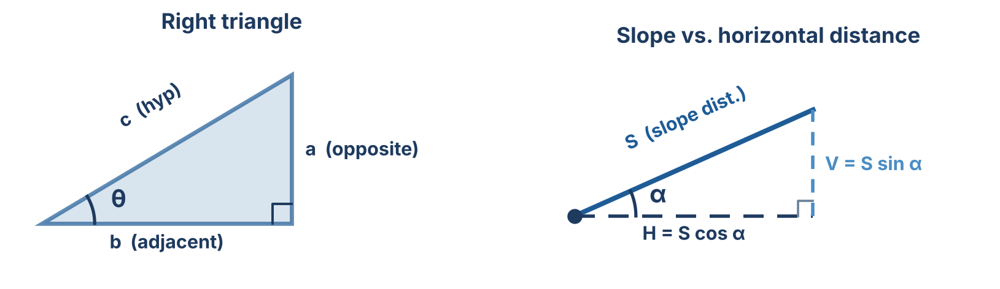
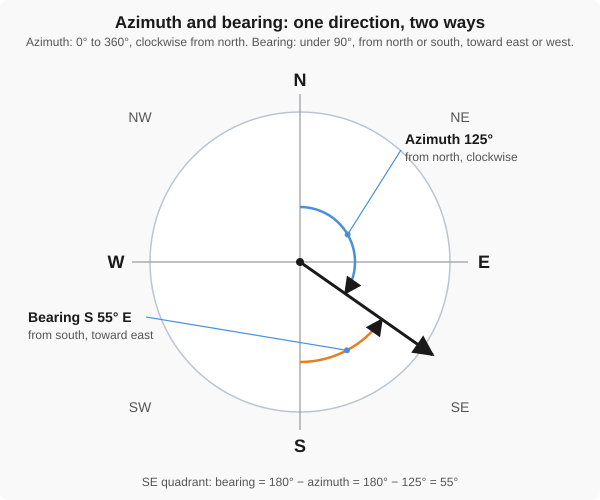
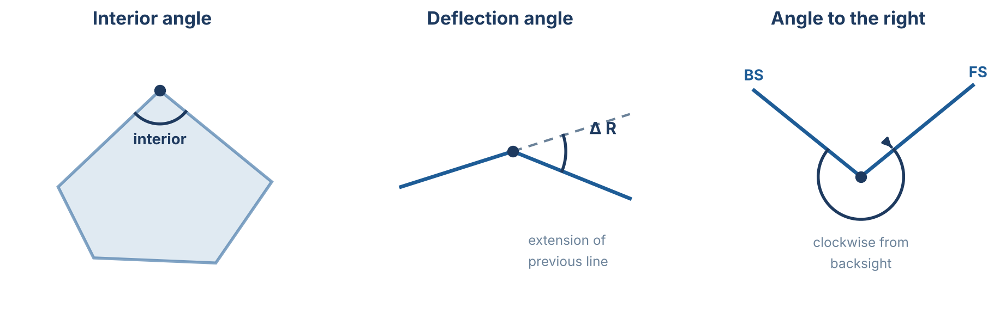
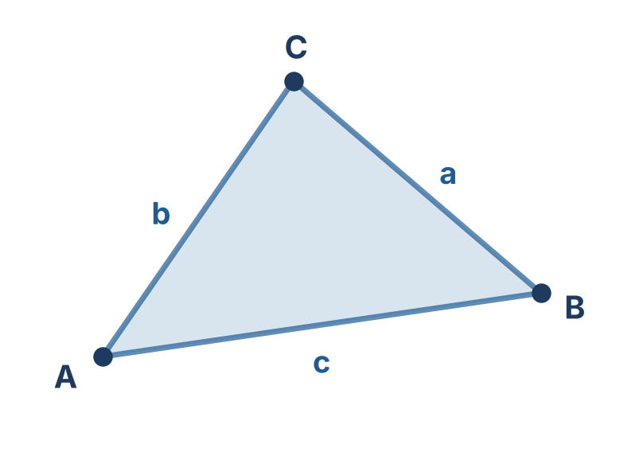
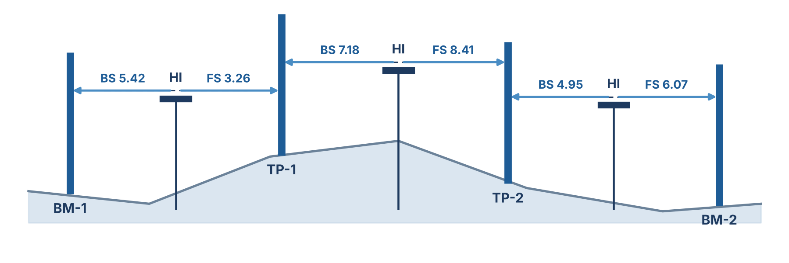
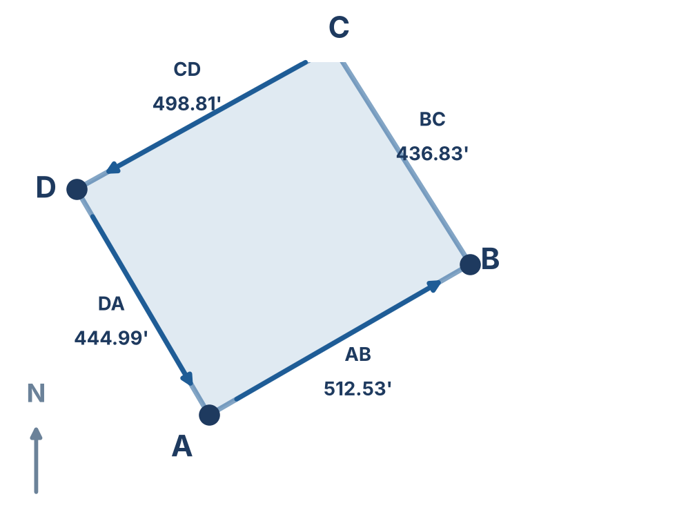
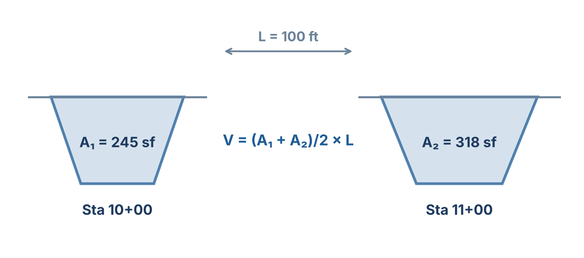
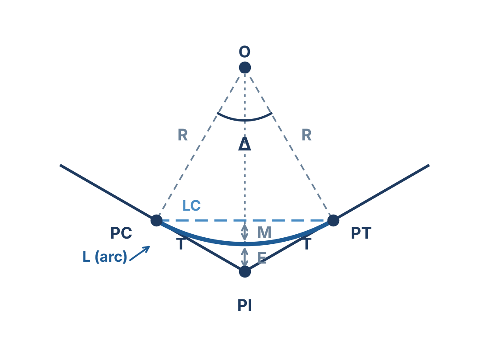
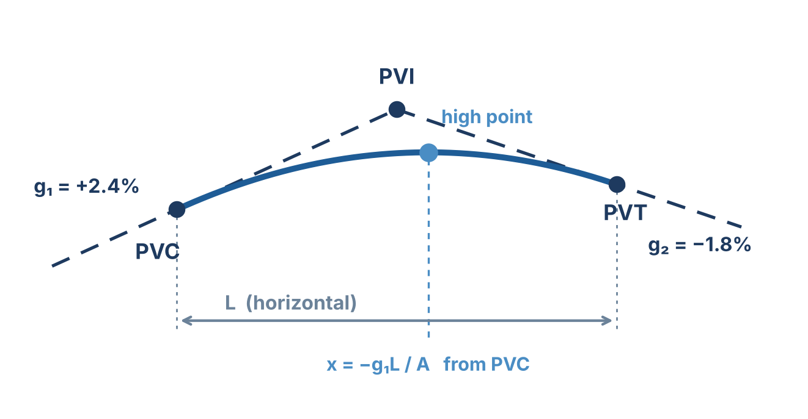

<!-- _class: title -->

# Surveying Fundamentals for the FE Exam

## Week 12 — Tuesday Lecture · the five FE Civil Surveying topics (6–9 of 110 questions), plus the traverse and curves that use them

<!--
Built from the TA's FE Surveying Review deck (docs/slides/fe_surveying_review.pptx), revised in instructor review 2026-11-17.
Pace: angles, coordinates and leveling go quickly; spend the time on the closed traverse.
If this is new to most of the room, say so up front: the homework hints walk through every step, and the Handbook has the formulas.
Format for every question slide: pairs, 1–2 minutes, then one pair answers and the class discusses.
-->

---

## What we'll cover

| # | Topic | FE Civil spec |
|---|---|---|
| 1 | Angles, distances, and trigonometry | Surveying **A** |
| 2 | Coordinate systems | Surveying **D** |
| 3 | Leveling | Surveying **E** |
| 4 | The closed traverse | Uses **A**, **B**, **D** — not its own item since 2020 |
| 5 | Area computation | Surveying **B** |
| 6 | Earthwork and volumes | Surveying **C** |
| 7 | Curves — horizontal and vertical | Transportation **13.A**, geometric design |

If any of this is new, that is fine: the homework hints walk through each step. The closed traverse gets the most time because it ties four topics together. Curves come last: they are covered in other coursework, so this is a formula refresher.

<!--
Spec letters are from the NCEES FE Civil CBT specifications, effective July 2020 (ncees.org/exams/fe-exam → FE Civil). Surveying is knowledge area 9, 6–9 questions.
The 2014 specs had "D. Closure" under Surveying; the 2020 revision dropped it, so the traverse is tested through angles, coordinates and area.
Curves are not named in the specs; geometric design under Transportation is the nearest line.
Budget roughly: 5 / 6 / 5 / 10 / 5 / 5 / 8 minutes, plus the five questions.
-->

---

## The FE Reference Handbook

1. **Get it free.** Create a MyNCEES account at ncees.org and download the current edition from your dashboard. A printed copy is sold separately, but it is not what you use on exam day
2. **It is the only reference allowed.** NCEES supplies it on screen as a searchable PDF. No notes, textbooks or printouts
3. **Study with it open.** Solve every practice problem from the Handbook so its notation and variable definitions are already familiar. Search by keyword rather than memorizing page numbers
4. **Match the version.** NCEES revises the Handbook; formulas and page organization shift between editions

Every formula in this deck is a keyword search away. Find it, and read its variable definitions before you use it.

<!--
Ask who already has the Handbook downloaded. Anyone who does not should do it tonight.
-->

---

## The exam itself

| | |
|---|---|
| Questions | 110, built per examinee — no two people get the same set |
| Time | 5 h 20 min of exam inside a roughly 6-hour appointment (tutorial and a 25-min break included) |
| Question types | Multiple choice, plus multiple correct, point and click, drag and drop, fill in the blank — **no partial credit** |
| Reference | The FE Reference Handbook, on screen. Version 10.4 is the latest NCEES documents publicly; check yours in MyNCEES |
| Calculators | Casio fx-115 and fx-991 · HP 33s and 35s · TI-30X and TI-36X (the list for exams through 2027); an on-screen TI-30XS is provided |
| Result | Pass or fail; a diagnostic report by topic only if you fail |
| Fee | *As of November 2026, $225 — check NCEES when you register* |

NCEES surveyed engineers in 2026 to update the FE content. The topic list can change; no date has been announced.

<!--
Sources, all NCEES, checked 2026-11-17: ncees.org/exams/fe-exam (fee, question count, appointment breakdown), the NCEES Examinee Guide November 2026, ncees.org/computer-based-testing-cbt (item types, no partial credit), ncees.org/exams/calculator (approved list "through 2027"), the FE Reference Handbook 10.4 change notice (March 2024), and the 2026-04-02 news item on the FE content survey.
NCEES's own pages give the appointment as both "6 hours" and "5 hr 55 min".
-->

---

<!-- _class: title -->

# 1 · Angles, Distances, and Trigonometry

## Right triangles · bearings and azimuths · field angles · oblique triangles

---

## Right-triangle trigonometry

$\sin\theta = a/c \quad \cos\theta = b/c \quad \tan\theta = a/b \quad a^2 + b^2 = c^2$
Inverse functions return a reference angle only — the quadrant comes from the signs of the components.

**DMS:** decimal degrees $= D + M/60 + S/3600$. On a 500 ft leg, 1″ moves the far end about 0.002 ft; 1′ about 0.15 ft.

**Reducing a slope distance:** $H = S\cos\alpha$, $V = S\sin\alpha$, $\alpha$ from horizontal. From a zenith angle $z$: $H = S\sin z$, $V = S\cos z$.
Every computation that follows uses horizontal distance.

<!--
Thirty seconds here. Point out that FE problems often give a slope distance to see whether you reduce it.
-->

---

## Azimuths and bearings

| Quadrant | Azimuth | Bearing |
|---|---|---|
| NE | 0°–90° | N (Az) E |
| SE | 90°–180° | S (180° − Az) E |
| SW | 180°–270° | S (Az − 180°) W |
| NW | 270°–360° | N (360° − Az) W |

**Reversing a line:** back azimuth = azimuth ± 180°. A back bearing keeps the angle and swaps both letters: N 40° E becomes S 40° W.

Convert everything to azimuths before computing latitudes and departures.

<!--
A common error is mixing the two systems mid-problem.
Figure redrawn 2026-11-17 in the house style; the TA's version had the SW label printed over "bearing angle".
-->

---

<!-- _class: prompt -->

# A line has an azimuth of 213°40′. What is its bearing?

A) N 33°40′ E · B) S 33°40′ W · C) S 56°20′ W · D) N 46°20′ W

<!--
Pairs, 1 minute. FE style: one correct answer and three built from common slips.
Likely wrong answers: C (used 270° − Az, measuring from the wrong axis) and A (right angle, wrong quadrant).
-->

---

<!-- _class: answer -->

## B — S 33°40′ W

- 213°40′ is between 180° and 270°, so the line points **south-west**
- In the SW quadrant, bearing = Az − 180° = **33°40′**, measured from **south**
- C measured from the west axis instead; A is the back bearing — the same line run the other way

Quadrant first, then the angle.

---

## Angles as they are measured in the field

- **Interior angle** — inside a closed figure; for $n$ sides they sum to $(n-2)\times180°$
- **Deflection angle** — from the extension of the previous line, labelled R or L; route surveys
- **Angle to the right** — clockwise from backsight to foresight; the total-station convention

**Carrying an azimuth through a traverse**
Az(next) = Az(previous) ± 180° + angle to the right
Add or subtract 360° to stay between 0° and 360°.

---

## Oblique triangles — laws of sines and cosines

**Law of sines:** $\dfrac{a}{\sin A} = \dfrac{b}{\sin B} = \dfrac{c}{\sin C}$
Two angles and any side, or two sides and a non-included angle.

**Law of cosines:** $a^2 = b^2 + c^2 - 2bc\cos A$
Two sides and the included angle, or all three sides to find an angle.

**The ambiguous case.** Two sides and a non-included angle (SSA) can describe two triangles. The law of sines returns only the acute solution, so check whether the obtuse supplement also fits.

---

<!-- _class: title -->

# 2 · Coordinate Systems

## Geodetic and plane · state plane and UTM · grid versus ground · forward and inverse

---

## Geodetic versus plane coordinates

**Geodetic** — latitude, longitude, ellipsoid height on a reference ellipsoid. Angular, not linear: a degree of longitude shrinks toward the poles. Correct over any distance.

**Plane (grid)** — northing and easting on a flat projection. Ordinary plane trigonometry works. Distortion grows with distance from the projection origin.

**Two kinds of height:** $h = H + N$

- $h$ — ellipsoid height, what GNSS measures directly
- $H$ — orthometric height, from the geoid: the elevation on plans
- $N$ — geoid height, the separation between the two

**Datums:** horizontal NAD 83, vertical NAVD 88. Coordinates from different datums do not mix — confirm the datum on every project.

<!--
h = H + N is where drone and GNSS work most often goes wrong, even though the FE treats it lightly.
NGS is replacing NAD 83 and NAVD 88 with modernized reference frames; verify current status before relying on this beyond the exam.
-->

---

## State plane, UTM, and grid versus ground

**State Plane Coordinate System** — zones kept small so distortion stays small. Lambert conformal conic for zones long east–west; transverse Mercator for zones long north–south. Utah: Lambert, three zones (North, Central, South).

**UTM** — 60 zones, each 6° of longitude; metres; 500,000 m false easting on the central meridian. **Provo and nearly all of Utah fall in Zone 12.** Our Bentley outputs use UTM Zone 12N, **EPSG:32612**.

**Grid versus ground**

Grid distance = ground distance × combined factor
Combined factor = scale factor × elevation factor

At Utah elevations the combined factor is less than one, so grid distances are shorter than distances on the ground. Staking a grid distance without converting it puts the point in the wrong place.

<!--
The strip of western Utah west of 114° W is in UTM Zone 11.
EPSG:32612 is WGS 84 / UTM zone 12N, the system the Bentley guide and QGIS page use for every class product.
-->

---

## Forward and inverse computations

**Forward — coordinates from a line**
$N_2 = N_1 + d\cos(\text{Az})$
$E_2 = E_1 + d\sin(\text{Az})$

**Inverse — a line from two points**
$\Delta N = N_2 - N_1, \quad \Delta E = E_2 - E_1$
$d = \sqrt{\Delta N^2 + \Delta E^2}$
$\text{Az} = \arctan(\Delta E/\Delta N)$, placed by quadrant

**Worked example — inverse A to C**
A: N 5,000.00, E 5,000.00
C: N 5,625.63, E 5,210.86

ΔN = +625.63 ft, ΔE = +210.86 ft
d = √(625.63² + 210.86²) = **660.21 ft**
Az = arctan(210.86 / 625.63) = **18°37′33″**
Both positive → NE → **N 18°37′33″ E**

The quadrant comes from the signs of ΔN and ΔE — never from the calculator alone.

---

<!-- _class: title -->

# 3 · Leveling

## Differential leveling · the field book · loop closure · grade · curvature and refraction

---

## Differential leveling

**The only two equations you need**
**HI = known elevation + BS**
**Elevation = HI − FS**

- **BS** — reading on a point of known elevation (+)
- **FS** — reading on a point being established (−)
- **TP** — turning point: an FS, then a BS from the next setup
- **IFS** — side shot; does not advance the line

---

## Worked example — a level run from BM-1 to BM-2

| Station | BS (+) | HI | FS (−) | Elevation |
|---|---|---|---|---|
| BM-1 | 5.42 | 105.42 | — | 100.00 |
| TP-1 | 7.18 | 109.34 | 3.26 | 102.16 |
| TP-2 | 4.95 | 105.88 | 8.41 | 100.93 |
| BM-2 | — | — | 6.07 | 99.81 |
| Σ | 17.55 | | 17.74 | |

**Arithmetic check:** ΣBS − ΣFS = −0.19; 99.81 − 100.00 = −0.19 ✓

**Misclosure:** published BM-2 is 99.86 ft, so 99.81 − 99.86 = **−0.05 ft**. If within tolerance, distribute it — by distance, or equally among setups.

The check proves only the arithmetic — it says nothing about whether the readings were good.

---

<!-- _class: prompt -->

# Complete the level notes. What is the elevation of BM-X?

| Station | BS (+) | HI | FS (−) | Elevation |
|---|---|---|---|---|
| BM-7 | 4.36 | ? | — | 1,250.00 |
| TP-1 | 3.15 | ? | 7.82 | ? |
| BM-X | — | — | 5.61 | ? |

<!--
Pairs, 2 minutes. On the FE this could be a drag-and-drop or fill-in-the-blank item: the same table, with values to place.
Make them do the arithmetic check before they announce the answer.
-->

---

<!-- _class: answer -->

## BM-X = 1,244.08 ft

| Station | BS (+) | HI | FS (−) | Elevation |
|---|---|---|---|---|
| BM-7 | 4.36 | **1,254.36** | — | 1,250.00 |
| TP-1 | 3.15 | **1,249.69** | 7.82 | **1,246.54** |
| BM-X | — | — | 5.61 | **1,244.08** |

Check: ΣBS − ΣFS = 7.51 − 13.43 = **−5.92** = 1,244.08 − 1,250.00 ✓

---

## Grade, and the errors that need watching

**Grade:** $G(\%) = \dfrac{\Delta\text{elevation}}{\text{horizontal distance}}\times100$
The denominator is horizontal distance, not slope distance.

**Curvature and refraction.** Earth curvature makes a distant rod read too high; refraction offsets part of it. The combined correction grows with the square of the sight distance. Take the coefficient from the Handbook, not memory.

**Field practice that removes error rather than correcting it**

1. **Balance the sights** — equal BS and FS distances cancel curvature, refraction and collimation error
2. **Close the loop** — an open run never closed has no check at all
3. **Keep the rod plumb** — a leaning rod always reads high

---

<!-- _class: title -->

# 4 · The Closed Traverse

## The problem that ties angles, azimuths, coordinates and area together — we spend the most time here

---

## The workflow, and the example we'll carry through

1. Check the angular misclosure; adjust the angles
2. Compute an azimuth for every leg
3. Compute latitudes and departures
4. Find the linear misclosure and the precision
5. Adjust with the compass (Bowditch) rule
6. Compute coordinates, then area

**Given:** four interior angles, four distances, azimuth of AB = 60°00′00″, A at N 5,000.00, E 5,000.00

<!--
Tell them up front that every number on the next six slides comes from this one figure.
-->

---

## Step 1 — angular misclosure and adjustment

| Station | Observed | Corr. | Adjusted |
|---|---|---|---|
| A | 90°25′20″ | −5″ | 90°25′15″ |
| B | 87°45′05″ | −5″ | 87°45′00″ |
| C | 93°15′05″ | −5″ | 93°15′00″ |
| D | 88°34′50″ | −5″ | 88°34′45″ |
| Σ | 360°00′20″ | −20″ | 360°00′00″ |

Interior angles must sum to $(n-2)\times180°$; $n = 4$ → 360°00′00″. Misclosure **+20″**, so **−5″** at each station.

**Why equal?** Every angle was turned the same way with the same instrument, so none is more suspect than another.

Check the misclosure against the project tolerance first. Adjustment distributes error — it does not make bad angles good.

---

## Step 2 — azimuths for every leg

**Az(next) = Az(previous) ± 180° + angle to the right**

| Leg | Azimuth | Bearing |
|---|---|---|
| AB | 60°00′00″ | N 60°00′00″ E |
| BC | 327°45′00″ | N 32°15′00″ W |
| CD | 241°00′00″ | S 61°00′00″ W |
| DA | 149°34′45″ | S 30°25′15″ E |

**The first step, written out**
Back azimuth BA = 60° + 180° = 240°00′00″
Angle at B = 87°45′00″
Az BC = 240°00′00″ + 87°45′00″ = **327°45′00″**

**The check that costs nothing:** carry the rule once more from DA through A. It must return exactly 60°00′00″. If not, stop.

---

## Step 3 — latitudes and departures

| Leg | Azimuth | Distance | Latitude | Departure |
|---|---|---|---|---|
| AB | 60°00′00″ | 512.53 | +256.265 | +443.864 |
| BC | 327°45′00″ | 436.83 | +369.439 | −233.099 |
| CD | 241°00′00″ | 498.81 | −241.828 | −436.269 |
| DA | 149°34′45″ | 444.99 | −383.728 | +225.320 |
| Σ | | 1,893.16 | +0.148 | −0.184 |

Latitude = $d\cos(\text{Az})$, north–south
Departure = $d\sin(\text{Az})$, east–west
North and east positive.

A perfect traverse closes: ΣLat = ΣDep = 0. What is left over is the measurement error.

Carry three decimals; round only at the end.

---

## Step 4 — linear misclosure and precision

Misclosure $= \sqrt{(\Sigma\text{Lat})^2 + (\Sigma\text{Dep})^2}$
$= \sqrt{0.148^2 + 0.184^2} = 0.237$ ft

Precision = perimeter ÷ misclosure
= 1,893.16 ÷ 0.237 = 7,988 → **1 : 8,000**

**What it is:** the gap between where the traverse ends and where it started, against how far you walked.

**What it is not:** a statement that the coordinates are *accurate* to 1 part in 8,000. Systematic errors can close beautifully and still be wrong.

This is *precision* in the [Measurement Fundamentals](../gen_reading/measurement_fundamentals/) sense: the measurements agree with each other. Only a check against something independent tests accuracy.

<!--
Week 5 link: repeating a measurement, or closing a loop on yourself, tests precision. A traverse with a stretched tape closes perfectly and is still wrong by the stretch.
A traverse that fails tolerance gets re-measured, not adjusted.
-->

---

## Step 5 — the compass (Bowditch) rule

$C_{\text{lat}} = -\Sigma\text{Lat}\times\dfrac{\text{leg length}}{\text{perimeter}}$
$C_{\text{dep}} = -\Sigma\text{Dep}\times\dfrac{\text{leg length}}{\text{perimeter}}$

| Leg | C lat | C dep | Adj. lat | Adj. dep |
|---|---|---|---|---|
| AB | −0.040 | +0.050 | +256.225 | +443.914 |
| BC | −0.034 | +0.043 | +369.405 | −233.056 |
| CD | −0.039 | +0.049 | −241.867 | −436.220 |
| DA | −0.035 | +0.043 | −383.763 | +225.363 |
| Σ | −0.148 | +0.184 | 0.000 | 0.000 |

Longer legs absorb more of the correction.

**Compass or transit rule?** The compass rule assumes angles and distances were measured with about equal precision — the normal case with a total station. **Use it unless a problem names another rule.** The transit rule weights corrections by the size of each latitude and departure.

The corrected sums must be zero — if not, the arithmetic is wrong.

---

## Step 6 — adjusted coordinates

| Point | Northing | Easting |
|---|---|---|
| A | 5,000.00 | 5,000.00 |
| B | 5,256.22 | 5,443.91 |
| C | 5,625.63 | 5,210.86 |
| D | 5,383.76 | 4,774.64 |

N(next) = N(previous) + adjusted latitude
E(next) = E(previous) + adjusted departure

**The final check:** carry DA forward from D. It must land exactly on N 5,000.00, E 5,000.00.

**Where A comes from:** here an assumed 5,000/5,000. On a real project, a control monument with published state plane coordinates — and the whole traverse carries that datum.

---

<!-- _class: title -->

# 5 · Area Computation

## Coordinate method · double meridian distance · irregular boundaries

---

## The coordinate method

$2A = \left|\sum (E_i N_{i+1} - E_{i+1} N_i)\right|$ — once around, wrapping the last point to the first.

| Point | N (reduced) | E (reduced) |
|---|---|---|
| A | 0.00 | 0.00 |
| B | 256.22 | 443.91 |
| C | 625.63 | 210.86 |
| D | 383.76 | −225.36 |

5,000 subtracted from every coordinate: translating a figure does not change its area.

(443.91)(625.63) − (210.86)(256.22) = 223,696.86
(210.86)(383.76) − (−225.36)(625.63) = 221,911.61
The two terms through A are zero.

2A = 445,608.47 ft² → **A = 222,804 ft² = 5.115 acres**

Use the adjusted coordinates — unadjusted ones carry the misclosure into the area.

**A polygon you digitize in QGIS is a list of vertex coordinates; its plan area is this same cross-multiplication.**

---

<!-- _class: prompt -->

# The coordinate method gives 2A = 392,040 ft². What is the area?

A) 9.00 acres · B) 4.50 acres · C) 196,020 acres · D) 0.45 acres

<!--
Pairs, 1 minute. Two traps in one: forgetting to halve (A) and forgetting to convert (C).
-->

---

<!-- _class: answer -->

## B — 4.50 acres

- Halve first: A = 392,040 ÷ 2 = **196,020 ft²**
- Then convert: 196,020 ÷ 43,560 = **4.50 acres**
- A forgot the ÷ 2. C forgot the conversion. D slipped a decimal

---

## Other area methods worth recognizing

**Double meridian distance** — straight from latitudes and departures, no coordinates needed.
DMD(first course) = its departure
DMD(next) = previous DMD + previous departure + its own departure
$2A = \sum(\text{DMD}\times\text{latitude})$

**Trapezoidal rule** — offsets $h$ at equal spacing $d$; straight lines between offsets, any number of intervals.
$A = d\left[\dfrac{h_0 + h_n}{2} + h_1 + \dots + h_{n-1}\right]$

**Simpson's 1/3 rule** — a parabola through each three offsets; better on a smoothly curving boundary. Needs an even number of intervals.
$A = \dfrac{d}{3}\left[h_0 + 4\Sigma h_{\text{odd}} + 2\Sigma h_{\text{even}} + h_n\right]$

---

<!-- _class: title -->

# 6 · Earthwork and Volumes

## Average end area · the prismoidal formula · borrow pits · mass diagrams

---

## Average end area

$V = L\,\dfrac{A_1 + A_2}{2}$
ft³ from ft² and ft; ÷ 27 for cubic yards.
Cut and fill are tracked separately — never net them inside a segment.

10+00 to 11+00: 100 (245 + 318)/2 = 28,150 ft³
11+00 to 12+00 (A₃ = 196 ft²): 100 (318 + 196)/2 = 25,700 ft³
**Total 53,850 ft³ = 1,994.4 yd³**

---

<!-- _class: prompt -->

# End areas of 150 ft² and 210 ft², 100 ft apart, both in cut. Volume?

A) 18,000 yd³ · B) 667 yd³ · C) 1,333 yd³ · D) 2,000 yd³

<!--
Pairs, 1 minute. Every wrong answer is a units or averaging slip.
-->

---

<!-- _class: answer -->

## B — 667 yd³

- V = 100 × (150 + 210) / 2 = **18,000 ft³**
- 18,000 ÷ 27 = **666.7 yd³**
- A forgot to convert. C forgot to average the two areas. D divided by 9 — square feet to square yards, not cubic

---

## Prismoidal formula and borrow pits

**Prismoidal formula**
$V = L\,\dfrac{A_1 + 4A_m + A_2}{6}$

$A_m$ is the section measured at the midpoint — not the average of $A_1$ and $A_2$. Exact for a prismoid, so it is the reference average end area is compared against.

**Borrow pit / grid method**
$V = \dfrac{a}{4}\sum(n\times h)$

Equal squares of plan area $a$; cut depth $h$ at every grid corner. $n$ = number of squares sharing the corner: 1 at a grid corner, 2 along an edge, **3 at a re-entrant corner**, 4 in the interior.

**Cut/fill from a drone DSM is this grid method with very small squares** — every pixel is a column. A 1.2 in (3 cm) bias over a two-acre pad is about 320 yd³ ([Measurement Fundamentals](../gen_reading/measurement_fundamentals/)).

---

## Mass diagrams, and which method to use

**Mass diagram** — cumulative volume against station, cut positive and fill negative.

- Rising curve: cut. Falling curve: fill
- A horizontal line across the curve balances cut against fill between its intersections
- The area between the curve and that line measures haul

**Which one to use**

Average end area is the standard working method; **use the prismoidal formula when a mid-section area is given**, or when the section changes shape quickly between stations.

Shrinkage and swell factors convert between bank, loose and compacted volumes — check which one a problem asks for.

---

<!-- _class: title -->

# 7 · Curves

## Horizontal and vertical — a formula refresher, since these are covered elsewhere in your coursework

---

## Horizontal curve elements

| Element | Formula |
|---|---|
| Tangent T | $R\tan(\Delta/2)$ |
| Curve length L | $R\Delta$ (radians) $= \pi R\Delta/180°$ |
| Long chord LC | $2R\sin(\Delta/2)$ |
| External E | $R[\sec(\Delta/2) - 1]$ |
| Middle ordinate M | $R[1 - \cos(\Delta/2)]$ |
| Degree of curve D (arc) | $5{,}729.58/R$ |

Stationing runs along the curve: **PT = PC + L**, never PI + T. Δ is the deflection between the tangents — the same angle the curve subtends at the centre.

---

## Horizontal curve — worked example

**Given:** Δ = 24°30′00″, R = 1,200 ft, PI at 42+50.00

| T | L | LC | E | M | D (arc) |
|---|---|---|---|---|---|
| 260.55 | 513.13 | 509.23 | 27.96 | 27.32 | 4°46′29″ |

T = 1,200 tan(12°15′) = 260.55 ft
L = π (1,200)(24.5°)/180° = 513.13 ft

**Stationing**
PC = 4,250.00 − 260.55 = **39+89.45**
PT = 3,989.45 + 513.13 = **45+02.58**

PI + T would give 45+10.55 — **7.96 ft** past the true PT. That difference, 2T − L, is the distance the curve saves over going around the PI.

---

<!-- _class: prompt -->

# Δ = 40°00′, R = 800 ft, PI at 30+00.00. Station of the PT?

A) 32+91.18 · B) 32+67.33 · C) 35+58.51 · D) 27+08.82

<!--
Pairs, 2 minutes. A is PI + T, the classic trap. C is PI + L. D is the PC.
-->

---

<!-- _class: answer -->

## B — 32+67.33

- T = 800 tan 20° = **291.18 ft**; L = π (800)(40°)/180° = **558.51 ft**
- PC = 3,000.00 − 291.18 = **27+08.82** (that is D)
- PT = PC + L = 2,708.82 + 558.51 = **32+67.33**
- A is PI + T — the stationing does not go around the PI. C is PI + L

---

## Vertical curves

$A = g_2 - g_1$ (percent)  $K = L/|A|$
Negative A: crest. Positive A: sag.

$y = \text{Elev}_{\text{PVC}} + \dfrac{g_1}{100}x + \dfrac{A}{200L}x^2$
High or low point: $x = -g_1 L / A$

**Example:** $g_1$ = +2.4 %, $g_2$ = −1.8 %, L = 600 ft, PVI 28+00 at 4,250.00
PVC 25+00 at 4,250.00 − 0.024(300) = 4,242.80
A = −4.2 %, K = 142.86; x = 342.86 ft → **28+42.86**, y = **4,246.91**

---

## Where these problems actually go wrong

1. **Mixing bearings and azimuths** — convert to azimuths first
2. **Using slope distance** — reduce it to horizontal first
3. **Dropping a sign** — a wrong-signed latitude reverses a leg silently
4. **Area from unadjusted coordinates** — the misclosure goes into the area

5. **Stationing the PT as PI + T** — it is PC + L
6. **Sign error on A** — A = g₂ − g₁, always that order
7. **Unit conversions** — ft³ ÷ 27 for yd³; ft² ÷ 43,560 for acres; UTM is metric
8. **Skimming variable definitions** — several Handbook formulas take Δ in radians

<!--
If they remember nothing else: convert to azimuths first, keep the signs, and station the curve along the curve.
-->

---

## Homework and next steps

1. **Five practice problems** — bearings and angles, differential leveling, average end area, then two longer ones on the closed traverse and on curves. Hints for each are on the [FE Surveying Review](../gen_reading/fe_surveying_review/) page; check your answers with a TA
2. **Work them with the Handbook open** — find each formula and read its variable definitions before using it
3. **Worth a second pass** — the closed traverse, which exercises four topics at once, and grid versus ground, which follows you into real work

**Download the Handbook tonight** — free, from a MyNCEES account at ncees.org
