# Bentley iTwin Capture Modeler

!!! abstract "Key Takeaways"
    - **Photos + Metadata = 3D Reality**: Photogrammetry works by finding matching points in multiple overlapping photos and using GPS metadata to triangulate their position.
    - **Aerotriangulation (AT) is Critical**: This is the "brain" of the process where the software figures out exactly where the camera was for every shot. If the AT fails, the model fails.
    - **Check before you continue**: After AT, confirm that (almost) every photo was calibrated. Reconstruction on a bad AT only wastes hours.
    - **Two reconstructions, four products**: One *Orthophoto/DSM* reconstruction gives the orthophoto and the DSM; one *3D reconstruction* gives the 3D mesh and the point cloud.
    - **The deliverable for QGIS is a GeoTIFF in EPSG:32612**: Choose the coordinate system when you make the production, not afterward.

---

**Bentley iTwin Capture Modeler** (formerly ContextCapture) is photogrammetry software that turns 2D drone photos into 3D models and 2D maps. This page walks you from a folder of photos to four products: an **orthophoto** (a map-accurate photo of the site, also called an orthomosaic), a **DSM** (Digital Surface Model, the elevation of everything the camera saw, including roofs and trees), a **3D mesh** (a textured surface for fly-throughs), and a **point cloud** (millions of colored 3D points). Then you open the orthophoto in QGIS.

{ width="100%" }

*Figure 1: Six stages, four buttons — Bentley's Import, Aerotriangulation, Reconstruction and Production map onto the pipeline the How Photos Become 3D reading describes.*

Slides for the processing lab: [HTML](../slides/bentley_itwin.html) · [PDF](../slides/bentley_itwin.pdf) · [PPTX](../slides/bentley_itwin.pptx)

!!! note "Which version this page describes"
    The step names below follow iTwin Capture Modeler 2024.1.8 (Help > About reads "iTwin Capture Modeler 2024 Update 1") on the lab computers. Newer releases may move a button, but the four steps stay the same. Where a label could not be checked in the program, it is written in plain words. The screenshots come from a thermal-survey project of the instructor's, so they show thermal photos; a student's RGB project will look the same with colour photos.

---

## Before You Start

### Get the software

*   **Lab computers:** The software is installed on the lab computers. Search for "iTwin Capture Modeler" in the Start menu.
*   **Your own computer:** Bentley gives students free learning licenses through **Bentley Education** (see [Resources](#resources)). Sign in with your BYU email, request iTwin Capture Modeler, and install it. Bentley lists these minimums for the current release: Windows 11 (64-bit), 16 GB of memory, an 8-core processor, and a dedicated NVIDIA graphics card. A thin-and-light laptop will install it but process very slowly.

!!! warning "The processing engine must be running"
    Capture Modeler is really two programs. **iTwin Capture Modeler Master** is the window where you click buttons. **iTwin Capture Modeler Engine** does the heavy computing. Master only places a job in a queue; if no Engine is running, the job sits at "pending" forever. On the lab computers the Engine should already be running; if a job never starts, search the Start menu for "iTwin Capture Modeler Engine" and open it. <!-- verify label in app -->

### Put the photos in one place

1.  Copy the photos from the drone's memory card to the **local drive** of the computer (a folder such as `C:\Drone\RockCanyon\photos`). Do not process from a USB stick or a cloud-synced folder; both are slow and can drop out mid-job.
2.  Put **only** the photos for this flight in that folder. Keep the originals untouched: do not crop, rotate, sharpen or "fix" them first.
3.  Make a second empty folder for the project and a third for outputs, for example `C:\Drone\RockCanyon\project` and `C:\Drone\RockCanyon\outputs`.

### What a good photo set looks like

*   **Overlap:** Bentley recommends about 80% along the flight line and 50% or more between lines for aerial photos. Your flight plan from the [Week 6 lab](../labs/3_creating_flight_plans.md) should already do this.
*   **Sharp and evenly exposed:** No motion blur, no heavily over- or under-exposed frames.
*   **One camera, one focal length:** Do not mix photos from two different drones in one project.
*   **GPS in the photos:** Drone photos normally carry latitude, longitude and altitude in their EXIF metadata (the data a camera writes into each photo file). The software uses it to place the site on the Earth.

### Time and disk space to expect

These are rough numbers for a lab-sized set (a few hundred photos) on a lab computer. Your run may differ.

| Step | Typical time |
|------|--------------|
| Import | A few minutes |
| Aerotriangulation | 15 minutes to an hour |
| Orthophoto/DSM reconstruction and production | 30 minutes to a few hours |
| 3D reconstruction and mesh production | Several hours (the slowest step) |

Plan for outputs to take **several times the size of the photo folder** on disk, and more for the mesh. Start the long jobs early in the lab, or run them overnight; once submitted, a job keeps running even if you close the window.

---

## 1. Create a Project

1.  Open **iTwin Capture Modeler**.
2.  Create a **new project** (the button on the start screen, or the File menu). <!-- verify label in app -->
3.  Name it with the lab and your group, for example `Lab5_Group3_RockCanyon`, and choose the project folder you made earlier.
4.  In the project, use the **New Capture** button in the workflow bar and choose **New Block**. A *block* is the set of photos that will be processed together. Name it `RockCanyon_photos`.

!!! note "Project, block, reconstruction, production"
    The software organizes work as a tree. A **Project** contains **Blocks** (photos). A block contains **Reconstructions** (a workspace and settings). A reconstruction contains **Productions** (the files you actually export). Click the items in the tree on the left to move between them.

{ width="100%" }

*Screenshot: The project tree on the left shows a block of photos (`Block_1`), its aerotriangulated copy (`Block_1 - AT`), a reconstruction (`Orthophoto/DSM_1`) and a production (`Production_1`). iTwin Capture Modeler 2024, Bentley Systems.*

---

## 2. Import Photos

1.  Select your block and open the **Photos** tab.
2.  Click **Add Photos...**. You can add a handful of files, or add **all the photos of a directory** and select your photo folder. The other buttons on this tab are **Import Videos...**, **Remove Photos**, **Set Downsampling...**, **Check Image Files...** and **Import Positions...**.
3.  A dialog may say that GPS altitude was interpreted using **sea level** as its reference. Drone altitude is usually measured from the takeoff point or the GPS ellipsoid, so click **Modify** and choose the reference that matches your drone's documentation (**Sea level** or **WGS 84 ellipsoid**). If you do not know, leave the default for the lab; the orthophoto's horizontal position is not affected. <!-- verify label in app -->
4.  Photos with the same camera and settings land together in one **photogroup**. A single drone should produce one photogroup. If you see two or more, a photo came from a different camera or setting; find and remove the odd one.

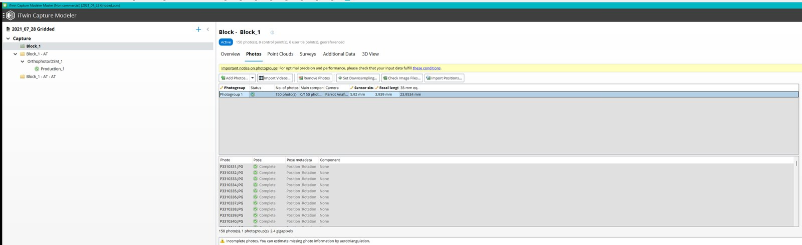{ width="100%" }

*Screenshot: A block's **Photos** tab, with the tab row (Overview, Photos, Point Clouds, Surveys, Additional Data, 3D View), the photo buttons, and one photogroup of 150 photos. iTwin Capture Modeler 2024, Bentley Systems.*

### Check that positions were read

In the Photos tab, each photo should show a position (latitude and longitude, or easting and northing). Open the block's **3D view** tab: you should see the camera positions laid out in the pattern you flew.

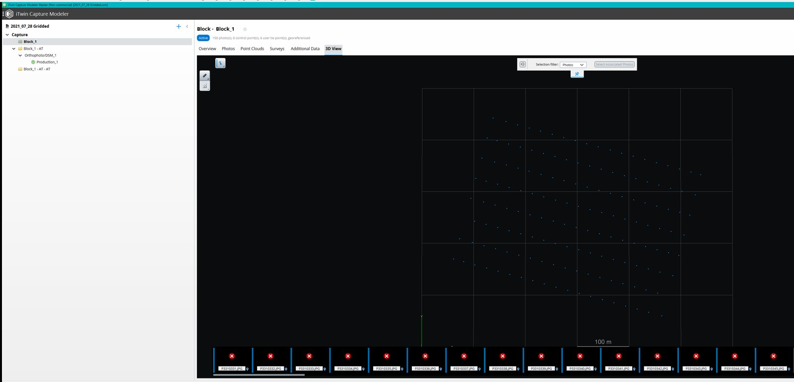{ width="100%" }

*Screenshot: The block's **3D View** tab, seen from above: each dot is a camera position, laid out in the grid pattern that was flown. iTwin Capture Modeler 2024, Bentley Systems.*

*   If positions are missing, the photos probably had no complete GPS tag. The software ignores a tag that has latitude and longitude but no altitude. The AT can still run, but the result will have an arbitrary position and scale, and QGIS will not place it on the map. Ask a TA for the flight log, and use the Photos tab's **Import Positions...** button to load them from a text file. <!-- verify label in app -->
*   If the sensor size or focal length is flagged as missing, Capture Modeler is not sure about your camera. Pick your drone's camera from the camera list if it is offered, or enter the sensor size from the drone's specification sheet.

!!! tip "Pro-Tip: The 'Bad Photo' Hunt"
    Before you start the next step, look through your imported photos. If you see a photo that is blurry, pointed at the ground during takeoff, or far away from the study area, **select it and remove it** from the block. "Garbage in = Garbage out" for 3D modeling! Check the first and last few photos of the flight in particular: they are often taken while the drone is climbing or turning.

---

## 3. Aerotriangulation (AT)

This step figures out exactly where each camera was in 3D space when it took the picture, and also works out the camera's lens properties. It produces a new block with every photo's position and rotation.

### Submit it

1.  With the block selected, click **Submit Aerotriangulation**. A small popup asks whether to **Process with iTwin Capture Modeler Engine** or **Process on the Cloud**; choose the Engine.

    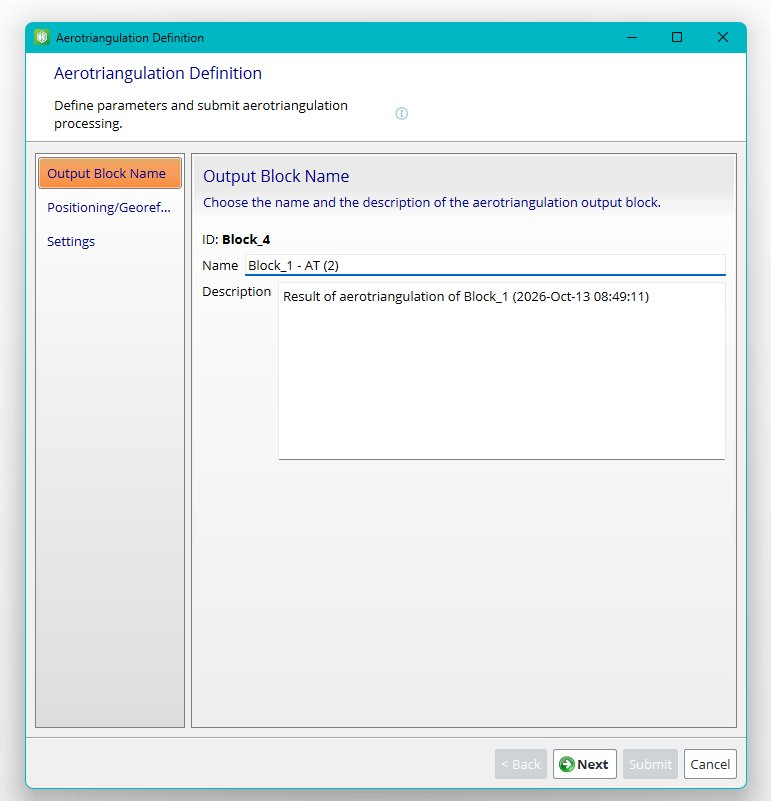{ width="100%" }

    *Screenshot: The **Aerotriangulation Definition** wizard opens on its **Output Block Name** page; the other pages are Positioning/Georeferencing and Settings. iTwin Capture Modeler 2024, Bentley Systems.*

2.  The **Aerotriangulation Definition** wizard opens, with three pages. Go through them and change very little:
    *   **Output Block Name:** accept the suggested name or add `_AT`.
    *   **Positioning/Georeferencing:** keep the default, which uses the **photo positioning metadata** (the drone's GPS). Leave control points off for now (see section 4).
    *   **Settings:** leave **Poses and tie points** on the default (**Adjust**, which suits photos that already carry GPS positions; the other choices are **Compute**, **Extend** and **Lock**), and leave the keypoints density and pair selection mode at their defaults. Do not open the **Advanced** buttons. Bentley's own advice is to try the default modes first.

    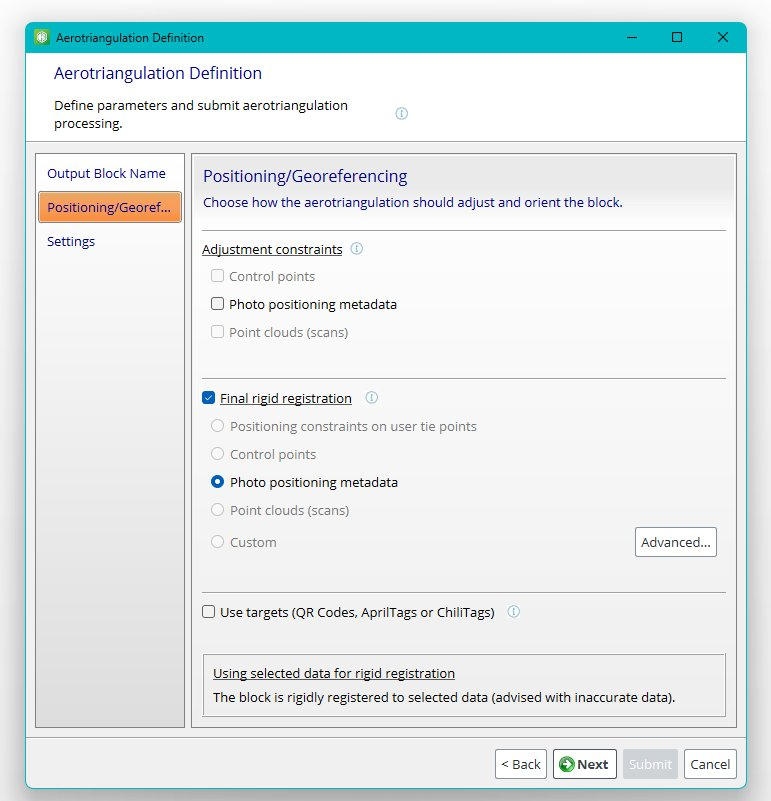{ width="100%" }

    *Screenshot: The **Positioning/Georeferencing** page, with **Photo positioning metadata** selected for the final rigid registration. iTwin Capture Modeler 2024, Bentley Systems.*

    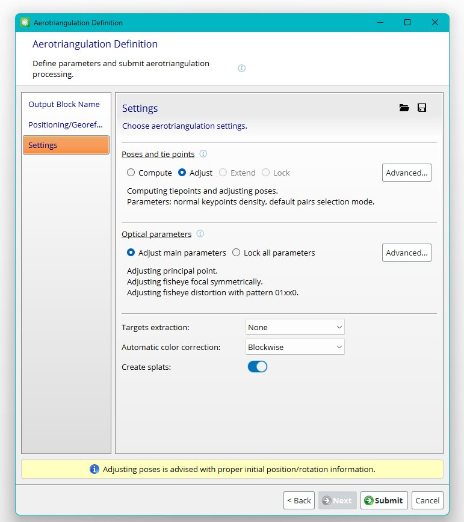{ width="100%" }

    *Screenshot: The **Settings** page, with **Poses and tie points** set to Adjust; **Submit** is on this last page. iTwin Capture Modeler 2024, Bentley Systems.*

3.  On the last page, click **Submit**. A new block appears in the tree and shows progress while it works.

You can keep working, or close Master altogether; the job stays in the queue. While it runs, a counter shows the number of **lost photos**. If many photos are lost, cancel, delete the output block, and look at the acquisition report (below) before you try again.

### Read the result

Open the new (output) block. Its overview, or *dashboard*, summarizes the result. Check these four things:

1.  **How many photos were calibrated.** Every photo should be in the main component. A few lost photos at the edge of the site are tolerable; a large fraction is not. Photos that were not calibrated are flagged in the **Photos** tab.

    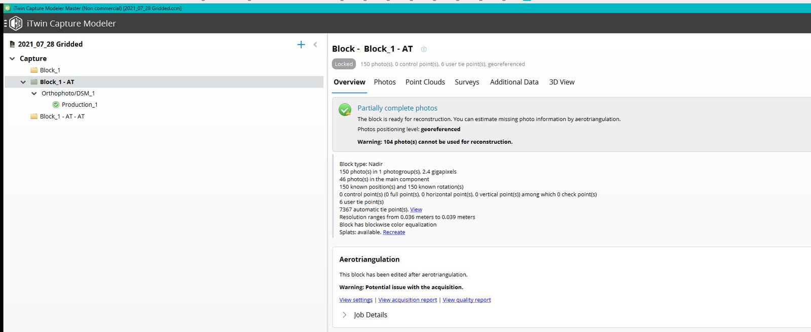{ width="100%" }

    *Screenshot: The output block's overview (dashboard): 46 of the 150 photos are in the main component, and a warning says 104 cannot be used for reconstruction. iTwin Capture Modeler 2024, Bentley Systems.*

2.  **The reprojection error.** Open **View quality report**. The *reprojection error* is how far, in pixels, the software's 3D point lands from where it was actually seen in a photo; smaller is better. In the 3D view, photos are colored by this error: under **1 px** is good, **1 to 3 px** is acceptable, and over **3 px** deserves a look. A well-flown drone set typically sits well under 1 px on average. <!-- verify label in app -->

    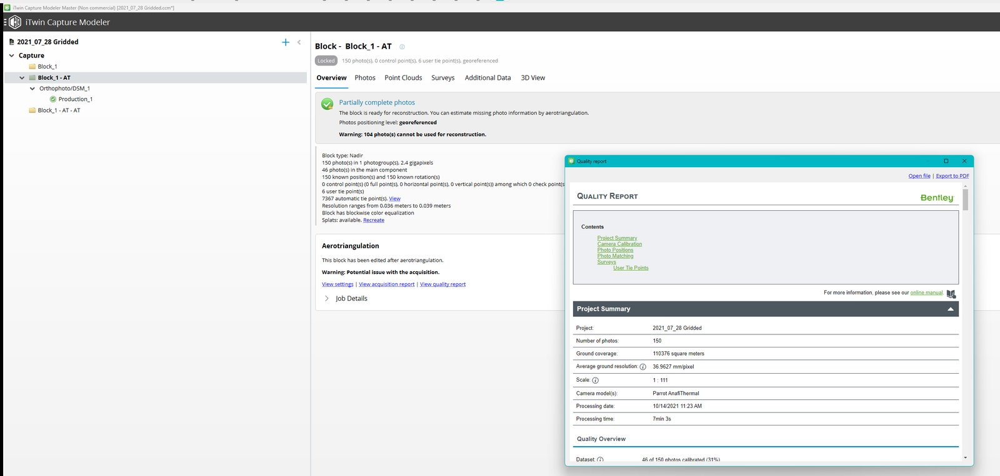{ width="100%" }

    *Screenshot: The quality report opened from **View quality report**, starting with its Project Summary. iTwin Capture Modeler 2024, Bentley Systems.*

3.  **The sparse point cloud.** Open the output block's **3D view** tab. The colored points are the *tie points* (features the software matched across photos), and the pyramid-shaped cameras are the photos. This is called **sparse** because it is only the matched points, not the finished model.

    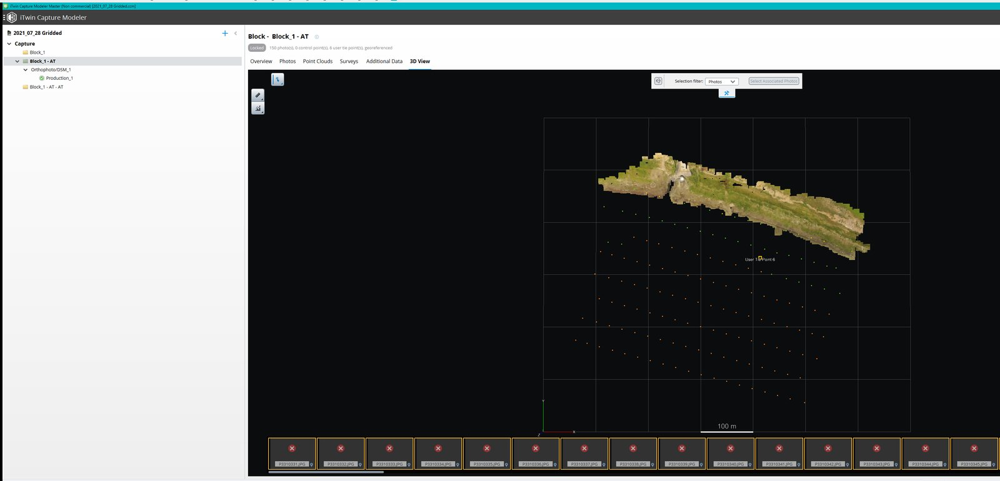{ width="100%" }

    *Screenshot: The output block's **3D View**: the colored tie points and the camera positions, with the thumbnail strip of photos along the bottom. iTwin Capture Modeler 2024, Bentley Systems.*

4.  **The acquisition report.** **View acquisition report** lists disconnected groups of photos and the photos that were lost, so you can see where the flight did not overlap enough.

!!! question "Activity: 3D vs. 2D Thinking"
    Look at the sparse point cloud. Can you recognize the buildings or trees yet?

    - Which areas have the most points? (Hint: These are usually areas with high "texture" like brick or grass.)
    - Are there any "holes" where points are missing? A hole means no usable matches there. This often happens on shiny surfaces like car roofs, windows and water, on featureless surfaces like fresh asphalt or snow, or where the flight did not cover the ground with enough overlap.

!!! warning "Stop here if the AT looks wrong"
    If many photos are not calibrated, the cloud looks like a bowl or a dome instead of a flat site, or the cameras are in a heap instead of in rows, do **not** go on to reconstruction. See [When Something Goes Wrong](#8-when-something-goes-wrong).

---

## 4. Ground Control and Checkpoints (Optional)

**Ground control points (GCPs)** are marked spots on the ground (a painted X, a checkerboard target) whose real-world coordinates were surveyed with a more accurate instrument than the drone's GPS. Adding them to the AT pins the model to the true coordinates and removes slow bending of the model over a long site. A **checkpoint** is a surveyed point that is *not* used in the calculation. Instead you compare its surveyed coordinates to where the model puts it, which is an independent check on the accuracy (the idea of ground truth from the [Measurement Fundamentals](../gen_reading/measurement_fundamentals.md) reading).

**For the lab, skip this section.** The Rock Canyon flight uses only the drone's GPS, so your orthophoto is good for measuring *distances and areas* within the site, which is what the lab asks for, but its absolute position can be off by a meter or two. If your TAs did survey control points, the steps are:

1.  Open the output block's **Surveys** tab (the block's tabs are Overview, Photos, Point Clouds, Surveys, Additional Data and 3D View).
2.  Click **Add Survey Point**, set the type to **Control Point**, and enter its coordinates in the right coordinate system. If the point is a checkpoint, tick **Check point**.
3.  Open photos that show the target and mark it by clicking, then **Accept position**. Mark each point in at least **two** photos (three or more is better).
4.  You need at least **three** control points for the software to use them. Run **Submit Aerotriangulation** again on the output block and, on the Positioning/Georeferencing page, choose **Control points**.

---

## 5. Reconstruction

A *reconstruction* is the workspace in which the products are built. You make **two**, because the 2D and 3D products are computed differently.

### Orthophoto/DSM reconstruction (for QGIS)

1.  Select the **AT output block** (the one that finished successfully) and click **New Reconstruction** (the other button beside it is **Export**). The new reconstruction appears in the tree with a name such as `Orthophoto/DSM_1` and has the tabs **Overview**, **Spatial Framework**, **Geometry Constraints**, **Reference Model** and **Processing Settings**.
2.  Choose the reconstruction type **Orthophoto/DSM**. Name it `RockCanyon_ortho`.
3.  Open the **Spatial Framework** tab:
    *   **Spatial reference system:** set **WGS 84 / UTM zone 12N** (`EPSG:32612`), the system the QGIS page uses for this course. Search the list or the database for "32612".
    *   **Resolution:** this is the pixel size of the finished map. Choose roughly the **ground sample distance (GSD)** of your photos (about 2 to 5 cm per pixel for a typical Rock Canyon flight). A finer value only makes bigger files, not a better map.
    *   **Region of interest:** the box the software will process. The default (called *Smart*) is usually right. If distant background was included, edit the box or polygon in the 3D view so that it covers only your site; the smaller the area, the faster the job.
    *   **Tiling:** for a site this size, **No tiling** is fine. Use a **Regular planar grid** if the job fails for lack of memory.

    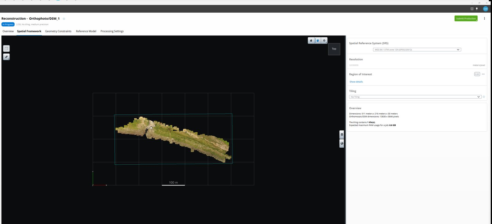{ width="100%" }

    *Screenshot: The **Spatial Framework** tab of `Orthophoto/DSM_1`: reference system, resolution, region of interest and tiling on the right, the region of interest box in the 3D view. iTwin Capture Modeler 2024, Bentley Systems.*

4.  Open the **Processing Settings** tab. Set **Geometric precision** to **Medium**, which Bentley describes as the fastest and best suited to orthomosaic/DSM products. Leave everything else alone.

    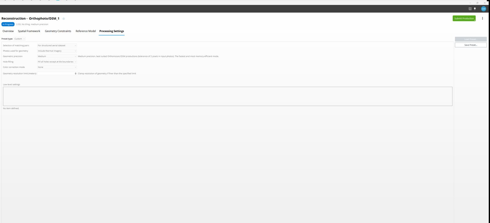{ width="100%" }

    *Screenshot: The **Processing Settings** tab, with **Geometric precision** set to Medium. iTwin Capture Modeler 2024, Bentley Systems.*

### 3D reconstruction (for the mesh and the point cloud)

1.  Select the AT output block again and click **New Reconstruction**. Choose **3D reconstruction** and name it `RockCanyon_3D`.
2.  Use the same coordinate system and region of interest as before. Because 3D models are large, choose a **Regular planar grid** or **Adaptive tiling** for anything bigger than a small building site.
3.  In **Processing Settings**, **Geometric precision** defaults to **Extra**. Use **High** if you are short on time; it is similar in cost but gives a smaller file. Avoid **Ultra**, which Bentley says is about four times slower and uses four times the memory.
4.  Leave **Hole-filling** on **Fix small holes only**, and leave color correction, untextured regions and the resolution limits at their defaults.

!!! warning "Settings lock after the first production"
    Once you submit a production, the **Spatial Framework** and **Processing Settings** tabs become read-only. To try other settings, **clone** the reconstruction (right-click it, then **Clone**) and edit the copy.

---

## 6. Production

A *production* is the step that writes the files. Select a reconstruction and click **Submit Production**. A wizard with six pages asks for a **Name**, a **Purpose**, **Format/Options**, **Spatial Reference System**, **Extent** and **Destination**. Use a new, empty folder for each production (for example `outputs\ortho`, `outputs\mesh`, `outputs\points`).

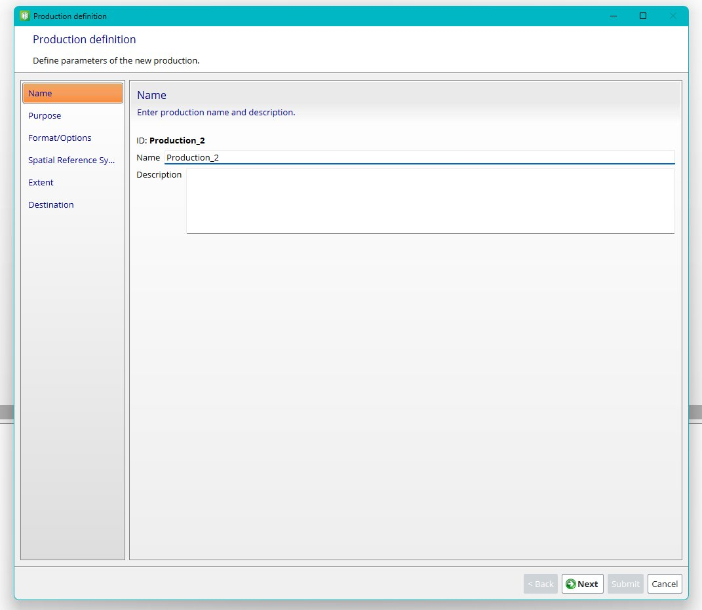{ width="100%" }

*Screenshot: The production wizard opens on its **Name** page; the pages listed at the left run from Name to Destination. iTwin Capture Modeler 2024, Bentley Systems.*

### Orthophoto and DSM (from the Orthophoto/DSM reconstruction)

1.  **Purpose:** **Export Orthomosaic/DSM**. (For an Orthophoto/DSM reconstruction the purposes offered are **Reference model**, **Export Orthomosaic/DSM** and **Water detection**.)

    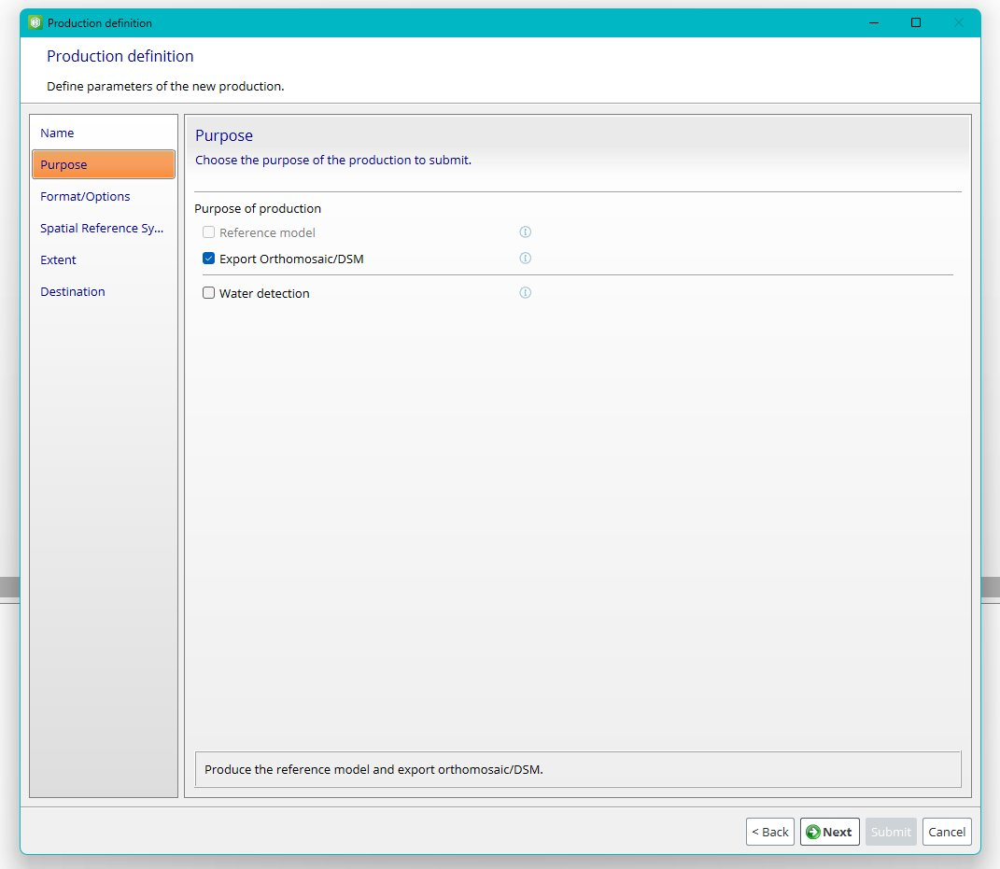{ width="100%" }

    *Screenshot: The **Purpose** page for an Orthophoto/DSM reconstruction, with **Export Orthomosaic/DSM** ticked. iTwin Capture Modeler 2024, Bentley Systems.*

2.  **Format/Options:** tick both the **Orthomosaic** and the **DSM** checkboxes.
    *   **Orthomosaic format:** **TIFF/GeoTIFF**. This is the file QGIS opens. (JPEG has no coordinates and cannot be used for measurement.)
    *   **DSM format:** **TIFF/GeoTIFF**.
    *   **Resolution (meters):** the pixel size, in the units of the coordinate system (meters for UTM). Use the same value as the reconstruction resolution, for example `0.03` for 3 cm.
    *   **Merge output parts:** tick it, so you get **one** file instead of several pieces.
    *   Leave the color source and the **no data** setting at their defaults (areas with no photos will be left empty or transparent).

    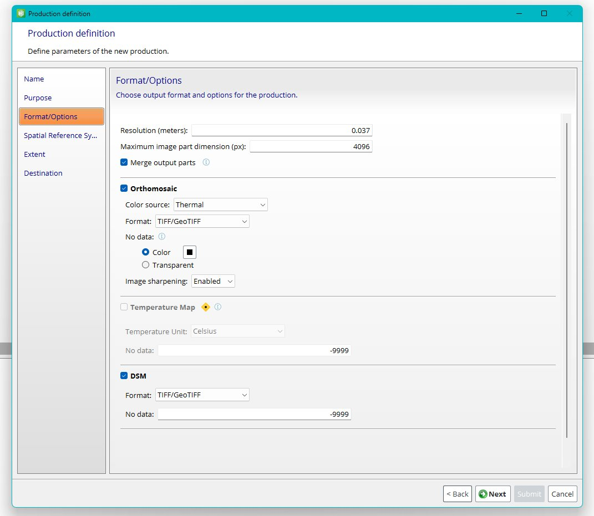{ width="100%" }

    *Screenshot: The **Format/Options** page: **Resolution (meters)**, **Merge output parts**, and the **Orthomosaic** and **DSM** checkboxes, each with TIFF/GeoTIFF. iTwin Capture Modeler 2024, Bentley Systems.*

3.  **Spatial reference system:** `EPSG:32612` again. A GeoTIFF made in a *geographic* system such as WGS 84 latitude/longitude is in degrees and will give wrong lengths in QGIS.
4.  **Extent:** keep the default, the whole region of interest. **Destination:** your empty `outputs\ortho` folder.
5.  Click **Submit**.

!!! note "About DSM heights"
    The DSM elevations come from the photo altitudes and are measured against the reference chosen in section 2 (sea level or ellipsoid). The *shape* of the surface is reliable for volumes and slopes; its *absolute* elevation is only as good as the drone's GPS unless you used ground control.

### 3D mesh (from the 3D reconstruction)

1.  **Purpose:** **Export 3D mesh**.
2.  **Format:** pick for the use.

    | Use | Format |
    |-----|--------|
    | View in Bentley software and the web | **iTwin Ready** (makes 3SM and 3D Tiles together) |
    | Open in a CAD or 3D program, or a class model viewer | **OBJ wavefront** |
    | Open in MicroStation | **Bentley DGN** |
    | Google Earth | **Google Earth KML** |
    | Older Bentley viewer | **Legacy 3MX** |

3.  Leave **Include texture maps** on, and the other options at their defaults. Coordinate system `EPSG:32612`, a new empty folder, **Submit**.

### Point cloud (from the 3D reconstruction)

1.  **Purpose:** **Export 3D point cloud**.
2.  **Format:** **ASPRS LASer (LAS)**, the standard file for engineering analysis. Tick **Merge output point clouds** so tiles come out as one file, and optionally **Compression: LAZ** for a smaller file (QGIS opens LAZ).
3.  **Point sampling:** leave the default unless the file is too big. Choose `EPSG:32612`, a new folder, **Submit**.

### Where the files land

Each production writes into the destination folder you picked. Open the production in the project tree and click **Open output directory** to see them in File Explorer. Check the **3D view** tab of the production to look at the result inside Capture Modeler before you leave the lab.

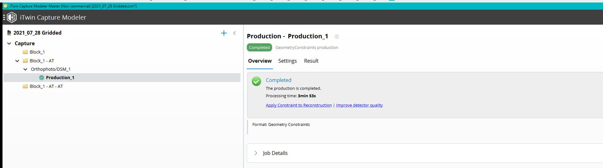{ width="100%" }

*Screenshot: A finished production's **Overview** tab, with its tabs Overview, Settings and Result. This example is a GeometryConstraints production; yours will list its own format. iTwin Capture Modeler 2024, Bentley Systems.*

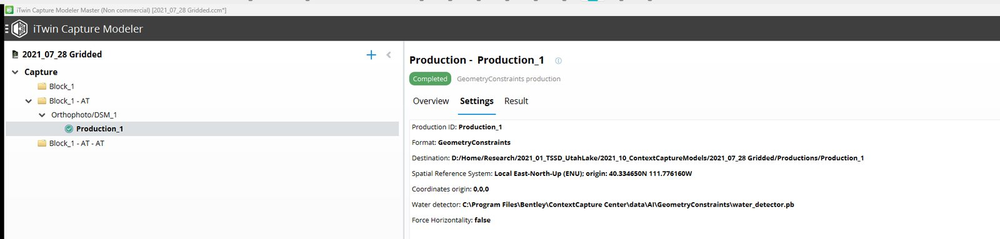{ width="100%" }

*Screenshot: The same production's **Settings** tab, listing its format, destination folder and spatial reference system. iTwin Capture Modeler 2024, Bentley Systems.*

!!! tip "Do the orthophoto first"
    The orthophoto and DSM finish far sooner than the 3D mesh. Submit the **Orthophoto/DSM** production first, then start the QGIS part of the lab while the 3D jobs run.

!!! info "Which format do I need?"
    For most labs in this class, you need the **Orthophoto (GeoTIFF)** to perform measurements in QGIS. The DSM is used for elevations and volumes; the mesh is for visuals; the point cloud is for engineering analysis.

---

## 7. Open the Orthophoto in QGIS

1.  Install and set up QGIS following [Using QGIS](qgis_measurements.md).
2.  Drag the orthophoto `.tif` from your `outputs\ortho` folder into a new QGIS project.
3.  Look at the **bottom-right corner** of the QGIS window. It should read **`EPSG:32612`**. If it reads `EPSG:4326`, the file is in degrees; set the project CRS as the QGIS page describes, or go back to section 6 and rebuild the production in `EPSG:32612`.
4.  Sanity check: measure something whose size you know (a parking stall, a basketball court, a fence you can pace). If the answer is off by a large factor, the CRS or the units are wrong.
5.  Load the DSM the same way if you need elevations.

---

## 8. When Something Goes Wrong

| Symptom | Likely cause | What to do |
|---------|--------------|------------|
| A job stays on **pending** and never starts | The Engine program is not running | Open **iTwin Capture Modeler Engine** from the Start menu, then check the Job Queue Monitor panel |
| AT finishes but many photos are **not calibrated** | Too little overlap; blurry or featureless photos; photos from a different flight mixed in | Open the acquisition report, remove the bad photos, and submit AT again. As a second try, set **Keypoints density** to **High** (slower) |
| AT says the set splits into **several components** | Gaps in the flight pattern, or a break between two flights | Look at the 3D view for the gap. Use only the main component, or re-fly the gap |
| Sparse cloud is **dome- or bowl-shaped**, or the site is not flat | Camera lens properties not estimated well, common with flat, straight-down grids | Check that every photo is calibrated; ask a TA about re-running AT with the camera calibrated first |
| **Holes** in the orthophoto or DSM | No photo coverage, shiny or featureless surfaces (water, glass, fresh asphalt) | Check coverage in the 3D view; accept the holes, and report them in your lab answers |
| **Webbed or stretched** mesh over trees, walls and thin objects | Straight-down photos see sides poorly, thin things are hard to match | Expected with a nadir-only flight. A flight with oblique photos fixes it; for the lab, note it |
| Job has run for **hours** | Settings too heavy (Ultra, a huge region of interest, no tiling); computer too small | Cancel, clone the reconstruction, shrink the region of interest, use **Medium** or **High** precision, and use tiling |
| A production **fails** or the dashboard shows **errors** | Out of memory or disk, or a photo file was moved | Click **View error details**; free up space; check that the photos are still where the project expects them |
| **Out of disk** space | Mesh and temp files are large | Right-click the project and choose **Free up disk space**, delete old productions' folders, and write outputs to a drive with room |
| Orthophoto opens in QGIS but **measurements are absurd** | File is in degrees (`EPSG:4326`) | Rebuild the production in `EPSG:32612`, or set the QGIS project CRS (see [Using QGIS](qgis_measurements.md)) |
| Orthophoto opens but sits **far from where it should** | Photos had no GPS, or the wrong altitude reference was chosen | Check the Photos tab for positions; the lab only needs relative measurements |
| Project will not open, photos show as **missing** | The photo folder was moved or renamed | Use the **Reference manager** in the project to point the project at the new photo folder |

---

## Resources

*   [Bentley Education](https://www.bentley.com/education) — Bentley's free learning licenses for students and instructors; sign in with your university email and request iTwin Capture Modeler.
*   [iTwin Capture Modeler product page](https://www.bentley.com/software/itwin-capture-modeler/) — Bentley's overview of the product, with current system requirements.
*   [Calibrating a camera for use in iTwin Capture Modeler](https://communities.bentley.com/products/itwin-capture/w/itwin-capture-wiki/70752/calibrating-a-camera-for-use-in-itwin-capture-modeler) — Bentley support article on calibrating a camera first, useful if your AT gives a dome-shaped result. It needs a Bentley sign-in to load fully.
*   **The installed user guide** — on a lab computer, the full manual is a PDF in `C:\Program Files\Bentley\iTwin Capture Modeler\doc\` (*iTwin Capture Modeler User Manual*, plus a short *Drone Capture Guide*). It is the authority on every label named on this page.
*   [How Photos Become 3D](../gen_reading/sfm_workflow.md) and [Planning the Flight](../gen_reading/mission_planning_sfm.md) — the course readings behind these steps.
*   [Using QGIS](qgis_measurements.md) — what to do with the orthophoto once it exists.

---

## Where this is used

- [Week 8 lab — Data Processing](../labs/5_data_processing.md) — you follow this page with the photos from the Rock Canyon flight, then measure the orthophoto in QGIS.
