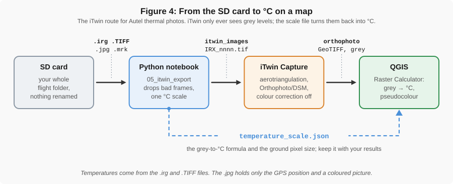

# Thermal Mosaic in iTwin

!!! abstract "Key Takeaways"
    - **iTwin cannot read the Autel's temperatures.** A short Python notebook turns them into grey photos that iTwin can process, and writes down the scale that turns grey back into °C.
    - **One scale for the whole flight.** Every photo uses the same grey-to-°C line, so the same grey means the same temperature everywhere on the map.
    - **Three changes from the normal iTwin steps:** GPS heights measured from the **WGS 84 ellipsoid**, **colour correction off**, and a pixel size no finer than the thermal camera's ground pixel (about 5 cm).
    - **QGIS turns the grey orthophoto back into °C** with one Raster Calculator line copied from `temperature_scale.json`. Keep that file with your results.
    - **Check one number** against an infrared thermometer or the tool's quick mosaic before you believe the map.

---

This page is for final-project groups who flew the **Autel thermal drone** and want a thermal orthophoto (a map-accurate mosaic) from **Bentley iTwin Capture Modeler**, in °C, in QGIS. There are two ways to get a thermal map from that drone:

| Route | What you get | Use it when |
|---|---|---|
| **Quick mosaic** (`autel-ortho`, on [Example Projects](../final_project/project_ideas.md#roof-heat-loss-at-8-am)) | A °C mosaic in a few minutes, each photo laid flat on the ground at the takeoff height | The ground is flat, or a rough picture of where the warm spots are is enough |
| **iTwin route** (this page) | A °C orthophoto and a DSM (Digital Surface Model) from photogrammetry | The roof or site has real relief, or you want a surface model as one of your products |

{ width="100%" }

*Figure 4: From the SD card to °C on a map. iTwin only ever sees grey levels; `temperature_scale.json` carries the formula from the notebook to QGIS.*

!!! note "This route is new"
    The notebook has been tested, but the iTwin and QGIS steps on this page have **not yet been run end to end** on a class flight. Settings marked in plain words come from the iTwin user manual, not from the program. If something on your screen differs from this page, or a step fails, tell a TA what you saw, so the page can be corrected for the next group.

---

## What You Need

Get these in order. Allow about **10 minutes** for items 2 to 4 on a computer that has none of them.

| # | What | Where it comes from | Time |
|---|---|---|---|
| 1 | Your whole flight folder | The drone's SD card | A few minutes to copy |
| 2 | Miniforge and a `thermal` environment | conda-forge's website | About 5 minutes |
| 3 | The autel-thermal tool | The class SharePoint (for now) | About 3 minutes |
| 4 | Something to run the notebook in | VS Code, or the JupyterLab that item 3 installs | 0 to 5 minutes |
| 5 | iTwin Capture Modeler and QGIS | Already on the lab computers | — |

!!! warning "Install on every computer you use"
    Items 2 to 4 live in **your** user account on **one** computer. If you work on a lab computer on Tuesday and your laptop on Thursday, install on both, lab computers included. Miniforge installs for you alone and does not need administrator rights.

### 1. The whole flight folder

Copy the flight's folder off the SD card to the computer's own drive, and keep everything in it together:

- `IRX_nnnn.irg` and `IRX_nnnn.TIFF`: the temperatures. Without these there is no °C.
- `IRX_nnnn.jpg`: a coloured picture of each frame, and its **GPS position**. It holds no temperatures.
- The `.mrk` file: the drone's GPS log.

Rename nothing and leave nothing out; the notebook pairs files by their names. If the card splits the flight into `Thermal` and `Visible Light` folders, the `Thermal` folder is the one you will point the notebook at.

If the folder has only `IRX_nnnn.jpg` files, the camera was not set to **JPG + TIFF** before the flight. iTwin can still make a *picture* mosaic from those JPEGs, but never a temperature map. Talk to a TA about flying again.

### 2. Miniforge and a Python environment

**Miniforge** is a free, small installer for Python from the conda-forge project. An **environment** is a separate box of Python packages, so this tool cannot break anything else on the computer.

1. Download the installer for your computer from the [Miniforge page](https://github.com/conda-forge/miniforge#install):
    - **Windows:** `Miniforge3-Windows-x86_64.exe`. Run it, choose **Just Me**, and accept the other defaults.
    - **Mac:** the `MacOSX-arm64` file for an Apple-silicon Mac (M1 or newer), `MacOSX-x86_64` for an older Intel Mac. In Terminal, run `bash ~/Downloads/Miniforge3-MacOSX-arm64.sh` (with your file's name), answer `yes` to the questions, then close and reopen Terminal.
2. Open a command window: on Windows, **Miniforge Prompt** from the Start menu; on a Mac, Terminal.
3. Make the environment and switch to it:

        conda create -n thermal -c conda-forge python=3.12
        conda activate thermal

    Type `y` when asked. The start of each line now reads `(thermal)`. Every time you open a new command window, run `conda activate thermal` again first.

### 3. The autel-thermal tool

**autel-thermal** is the class's own Python tool for this camera. It reads the temperatures the way Autel's own software does, checks every frame, and includes the notebook this page uses.

<!-- When the autel-thermal repository is public, replace the next paragraph only: a pip install from GitHub (or from PyPI/conda-forge) replaces the zip, and the notebook comes from the repository's examples/ folder. Also drop "private for now" under Resources and the first Troubleshooting row. -->
**Get it from the class SharePoint for now.** Download `autel-thermal.zip` from the `Software/autel-thermal/` folder of the class SharePoint library (**link to come: ask a TA until it is posted here**) <!-- PLACEHOLDER: SharePoint sharing link to Software/autel-thermal/autel-thermal.zip, from the instructor -->. A short `README_autel-thermal.txt` sits beside it. Unzip it somewhere you will find again, such as `Documents\autel-thermal`. Then, in your command window with `(thermal)` showing, go to the unzipped folder that holds the file `pyproject.toml` and install:

```text
cd "C:\Users\yourname\Documents\autel-thermal"
pip install ".[notebooks,rgb]"
```

On a Mac the first line is `cd ~/Documents/autel-thermal`. Typing `cd ` and then dragging the folder onto the window fills in the path for you. The `[notebooks,rgb]` part adds JupyterLab, pandas and Pillow, which the notebook needs.

To check that it worked, run `autel-thermal --help`. It should print the tool's options, not "not recognized" or "command not found".

### 4. Something to run the notebook in

A **notebook** is a page of short Python steps (cells) with explanations between them. You run it cell by cell; you do not have to write any Python. Use either:

- **VS Code** (free, from Microsoft), with its **Python** and **Jupyter** extensions installed from the Extensions panel. This is the easier choice if you already have it.
- **JupyterLab**, which item 3 already installed. In the command window, `cd` into the `examples` folder of the tool and run `jupyter lab`; it opens in your web browser.

If you prefer, `python 05_itwin_export.py` in the `examples` folder runs the same steps as a plain script; edit `DATA_DIR` in the file first.

### 5. iTwin Capture Modeler and QGIS

Both are on the lab computers. To install them on your own computer, see [Get the software](bentley_itwin.md#get-the-software) on the Bentley page and [Installing QGIS](qgis_measurements.md#1-installing-qgis).

---

## Step 1: Run the Notebook

1. **Open the notebook.** In VS Code, use **File > Open Folder** and choose the unzipped `autel-thermal` folder, then open `examples/05_itwin_export.ipynb`. Click **Select Kernel** at the top right and choose the `thermal` environment. In JupyterLab, double-click the same file in the list on the left.
2. **Set the flight folder.** Find the cell headed **Parameters** and change `DATA_DIR` to the full path of your flight folder:

        DATA_DIR = r"C:\Users\yourname\thermal\your flight folder"     # Windows: keep the r
        DATA_DIR = "/Users/yourname/thermal/your flight folder"        # Mac

    Leave the other settings as they are. `BITS = 8` is the setting this page is written for. `TEMP_RANGE_C = None` lets the notebook pick the temperature range from your flight; set it to, for example, `(0, 40)` only if you want two flights on exactly the same scale.

3. **Run every cell**, top to bottom (in VS Code, **Run All**; in JupyterLab, **Run > Run All Cells**). The cell headed **Colab setup** does nothing on your own computer. A number appears beside each cell when it has run.

### What it writes

The results go to `autel-thermal-output\05_itwin_export` in your home folder (`C:\Users\yourname\` or `/Users/yourname/`), never into the flight folder. The notebook prints the exact path.

| File | What it is | What you do with it |
|---|---|---|
| `itwin_images\IRX_nnnn.tif` | One grey picture per usable frame, with the same name as the original. Grey 0 (black) is the coldest end of the scale, 255 (white) the warmest. Each carries the GPS position of its own `.jpg`. | Add this folder to iTwin in Step 2 |
| `temperature_scale.json` | The scale: `lo_c` and `hi_c` (the temperatures at grey 0 and 255), `degC_per_level`, the QGIS expression `qgis_raster_calculator`, the camera's size, and `median_ground_pixel_m` | Keep it with your results; you need two numbers from it in Step 2 and the expression in Step 3 |
| `positions_itwin.csv` | Each photo's longitude, latitude, height and camera angles | A backup, only if iTwin does not read the positions from the photos |
| `frames.csv` | Every frame, with the reason it was left out in the `skip` column (empty if it was used) | Look at it if many frames were left out |

!!! example "Reading the scale"
    Suppose the notebook prints `Grey 0 = -2 °C, grey 255 = 36 °C, one grey level = 0.149 °C`. The 256 grey levels share the 38 °C between −2 and 36, so the map **cannot show a difference smaller than about 0.15 °C**: that is its resolution, in the sense of the [Measurement Fundamentals](../gen_reading/measurement_fundamentals.md) reading. The QGIS expression in the file is then `-2 + "ORTHO@1" * 38 / 255`, so a pixel with grey level 128 is −2 + 128 × 38 / 255 = **17.1 °C**.

### Read what it left out, and check the first frames

The notebook prints the frames it will not send to iTwin and why:

- **stale-NUC ramp:** the camera had not finished warming up, and the frame's temperatures are wrong. NUC (non-uniformity correction) is the camera's own recalibration; until it settles, a cold camera reads far too cold.
- **below the minimum height:** taken on or just above the ground at takeoff or landing.
- **tilted more than 60°:** the camera sees the horizon or the sky, which iTwin cannot match.
- **no R-JPEG with GPS beside it:** the frame's `.jpg` is missing, so there is no position for it.

Then it prints the **first six frames** it kept, with their median temperature (`p50`). For a few frames after power-on the camera can read 4 to 7 °C too cold, and **no automatic check catches this**. If the first one or two medians are clearly colder than the rest, delete those `IRX_nnnn.tif` files from `itwin_images` before you go on. The habit that prevents it, powering on 10 minutes early and running the shutter calibration by hand, is on [Example Projects](../final_project/project_ideas.md#roof-heat-loss-at-8-am).

---

## Step 2: Build the Orthophoto in iTwin

Follow the [Bentley iTwin Capture Modeler](bentley_itwin.md) page, sections 1 to 6, with **only** the differences below. Make only the **Orthophoto/DSM** reconstruction; a 3D mesh from 640 × 512 thermal photos is coarse and slow for what it gives.

| Bentley page section | For thermal photos |
|---|---|
| [Put the photos in one place](bentley_itwin.md#put-the-photos-in-one-place) | Copy the `itwin_images` folder to the computer's local drive. That folder is your photo folder; do **not** add the original flight folder or its `.jpg` files. |
| [2. Import Photos](bentley_itwin.md#2-import-photos) | Add all the photos of the `itwin_images` directory. When iTwin says GPS altitude was read using **sea level**, click **Modify** and choose **WGS 84 ellipsoid**: this camera records its height above the ellipsoid, and in Utah the two references differ by more than ten metres. |
| [Check that positions were read](bentley_itwin.md#check-that-positions-were-read) | You should see one photogroup. If its sensor size or focal length is flagged as missing, enter **640 × 512** pixels, focal length **13 mm**, sensor size **7.68 mm** (iTwin asks for the sensor's largest dimension: 640 pixels × 12 µm). The same numbers are under `camera` in `temperature_scale.json`. Note whether iTwin set the photogroup's band to **Visible** or **Thermal**; you need it in the production. <!-- verify label in app --> |
| [3. Aerotriangulation (AT)](bentley_itwin.md#3-aerotriangulation-at) | Same defaults: photo positioning metadata, **Adjust**. Leave any colour equalization or colour correction option on the Settings page **off**. Expect fewer photos to be calibrated than in an RGB set: thermal photos of uniform ground (grass, water, fresh asphalt) have little texture to match. Roads, buildings and edges in view help. <!-- verify label in app --> |
| [5. Reconstruction](bentley_itwin.md#5-reconstruction) | Spatial Framework: `EPSG:32612` as usual, and **Resolution** no finer than `median_ground_pixel_m` from `temperature_scale.json` (about 0.055 m for a flight at 60 m, 0.046 m at 50 m). Processing Settings: **Geometric precision** Medium, and **Color correction mode: None**. The other modes change grey levels, and so temperatures. <!-- verify label in app --> |
| [6. Production](bentley_itwin.md#6-production) | Export Orthomosaic/DSM, both as **TIFF/GeoTIFF**, Resolution the same as the reconstruction, **Merge output parts** ticked, `EPSG:32612`. Set **Color source** to the optimized computation that matches the photogroup's band (**visible colors** for Visible, **thermal** for Thermal), and **No data** to **transparent**. <!-- verify label in app --> |

The ground pixel follows from the camera: height × 12 µm ÷ 13 mm, so 60 m × 0.012 mm ÷ 13 mm ≈ 0.055 m. Asking iTwin for finer pixels only makes a bigger file with the same detail.

!!! warning "Settings lock after the first production"
    If you find colour correction was left on after you submitted a production, the reconstruction's settings are read-only. Clone the reconstruction, set **None** in the copy, and produce again (see the warning in [5. Reconstruction](bentley_itwin.md#5-reconstruction)).

!!! note "Not iTwin's Temperature map"
    The production page may offer a **Temperature map**. It reads temperatures stored inside R-JPEG files from the cameras Bentley supports (FLIR and some DJI models). The Autel's `.jpg` holds no temperatures and the notebook's TIFFs are not R-JPEGs, so that option does not apply here. The °C come back in QGIS instead.

---

## Step 3: Back to °C in QGIS

1. Open the orthophoto `.tif` in QGIS and confirm the bottom-right corner reads `EPSG:32612`, as in [7. Open the Orthophoto in QGIS](bentley_itwin.md#7-open-the-orthophoto-in-qgis).
2. Open `temperature_scale.json` in a text editor (Notepad, TextEdit or VS Code) and copy the text after `"qgis_raster_calculator":`, without its outer quotation marks. It looks like `-2 + "ORTHO@1" * 38 / 255`, with your flight's numbers.
3. In QGIS, open **Raster > Raster Calculator**. Paste the expression, then replace `"ORTHO@1"` with your orthophoto's band 1 as listed under **Raster Bands** (double-click it there to insert it, for example `"Production_1_ortho@1"`). The orthophoto may have three identical colour bands and a fourth for transparency; any of bands 1 to 3 gives the same answer.
4. Under **Output layer**, choose a file name such as `thermal_degC.tif` with **GeoTIFF** as the format, and click **OK**. The new layer holds °C in every pixel.
5. Colour it: **Layer Properties > Symbology**, Render type **Singleband pseudocolor**, set Min and Max to the range you care about, and pick a colour ramp. Use the **Identify Features** tool to read the °C of any pixel.

!!! warning "Clipped pixels are not measurements"
    Grey 0 means `lo_c` **or colder** and grey 255 means `hi_c` **or warmer**, so pixels at exactly those two values were cut off, not measured. The empty area around the site may also come out at `lo_c`. To hide both, open **Layer Properties > Transparency** for the °C layer and enter `lo_c` as an additional no-data value. Do not report a minimum or maximum temperature that sits at either end of the scale.

---

## Check One Number

A map that looks right can still be wrong by several degrees. Before you put a temperature in your memo, check one against something independent, as the [Measurement Fundamentals](../gen_reading/measurement_fundamentals.md) reading asks:

- **An infrared thermometer** on one surface you can reach, such as a roof edge, a wall or a pavement patch, read as close in time to the flight as you can. Compare it with the °C layer at the same spot.
- **The tool's quick mosaic** of the same flight. In your command window, with `(thermal)` showing:

        autel-ortho "path\to\your flight folder" "path\to\quick_out" --mosaic

    Open `quick_out\mosaic.tif` (already in °C) beside your °C layer in QGIS. Remember the quick mosaic lays every photo flat at the takeoff height, so a raised roof comes out too large there; it is a check on the temperature, not on the outline.

The same roof or pond should read within about **1 °C**, and outlines should line up within a few metres. A bigger difference usually means colour correction was on, the expression came from a different flight's `temperature_scale.json`, or cold first frames were left in. Report the check, and its result, in your memo's Limitations section.

---

## Google Colab (No Install)

<!-- DRAFT, instructor to approve before publishing (2026-11-17). The notebook's own "Colab setup" cell still installs from GitHub, which fails while the repository is private; the steps below work around it by deleting that cell. Simplify once the zip option lands in autel-thermal. -->

**Google Colab** runs notebooks on Google's computers in your web browser, so nothing needs installing. It saves the install, not the data handling: your flight has to go up to Google Drive and the results come back down, and Colab forgets everything (the install included) when the session closes. iTwin still runs on a Windows computer afterwards. Use the local route above if you can; use Colab if you cannot install on the computer you have.

1. **Put three things in Google Drive**, in a folder such as `My Drive/thermal`:
    - `autel-thermal.zip`, as downloaded;
    - `05_itwin_export.ipynb`, taken out of the zip's `examples` folder;
    - your flight folder, with only the `.irg`, `.jpg` and `.mrk` files. The `.TIFF` files repeat what is in the `.irg`, so leaving them out halves the upload. That is about **1.2 MB a frame**, so about 350 MB for a 300-frame flight.
2. **Open the notebook in Colab:** in Drive, right-click `05_itwin_export.ipynb` and choose **Open with > Google Colaboratory**.
3. **Delete two cells**, because they do not work yet in this route: the one headed **Colab setup** (it installs from GitHub, where the tool is still private) and the last cell, headed **Colab: save the results** (your results will already be in Drive).
4. **Add a new code cell at the very top** with **+ Code**, paste this, and change the path if your zip is elsewhere:

        from google.colab import drive
        drive.mount("/content/drive")
        !pip install -q "autel-thermal[notebooks,rgb] @ file:///content/drive/MyDrive/thermal/autel-thermal.zip"
        COLAB_DATA_DIR = None

5. **In the Parameters cell**, point both folders at Drive:

        DATA_DIR = "/content/drive/MyDrive/thermal/your flight folder"
        OUT_DIR = Path("/content/drive/MyDrive/thermal/output")

6. **Runtime > Run all.** Allow Colab to reach your Google Drive when asked.
7. **Download the results.** In Drive, download `thermal/output/itwin_images` and `temperature_scale.json` to the iTwin computer. Drive zips a folder on download (about **0.35 MB a frame**); unzip it before adding the photos to iTwin. Then carry on from Step 2.

---

## When Something Goes Wrong

| Symptom | Likely cause | What to do |
|---|---|---|
| The install asks you to **sign in to GitHub** | You used an install line from somewhere else that points at GitHub; the repository is still private | Use the SharePoint zip and `pip install ".[notebooks,rgb]"` from its folder, as in [What You Need](#3-the-autel-thermal-tool) |
| `ImportError: ... is not installed` | The notebook is running in a different Python from the `thermal` environment | VS Code: **Select Kernel** and choose `thermal`. JupyterLab: start it from a command window after `conda activate thermal`. Then restart and run all again |
| `Can't find the flight folder` | `DATA_DIR` is wrong | Use the full path, with the `r` before the quotes on Windows. The message prints where Python looked |
| `No IRX_nnnn.irg or .TIFF files` | A JPG-only flight (camera not set to JPG + TIFF), or the wrong folder | If the message says it found thermal JPEGs only, there are no temperatures to recover. Otherwise point `DATA_DIR` at the folder that holds the `IRX_` files (it may be a `Thermal` subfolder) |
| **Every frame** skipped as `stale-NUC ramp`, or `No usable frames` | The camera was not warmed up before the flight, so its temperatures are wrong | The flight cannot give trustworthy °C. Talk to a TA; the warm-up habit is on [Example Projects](../final_project/project_ideas.md#roof-heat-loss-at-8-am) |
| iTwin shows **no positions** | The photos' GPS tags were not read | Check you added the `itwin_images` TIFFs. Then use **Import Positions...** on the Photos tab with `positions_itwin.csv` (longitude, latitude, ellipsoidal height in metres). <!-- verify label in app --> |
| AT calibrates **few photos** | Uniform ground with little thermal texture, or too little overlap | Look at the acquisition report. If most photos are lost, use the quick mosaic and say why in your memo |
| Reconstruction says it has **no photos for geometry** | The photogroup is marked Thermal, and iTwin builds geometry from visible photos by default | In the reconstruction's Processing Settings, set **Photos used for geometry** to **Include thermal imagery** <!-- verify label in app --> |
| Orthophoto is **all one grey**, or blank | Colour correction was on; the Color source does not match the photogroup's band; or QGIS is showing band 4 (transparency) | Clone the reconstruction with **Color correction mode: None**; match the Color source to the band; in QGIS use band 1 |
| °C are **several degrees off** the check | Colour correction on, the wrong `temperature_scale.json`, or cold first frames left in | Check each of the three; the expression must come from the same run as the photos |
| Area around the site reads as a **temperature** | No-data pixels are grey 0, which the expression turns into `lo_c` | Add `lo_c` as an additional no-data value (Step 3) |

---

## Resources

- **autel-thermal**: the class's Python tool. Its repository, [github.com/gus-p-williams/autel-thermal](https://github.com/gus-p-williams/autel-thermal), is **private for now** and the link will not open; use the SharePoint zip. The zip's `examples/README.md` has the tool's own install notes and troubleshooting.
- [Bentley Education](https://www.bentley.com/education): free student licences for iTwin Capture Modeler.
- [Bentley iTwin Capture Modeler](bentley_itwin.md) and [Using QGIS](qgis_measurements.md): the full walkthroughs this page builds on.
- [Thermal Imaging](../gen_reading/thermal.md): what a thermal camera measures, and when to fly.
- [Measurement Fundamentals](../gen_reading/measurement_fundamentals.md): resolution, and checking against ground truth.

---

## Where this is used

- [Flight and Data Processing](../final_project/flight_and_data_processing.md): Part 2, for groups that flew the thermal drone.
- [Example Projects — Roof heat loss at 8 a.m.](../final_project/project_ideas.md#roof-heat-loss-at-8-am)
